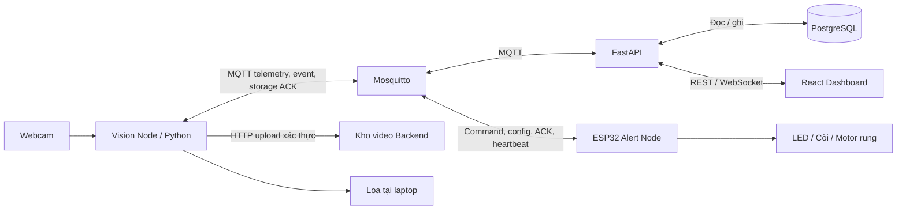

# Driver Monitoring AIoT Platform

Hệ thống nguyên mẫu giám sát trạng thái tài xế bằng camera tại Edge, quản lý thiết bị trên web và cảnh báo qua ESP32. Dự án kết hợp **Python/MediaPipe/scikit-learn, FastAPI, React, PostgreSQL và MQTT/Mosquitto**.

## Lệnh demo trên laptop đã chuẩn bị

```powershell
./edge-ai/run-multisignal-v2.ps1 -Demo
```

Launcher dùng bundle v2 và profile kính v5 đã thử trên laptop này; cần các artifact cục bộ tương ứng. **Nhìn thẳng, giữ đầu tương đối yên 5 giây đầu** để lấy mốc, rồi mới thử thao tác. Bấm Q để thoát. Camera, MQTT, upload video và tải ESP32 theo binding đang bật được sử dụng trong chế độ này.

Theo yêu cầu demo, cúi đầu từ 12° liên tục 3 giây được ánh xạ thành `DROWSY` với lý do **Cúi đầu kéo dài**. Đây là quy tắc tư thế và cũng có thể kích hoạt khi chủ động nhìn xuống; không phải kết quả model xác nhận ngủ. Quay ngang vẫn dùng `DISTRACTED`, mất mặt vẫn `UNKNOWN`. Không cần profile mắt cúi hoặc chạy hiệu chuẩn mới để dùng quy tắc này. [Logic và phạm vi](docs/head-motion-v1.md).

Lệnh demo ở trên là đường chạy chính. Profile kính áp dụng cho cùng người/camera/setup đã thử; máy khác cần nhận bundle và profile phù hợp. Công cụ kiểm tra riêng và hiệu chuẩn nhìn thẳng được giữ cho việc kiểm chứng, không cần chạy lại trước mỗi buổi demo.

[Bản hợp nhất với thay đổi của nhóm và kết quả kiểm tra ngày 10/11](docs/integration-cleanup-20261110.md).

## 1. Tổng quan

- **Vision Node:** laptop + webcam, đo EAR/PERCLOS và hướng đầu; nhận biết `ATTENTIVE`, `DROWSY`, `DISTRACTED`, `UNKNOWN`.
- **Alert Node:** ESP32 nhận lệnh, điều khiển LED/còi/motor rung, gửi heartbeat và ACK.
- **Backend:** tài khoản, phân quyền, vòng đời thiết bị, telemetry, lịch sử, Rule Engine, cấu hình và lệnh/ACK.
- **Web React:** dữ liệu thời gian thực, danh sách thiết bị, lịch sử, cảnh báo, điều khiển và video có kiểm tra quyền.
- **Phục hồi:** SQLite tại Edge, gửi bù MQTT và upload video nền; bản tin chỉ được dọn sau xác nhận hợp lệ.

AI v2 dùng CNN MobileNet phân tích mắt/miệng, RF kết hợp đặc trưng theo thời gian, nhánh EAR cho nhắm mắt kéo dài và quy tắc hướng đầu. Profile kính v5 đã qua một phiên camera đủ chín tình huống trên laptop nhóm. Quy tắc cúi đầu kéo dài đã nối vào Backend/web và được kiểm thử bằng MQTT/DB/ESP32 mô phỏng; còn xác nhận trên lượt camera và tải thật mới.

[Luồng AI hiện tại](docs/luong-xu-ly-ai-v2.md) ghi dataset, đặc trưng và quyết định. [Kết quả và giới hạn v2](docs/ai-v2-quality-calibration.md) giữ số đo đã thu. [Quy tắc cúi đầu](docs/head-motion-v1.md) mô tả ngưỡng và giao thức tích hợp. Baseline/RF cũ vẫn được giữ để đối chiếu và đọc artifact cũ.

### Vai trò

| Vai trò | Phạm vi |
|---|---|
| Admin | Quản lý toàn hệ thống, tài khoản, gán thiết bị, vòng đời và binding cảnh báo |
| Employee | Xem, gửi lệnh, sửa cấu hình và xử lý cảnh báo trên thiết bị được gán |
| Customer | Xem dữ liệu, lịch sử và cấu hình của thiết bị được gán |

Đăng ký công khai chỉ tạo Customer. `ACTIVE/MAINTENANCE/...` là vòng đời quản lý; `ONLINE/OFFLINE` là kết nối, được theo dõi riêng.

## 2. Kiến trúc và luồng dữ liệu



| Luồng | Cách hoạt động |
|---|---|
| Số đo | AI → MQTT → Backend → PostgreSQL; Backend cập nhật React qua WebSocket |
| Cảnh báo tự động | Event AI → Rule Engine → đúng ESP32 theo binding → tải → ACK |
| Điều khiển thủ công | React → REST API → MQTT command → ESP32 → ACK → lịch sử lệnh |
| Video | AI → hàng đợi bền vững → HTTP upload có xác thực → volume video của Backend |
| Mất BE/broker | Camera và loa tại Edge tiếp tục; dữ liệu lưu SQLite, gửi bù khi kết nối lại |

Topic theo mã thiết bị: `driver/{device_code}/telemetry`, `events`, `status`, `storage_ack`, `command`, `ack`, `config/update`, `config/applied`. `message_id` chống lưu trùng; `request_id` ghép lệnh và ACK. `SAVED` xác nhận lưu dữ liệu, `COMPLETED` xác nhận thiết bị báo thực hiện xong.

Policy thử nghiệm `driver-bench-20261107-v1`: mức 1/2/3 tại 3/6/10 giây trạng thái nguy cơ đã xác nhận; thời lượng tải 1/2/3 giây. Mức 1 LED+còi, mức 2/3 cả ba tải; mức 3 đề nghị nhắc mỗi 5 giây với quan sát mới. Backend còn kiểm tra tuổi event, phiên, trạng thái thiết bị và lệnh đang chờ. Xem [kiến trúc và bảo mật](docs/final-architecture-security.md).

### Cấu trúc repository

```text
backend/       API, nghiệp vụ, MQTT consumer tích hợp và kiểm thử
frontend/      React/Vite và kiểm thử giao diện
edge-ai/       Camera, đặc trưng, huấn luyện/suy luận, queue và local audio
firmware/      Firmware PlatformIO cho ESP32
database/      Schema, seed minh họa và migration đang sử dụng
deployment/    Docker Compose, broker, NTP LAN, HTTPS và monitoring
hardware/      Thông tin board, GPIO và tài liệu đấu nối
tests/         Kịch bản nghiệm thu và demo
docs/          Thiết kế, hợp đồng dữ liệu, model card và kết quả cuối
```

Báo cáo tiến độ, bàn giao theo tuần và output kiểm thử cũ được giữ cục bộ, nằm trong `.gitignore`. Code huấn luyện, test và minh chứng tổng hợp cuối vẫn được quản lý bằng Git. Model, dataset, video, SQLite, credential và backup DB được bàn giao riêng.

## 3. Cài đặt và chạy

Các lệnh dưới đây chạy bằng **PowerShell tại thư mục gốc repository**. Cần Docker Desktop đang chạy, Python 3.13 cho Edge AI; Node.js 22 chỉ cần khi chạy frontend trực tiếp. ESP32 dùng PlatformIO.

### 3.1. Chuẩn bị `.env`

```powershell
if (!(Test-Path .env)) { Copy-Item .env.example .env }
python deployment/mqtt/prepare_env.py
```

Mở `.env`, đặt `POSTGRES_PASSWORD`, `DATABASE_URL` và `SECRET_KEY` riêng. `DATABASE_URL` cho Backend chạy trực tiếp phải khớp `POSTGRES_*`, host `localhost:5433` theo `POSTGRES_PORT`; Compose tự đặt host nội bộ là `postgres`. Script tạo credential MQTT còn thiếu, giữ giá trị đã có.

Giữ `RULE_ENGINE_ENABLED=false` trong lúc chuẩn bị mạch. `AI_DEVICE_CODE`, `AI_MQTT_USERNAME` và `AI_MQTT_PASSWORD` phải khớp Vision Node đã đăng ký/cấp kết nối. Tài khoản web và tài khoản MQTT thiết bị là hai loại khác nhau.

### 3.2. Khởi động Docker

```powershell
docker compose --env-file .env -f deployment/docker-compose.yml config --quiet
docker compose --env-file .env -f deployment/docker-compose.yml up -d --build
docker compose --env-file .env -f deployment/docker-compose.yml ps -a
```

Compose chạy PostgreSQL, Mosquitto, migration, cấp quyền broker, Backend, React và giờ LAN. `mqtt-init`, `mqtt-setup`, `migrate` là tác vụ chạy một lần: **Exited (0)** là bình thường. PostgreSQL cần `healthy`; Backend/frontend/broker cần `Up`.

| Dịch vụ | Địa chỉ từ laptop |
|---|---|
| Giao diện React | <http://localhost:5173> |
| Swagger API | <http://localhost:8000/docs> |
| Health API | <http://localhost:8000/api/health> |
| MQTT cho AI/ESP32 | IP laptop, cổng **1884**; trong Docker là `mosquitto:1883` |
| PostgreSQL | `localhost:5433` mặc định; đổi bằng `POSTGRES_PORT` |
| NTP LAN | IP laptop, UDP **123** |

Những lần sau, nếu code không đổi, dùng `up -d` thay cho `up -d --build`. Kiểm tra lỗi bằng `docker compose --env-file .env -f deployment/docker-compose.yml logs --tail 80 backend`.

**Dữ liệu:** PostgreSQL, broker và video dùng volume riêng. Không dùng `down -v` để khởi động lại. `create.sql`/`insert.sql` chỉ tự chạy khi DB mới; không chạy lại chúng trên DB có dữ liệu. Compose áp dụng migration trước Backend. Xem [triển khai và backup](deployment/README.md).

### 3.3. Tài khoản và chuẩn bị thiết bị

Với DB nhóm đang dùng, đăng nhập bằng tài khoản được cấp. **Chỉ với DB vừa khởi tạo từ seed**, có tài khoản minh họa `lec` (Admin), `tranb` (Employee), `nguyenan` (Customer), mật khẩu mẫu `123456`. Đổi mật khẩu trước khi dùng chung; seed không chứng minh thiết bị đang kết nối.

Trong React, Admin mở **Thiết bị → Đăng ký thiết bị → Xem chi tiết → Cấp thông tin kết nối**, lưu credential riêng rồi **Kích hoạt**. Admin gán thiết bị cho tài khoản demo tại phần quản lý người dùng. Nếu node đã có credential, dùng đúng credential đã cấp, không provision lại tùy tiện.

Với DB mới, nên tạo mã riêng như `vision-demo` và `alert-demo`, tránh dùng nhầm node seed. Cập nhật mã tương ứng trong `.env` của AI và `include/config.h` của ESP32. Gán **cùng thiết bị thử** cho Employee/Customer để so sánh quyền.

### 3.4. Chạy Edge AI

Trên laptop đã chuẩn bị, dùng đúng một lệnh:

```powershell
./edge-ai/run-multisignal-v2.ps1 -Demo
```

Nhìn thẳng 5 giây đầu để lấy mốc góc, sau đó thử nhắm mắt, ngáp, quay đầu và cúi vừa phải; bấm Q để thoát. `-Demo` mở camera/loa, ghi clip, upload và gửi MQTT, có thể điều khiển ESP32 theo binding đang bật.

Kiểm tra bundle/profile mà không mở camera hoặc kết nối mạng:

```powershell
./edge-ai/run-multisignal-v2.ps1 -Demo -Check
```

**Khi cài trên máy khác:** Git không chứa trọng số, dataset, video hoặc profile cá nhân. Nhận bundle v2 tin cậy và profile đúng người/camera riêng; không copy profile người khác làm hiệu chuẩn của mình. Cài môi trường:

```powershell
if (!(Test-Path edge-ai/.venv/Scripts/python.exe)) { python -m venv edge-ai/.venv }
./edge-ai/.venv/Scripts/python.exe -m pip install -r edge-ai/requirements-lock.txt
./edge-ai/.venv/Scripts/python.exe -m pip install -r edge-ai/requirements-multisignal.txt --index-url https://download.pytorch.org/whl/cpu
```

`-BundlePath`, `-CalibrationPath`, `-ProfileId`, `-Condition` và `-Camera` chọn artifact/setup khác. Thiếu artifact/profile thì launcher dừng với lỗi rõ ràng, không tự đổi model hoặc tắt nhánh mắt. [Hiệu chuẩn nhìn thẳng](docs/eye-guard-calibration.md) chỉ cần khi đổi người/kính/camera/setup; không còn bước hiệu chuẩn mắt lúc cúi.

**Kiểm tra riêng trên máy:** `./edge-ai/run-multisignal-v2.ps1 -EyeTrial` thử mắt; `-HeadTrial` thử tư thế. Hai chế độ này lưu clip/log riêng, không gửi MQTT/HTTP hay điều khiển ESP32. Cùng condition kính mặc định, cả thử riêng và demo dùng cùng profile kính đã kiểm tra cùng quy tắc cúi đầu. Baseline chỉ dùng khi cần đối chiếu qua `main.py`; không dùng lẫn với lệnh demo v2.

Clip pending và queue ở `edge-ai/recordings/`, `edge-ai/data/`; clip đã upload nằm trong volume video của Backend. Upload dùng credential MQTT của chính Vision Node qua HTTP Basic, khác tài khoản đăng nhập web. Edge chỉ dọn clip sau phản hồi upload hợp lệ.

**Xem clip:** mở **Cảnh báo → Xem video**, hoặc chọn sự kiện có clip liên kết trong tab **Diễn biến** của Vision Node. Một sự kiện có thể không có clip khi chưa ghi xong/chưa upload; giao diện hiển thị tình trạng thực tế. Backend tạo bản xem H.264 và giữ nút tải gốc. Xem [hợp đồng video](docs/ai-ingest-video-contract.md).

**Admin:** mục **Giám sát AI** mở số đo/trạng thái; tại chi tiết Vision Node, **Cảnh báo tự động** chọn Alert Node rồi lưu để bật liên kết. `RULE_ENGINE_ENABLED=true`, Vision/Alert Node hoạt động và event mới hợp lệ là điều kiện gửi tải. Employee/Customer xem trong phạm vi thiết bị được gán.

### 3.5. Chuẩn bị ESP32

1. Kiểm tra nguồn, mạch driver/diode và GND theo [tài liệu phần cứng](hardware/README.md).
2. Copy `firmware/esp32-alert-node/include/network_config.example.h` thành `network_config.h`; điền Wi-Fi 2,4 GHz, IP LAN laptop, cổng **1884** và credential MQTT của đúng Alert Node.
3. Kiểm tra `DEVICE_CODE` trong `include/config.h` khớp mã đã đăng ký. Laptop và ESP32 cùng mạng LAN.
4. Build trước; chỉ upload sau khi người phụ trách xác nhận mạch:

```powershell
$taskPio = "$env:USERPROFILE\.platformio\penv\Scripts\pio.exe"
& $taskPio device list
& $taskPio run -d firmware/esp32-alert-node -e development
# COM7 chỉ là ví dụ; chọn USB-SERIAL CH340/USB-Serial hiện có, không chọn Bluetooth.
$taskPort = 'COM7'
# Sau khi kiểm tra mạch, ngắt nguồn tải và đóng Monitor trước khi upload:
& $taskPio run -d firmware/esp32-alert-node -e development -t upload --upload-port $taskPort
& $taskPio device monitor -d firmware/esp32-alert-node --port $taskPort --baud 115200
```

Đoạn trên dùng PlatformIO cài qua VS Code trên Windows; nếu đã có `pio` trong PATH thì có thể dùng `pio` thay `& $taskPio`. Cổng COM có thể đổi khi đổi cáp/cổng USB; đổi cáp không đổi firmware. Mô tả [đấu motor và tháo LED thử](hardware/README.md) đã cập nhật GND tại A5, thông số motor 5 V do người dùng cung cấp và cách bỏ dây cầu chéo nguồn; chưa coi mạch đã nghiệm thu đầy đủ.

Firmware lấy giờ LAN từ máy chạy broker trước khi dùng nguồn Internet dự phòng. Kiểm tra dịch vụ bằng `python deployment/time/check_ntp.py`; probe trên laptop chưa thay kiểm tra giờ trên ESP32. Không flash hoặc bật tải chỉ vì build thành công.

## 4. Demo theo mục 8.4 của đề bài

Chuẩn bị trước: ba tài khoản, node camera/ESP32 đúng credential và assignment, firmware đã nghiệm thu mạch, camera/loa hoạt động, đồng hồ đúng. Mở sẵn React, Swagger và Serial. Dành **5–7 phút demo**, ưu tiên quan sát tải thật và ACK.

| Bước | Thao tác trình diễn | Dấu hiệu cần thấy |
|---|---|---|
| **1. Đăng nhập các vai trò** | Dùng ba cửa sổ/profile riêng cho Admin, Employee, Customer | Admin có quản lý người dùng; Employee có lệnh/config trên node được gán; Customer chỉ xem |
| **2. Đăng ký hoặc kích hoạt** | Admin đăng ký node thử, cấp kết nối và kích hoạt; chuẩn bị credential trước nếu cần nạp board | REGISTERED → PROVISIONED → ACTIVE; ONLINE chỉ xuất hiện khi node thực sự kết nối |
| **3. Thiết bị gửi dữ liệu** | Chạy AI; quan sát Serial heartbeat ESP32 | AI gửi EAR/PERCLOS/trạng thái; ESP32 gửi heartbeat, phiên bản |
| **4. Dashboard realtime** | Chọn đúng Vision Node, nhìn thẳng rồi quay đầu vừa phải | Số đo/trạng thái và biểu đồ thay đổi; không dùng dữ liệu seed làm dữ liệu sống |
| **5. Điều khiển và phản hồi** | Employee/Admin mở chi tiết Alert Node → thử cảnh báo | Tải thật chạy; lịch sử có request_id và ACK. TEST_ALERT chỉ hoàn tất khi đủ ba ACK COMPLETED |
| **6. Đổi cấu hình** | Mở cấu hình Alert Node, thay một timing hợp lệ và lưu | Desired đổi trước; chỉ báo áp dụng khi ESP32 gửi APPLIED đúng config_id/revision |
| **7. Phát hiện offline** | Ngắt nguồn ESP32 hoặc Wi-Fi node, giữ Backend/broker chạy | ONLINE → OFFLINE; nếu không có LWT, chờ quá ngưỡng heartbeat khoảng 60 giây cộng chu kỳ quét. Sau đó nối lại |
| **8. Kích hoạt cảnh báo** | Dùng bản AI vừa kiểm tra, nhắm mắt mô phỏng tại bàn hoặc quay đầu vừa phải | Trạng thái nguy cơ, local audio, alert/command đúng node và tải thật; xem điều kiện Rule Engine bên dưới |
| **9. Thao tác trái quyền** | Customer gọi API gửi lệnh bằng chính JWT Customer trong Swagger, trên node đã gán | HTTP 403; không dùng JWT Admin cho bước này. UI cũng ẩn nút gửi lệnh |
| **10. Thu hồi thiết bị** | Admin decommission node thử và thử reconnect bằng credential cũ | Không được kết nối lại; lịch sử vẫn còn. Thực hiện cuối, vì node đó không dùng tiếp cho demo |

### Bật cảnh báo tự động cho bước 8

Chỉ bật sau khi xác nhận mạch. Đặt `RULE_ENGINE_ENABLED=true` trong `.env`, recreate Backend để nhận biến mới:

```powershell
docker compose --env-file .env -f deployment/docker-compose.yml up -d --force-recreate backend
```

Trên web, đăng nhập **Admin → Thiết bị → chi tiết Vision Node → Cảnh báo tự động**:

1. Chọn đúng Alert Node, bấm **Lưu thiết lập**. Liên kết mới được lưu ở trạng thái tắt.
2. Bấm **Mở … để kiểm tra / xem lệnh** để đến đúng ESP32. Chủ động dùng **Kiểm tra cảnh báo** sau khi mạch sẵn sàng; quan sát tải và phản hồi lệnh.
3. Quay lại Vision Node, bật **Bật cảnh báo tự động**, rồi **Lưu thiết lập**.
4. Đọc trạng thái đã lưu và các lý do bị chặn. `effective_enabled=true` chỉ có nghĩa là hai công tắc đã bật; dữ liệu AI mới, ESP32 ACTIVE/ONLINE, đồng hồ board và điều kiện từng lệnh vẫn được kiểm tra riêng.

Form tự tải lại trạng thái mỗi 5 giây, giữ phần đang sửa. Nếu người khác đã sửa liên kết, yêu cầu tải lại trước khi lưu tiếp. Mỗi camera có một thiết bị nhận; một ESP32 chỉ nhận liên kết tự động đang bật từ một camera. Đổi thiết bị nhận sẽ lưu ở trạng thái tắt và hủy phần lệnh tự động cũ chưa gửi. Phần đã gửi có thể chạy hết thời lượng; kiểm tra ACK/lịch sử trước khi bật lại. Hết thời gian chờ ACK không chứng minh motor đã dừng.

Policy `driver-bench-20261107-v1` hiển thị để xem, không chỉnh ngưỡng trên form. Event live mới, đúng phiên và còn hạn mới được phát lệnh; dữ liệu gửi bù chỉ lưu lịch sử. Rule Engine toàn hệ thống vẫn cấu hình tại `.env`, không được đổi bằng công tắc của từng camera.

API Admin vẫn có `GET/PUT /api/devices/{VISION_ID}/rule`. Khi dùng trực tiếp, đọc GET trước và gửi `expected_updated_at` đúng giá trị `updated_at` nhận được (null nếu chưa có liên kết), cùng `target_device_id`, `enabled` và `policy: {"policy_version":"driver-bench-20261107-v1"}`. Client cũ chưa gửi trường này vẫn được hỗ trợ; form web luôn kiểm tra phiên bản trước khi lưu. Không đổi ngưỡng để ép demo đạt.

Cho bước 9, dùng `POST /api/devices/{ALERT_ID}/commands` với JWT Customer:

```json
{"action":"TEST_ALERT","buzzer_ms":1000,"vibration_ms":1000,"led_mode":"FLASH"}
```

Nếu cần chứng minh thu hồi bằng phần cứng, dùng chính ESP32 demo ở bước 10 và đặt bước này cuối cùng. Không decommission node đang cần dùng cho các bước tiếp theo. Chi tiết cách ghi minh chứng: [kịch bản nghiệm thu](tests/final-acceptance.md).

**AI phải demo trực tiếp:** nhìn thẳng → nhắm mắt mô phỏng → mở lại → quay đầu vừa phải; nêu rõ điều kiện không kính đã thử và giới hạn kính. Có thể bổ sung mất BE/broker và gửi bù, nhưng không thay mười bước bắt buộc. Video dự phòng hỗ trợ khi có sự cố, không thay toàn bộ demo trực tiếp.

## 5. Kiểm thử và tài liệu

```powershell
python -m pip install -r backend/requirements-test.txt
python -X utf8 -m unittest discover -s backend/tests -v
python -X utf8 backend/tests/run_week4_isolated.py --regression
./edge-ai/.venv/Scripts/python.exe -X utf8 -m unittest discover -s edge-ai/tests -v
npm --prefix frontend ci
node --test frontend/tests/*.test.mjs
npm --prefix frontend run build
```

Runner tích hợp dùng DB/broker tạm, không dùng tải ESP32 thật. GitHub Actions kiểm tra Backend, AI, frontend, firmware và Docker; deployment vào laptop qua Compose, chưa có tự động CD.

- [Backend và API](backend/README.md) · [Frontend](frontend/README.md) · [Edge AI](edge-ai/README.md)
- [Firmware](firmware/esp32-alert-node/README.md) · [Phần cứng](hardware/README.md)
- [Docker, backup, migration](deployment/README.md) · [HTTPS/monitoring](docs/final-runbook.md)
- [Kiến trúc/bảo mật](docs/final-architecture-security.md) · [Model/dữ liệu/giới hạn](docs/final-ai-model.md)
- [Kết quả kiểm thử cuối](docs/final-verification.md) · [Đối chiếu đề bài](docs/final-project-acceptance.md)

Nhóm cần hoàn tất nghiệm thu tải vật lý, đánh giá kính/ánh sáng/người mới, ảnh mạch, báo cáo/slide và rehearsal trước khi chốt release.
