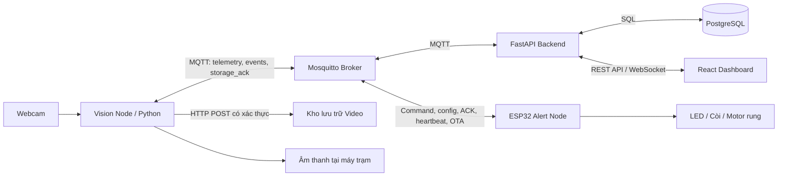

# Driver Monitoring AIoT Platform

Hệ thống nguyên mẫu giám sát trạng thái buồn ngủ và mất tập trung của tài xế tại biên (Edge AI), kết hợp quản lý thiết bị trên nền tảng Web và phát cảnh báo vật lý qua vi điều khiển ESP32. Dự án tích hợp **Python (MediaPipe, PyTorch, scikit-learn), FastAPI, React, PostgreSQL và MQTT (Eclipse Mosquitto)**.

---

## 1. Tổng quan hệ thống

Hệ thống gồm các thành phần chính phối hợp theo thời gian thực:

- **Vision Node (`edge-ai/`):** Chạy trên máy tính gắn webcam, trích xuất đặc trưng khuôn mặt (EAR, PERCLOS, MAR, góc tư thế đầu), phân loại trạng thái tài xế (`ATTENTIVE`, `DROWSY`, `DISTRACTED`, `UNKNOWN`), phát âm thanh cảnh báo tại chỗ và cắt clip sự kiện.
- **Alert Node (`firmware/`):** Mạch **ESP32 DOIT DevKit V1** nhận lệnh điều khiển qua MQTT, kích hoạt **Đèn LED, Còi báo động (Buzzer) và Motor rung**, gửi gói tin trạng thái định kỳ (heartbeat), phản hồi xác nhận lệnh (`ACK`) và hỗ trợ cập nhật firmware qua mạng (**OTA**).
- **Backend (`backend/`):** Xây dựng bằng FastAPI + PostgreSQL, đảm nhiệm xác thực JWT, phân quyền theo vai trò, quản lý vòng đời thiết bị, tiếp nhận dữ liệu MQTT, chạy bộ quy tắc cảnh báo tự động (**Rule Engine**), lưu trữ video và quản lý kho firmware OTA.
- **Web Dashboard (`frontend/`):** Ứng dụng React/Vite hiển thị số đo và biểu đồ thời gian thực qua WebSocket, quản lý người dùng/thiết bị, cấu hình nhịp cảnh báo từ xa, tra cứu lịch sử lệnh/video và theo dõi tiến trình cập nhật OTA.
- **Cơ chế chịu lỗi mạng:** Dữ liệu đo và clip sự kiện tại Edge được ghi vào hàng đợi SQLite cục bộ trước khi gửi, đảm bảo tự động đồng bộ bù lịch sử khi khôi phục kết nối mà không phát lại lệnh kích tải cũ.

### Phân quyền người dùng (RBAC)

| Vai trò | Phạm vi chức năng |
|---|---|
| **Admin** | Quản trị toàn hệ thống: quản lý tài khoản, đăng ký và điều chuyển vòng đời thiết bị, gán thiết bị cho người dùng, liên kết tự động Camera–ESP32 và quản lý cập nhật Firmware OTA |
| **Employee** | Nhân viên điều hành: theo dõi số đo trực tiếp, gửi lệnh kiểm tra cảnh báo, chỉnh cấu hình nhịp tải, xem/xóa video và đánh dấu đã xem cảnh báo trên các thiết bị được gán |
| **Customer** | Tài xế / Khách hàng cá nhân: xem trạng thái trực tiếp, biểu đồ lịch sử, cấu hình hiện tại, video sự kiện và đánh dấu đã xem cảnh báo của thiết bị được gán |

---

## 2. Kiến trúc và luồng dữ liệu



| Luồng nghiệp vụ | Cơ chế hoạt động |
|---|---|
| **Thu thập số đo (Telemetry)** | Vision Node → MQTT (`driver/{code}/telemetry`) → Backend lưu PostgreSQL → Đẩy qua WebSocket lên giao diện React |
| **Cảnh báo tự động (Rule Engine)** | Sự kiện AI đạt ngưỡng → Backend đối chiếu liên kết `rule_bindings` → Phát lệnh MQTT tới đúng ESP32 → Bật tải → Trả `ACK COMPLETED` |
| **Điều khiển & Cấu hình từ xa** | Giao diện React → REST API → MQTT (`command` / `config/update`) → ESP32 thực thi hoặc lưu NVS → Phản hồi `ACK` / `APPLIED` |
| **Lưu trữ Video sự kiện** | Vision Node đóng gói clip `.mp4` → Worker nền tải lên qua HTTP Basic Auth của thiết bị → Lưu vào Docker volume riêng |
| **Cập nhật Firmware (OTA)** | Admin tải lên file `.bin` và `.manifest.json` đã ký RSA-2048 → Backend gửi yêu cầu qua MQTT → ESP32 tải qua HTTPS, xác minh chữ ký/SHA-256, ghi phân vùng mới và phản hồi `CONFIRMED` |

Bộ quy tắc cảnh báo tự động (`driver-bench-20261107-v1`) leo thang theo thời gian duy trì trạng thái nguy cơ đã xác nhận:
- **Mức 1 (3 giây):** Bật LED + Còi trong 1 giây.
- **Mức 2 (6 giây):** Bật LED + Còi + Motor rung trong 2 giây.
- **Mức 3 (10 giây):** Bật cả 3 đầu ra trong 3 giây (nhắc lại mỗi 5 giây nếu nguy cơ vẫn tiếp diễn).

### Cấu trúc thư mục dự án

```text
backend/       Mã nguồn FastAPI, xử lý MQTT, Rule Engine, OTA và bộ kiểm thử API
frontend/      Giao diện web React/Vite và kiểm thử đơn vị giao diện
edge-ai/       Thu thập camera, mô hình CNN + Random Forest v2, hàng đợi SQLite và upload video
firmware/      Mã nguồn C++ (PlatformIO) cho mạch ESP32 Alert Node
database/      File khởi tạo bảng (create.sql), dữ liệu mẫu và các bản migration SQL
deployment/    Docker Compose, cấu hình Mosquitto ACL, đồng bộ giờ NTP LAN, TLS và monitoring
hardware/      Sơ đồ chân GPIO, nguyên lý mạch đệm tải và danh mục linh kiện
tests/         Kịch bản kiểm thử tích hợp và nghiệm thu hệ thống
docs/          Tài liệu kiến trúc, hợp đồng API/MQTT, thiết kế mô hình AI và quy trình OTA
```

---

## 3. Hướng dẫn cài đặt và khởi chạy

Các lệnh dưới đây được thực thi trên **PowerShell tại thư mục gốc của repository**. Yêu cầu cài sẵn **Docker Desktop**, **Python 3.13** (cho Edge AI) và **PlatformIO** (khi biên dịch/nạp code cho ESP32).

### 3.1. Tạo file biến môi trường `.env`

```powershell
if (!(Test-Path .env)) { Copy-Item .env.example .env }
python deployment/mqtt/prepare_env.py
```

Mở file `.env` vừa tạo để cập nhật mật khẩu cơ sở dữ liệu (`POSTGRES_PASSWORD`, `DATABASE_URL`) và khóa ký JWT (`SECRET_KEY`). Script `prepare_env.py` sẽ tự động sinh mật khẩu ngẫu nhiên cho các tài khoản MQTT hệ thống còn trống.

### 3.2. Khởi động cụm dịch vụ bằng Docker Compose

```powershell
docker compose --env-file .env -f deployment/docker-compose.yml config --quiet
docker compose --env-file .env -f deployment/docker-compose.yml up -d --build
docker compose --env-file .env -f deployment/docker-compose.yml ps -a
```

Khi khởi động thành công, các container `postgres`, `mosquitto`, `backend`, `frontend` và `time-server` ở trạng thái `Up` (các tác vụ khởi tạo một lần `mqtt-init`, `mqtt-setup`, `migrate` kết thúc với `Exited (0)`).

| Dịch vụ | Địa chỉ truy cập trên máy chạy Docker |
|---|---|
| Giao diện Web (React) | <http://localhost:5173> |
| Tài liệu OpenAPI (Swagger) | <http://localhost:8000/docs> |
| Kiểm tra trạng thái Backend | <http://localhost:8000/api/health> |
| MQTT Broker (cho AI & ESP32) | `<IP-LAN-laptop>:1884` (trong mạng Docker là `mosquitto:1883`) |
| PostgreSQL | `localhost:5433` (hoặc theo biến `POSTGRES_PORT` trong `.env`) |
| Đồng bộ thời gian NTP LAN | `<IP-LAN-laptop>:123/UDP` |

> **Lưu ý quản lý dữ liệu:** Không dùng lệnh `docker compose down -v` khi khởi động lại bình thường để tránh xóa dữ liệu trong các Docker volume (`postgres_data`, `mqtt_data`, `video_data`, `firmware_data`).

### 3.3. Tài khoản mẫu và đăng ký thiết bị

Khi khởi tạo DB lần đầu từ file dữ liệu mẫu (`database/insert.sql`), hệ thống tạo sẵn 3 tài khoản minh họa ứng với 3 vai trò: `lec` (Admin), `tranb` (Employee) và `nguyenan` (Customer) với mật khẩu mặc định `123456`.

Quy trình đưa thiết bị mới vào vận hành trên giao diện Admin:
1. Mở **Thiết bị → Đăng ký thiết bị**, chọn đúng phân loại (`VISION_NODE` cho Camera AI hoặc `ALERT_NODE` cho mạch ESP32).
2. Vào trang chi tiết thiết bị, chọn **Cấp thông tin kết nối** để nhận tài khoản/mật khẩu MQTT riêng, sau đó bấm **Kích hoạt** (`ACTIVE`).
3. Vào trang **Quản trị → Người dùng** để gán thiết bị cho tài khoản `Employee` và `Customer` cần phân quyền.

### 3.4. Cài đặt và chạy Edge AI (Vision Node)

Cài đặt môi trường ảo Python cho `edge-ai` (chỉ cần chạy lần đầu):

```powershell
if (!(Test-Path edge-ai/.venv/Scripts/python.exe)) { python -m venv edge-ai/.venv }
./edge-ai/.venv/Scripts/python.exe -m pip install -r edge-ai/requirements-lock.txt
./edge-ai/.venv/Scripts/python.exe -m pip install -r edge-ai/requirements-multisignal.txt --index-url https://download.pytorch.org/whl/cpu
```

**Chuẩn bị gói trọng số mô hình và hồ sơ hiệu chuẩn (bắt buộc khi chạy trên máy mới):**
Do thư mục `edge-ai/ml-runs/` nằm trong `.gitignore`, khi cài đặt trên một máy tính mới sau khi `git clone`, cần chuẩn bị đủ 2 thành phần trước khi khởi chạy:
1. **Gói mô hình v2 (`regions.pt`, `fusion.joblib`, `manifest.json`):** Tải ZIP và file `.sha256` từ [Release v1.0.0](https://github.com/toanhy189/Driver-Monitoring-AIoT-Platform/releases/tag/v1.0.0), đối chiếu SHA-256 rồi giải nén vào đường dẫn mặc định `edge-ai/ml-runs/multisignal-v2-20261110/selected/` (hoặc lưu ở thư mục tùy chọn và truyền đường dẫn qua tham số `-BundlePath`).
2. **Hồ sơ hiệu chuẩn mắt (`Calibration Profile`):**
   - Nếu chạy ở chế độ **không đeo kính**, có thể dùng ngay nhánh mặc định bằng cờ `-Condition no-glasses`.
   - Nếu chạy ở chế độ **có đeo kính** (`-Condition glasses`), cần đo hồ sơ riêng cho người và webcam của máy đó theo [docs/eye-guard-calibration.md](docs/eye-guard-calibration.md), sau đó truyền đường dẫn `report.json` qua `-CalibrationPath` cùng `-ProfileId` tương ứng.

Kiểm tra nhanh cấu hình mô hình và chạy phiên giám sát trực tiếp:

```powershell
# Kiểm tra gói mô hình và file hiệu chuẩn (không mở camera)
./edge-ai/run-multisignal-v2.ps1 -Demo -Condition glasses -Check

# Khởi chạy chính thức camera, suy luận AI, gửi MQTT và tải video sự kiện
./edge-ai/run-multisignal-v2.ps1 -Demo -Condition glasses
```

Khi cửa sổ camera mở lên, **nhìn thẳng và giữ đầu ổn định trong 5 giây đầu** để hệ thống lấy mốc góc tư thế chuẩn; nhấn phím `Q` khi muốn kết thúc phiên. Nếu thay đổi người thử, góc đặt webcam hoặc điều kiện đeo kính, xem hướng dẫn đo lại profile tại [docs/eye-guard-calibration.md](docs/eye-guard-calibration.md).

### 3.5. Cấu hình và nạp chương trình cho ESP32 (Alert Node)

1. Đấu nối phần cứng theo sơ đồ tại [hardware/README.md](hardware/README.md) (LED tại `GPIO26`, Còi tại `GPIO25`, Motor rung 5 V qua mạch đệm transistor và diode dập xung tại `GPIO33`, chung đường `GND` với ESP32).
2. Sao chép `firmware/esp32-alert-node/include/network_config.example.h` thành `network_config.h`, điền thông tin Wi-Fi 2.4 GHz, địa chỉ IP LAN của máy chạy broker (cổng `1884`) và tài khoản MQTT đã cấp cho thiết bị.
3. Kiểm tra hằng số `DEVICE_CODE` trong `include/config.h` trùng khớp với mã thiết bị trên Web, sau đó biên dịch và nạp firmware:

```powershell
$pio = "$env:USERPROFILE\.platformio\penv\Scripts\pio.exe"
& $pio device list
& $pio run -d firmware/esp32-alert-node -e development

# Thay COM7 bằng cổng USB-Serial thực tế của mạch ESP32 trên máy
$port = "COM7"
& $pio run -d firmware/esp32-alert-node -e development -t upload --upload-port $port
& $pio device monitor -d firmware/esp32-alert-node --port $port --baud 115200
```

---

## 4. Kịch bản Demo tổng thể (10 bước nghiệm thu)

Trước khi bắt đầu luồng cảnh báo tự động ở Bước 8, đảm bảo `RULE_ENGINE_ENABLED=true` trong `.env` (nếu vừa sửa `.env`, chạy `docker compose --env-file .env -f deployment/docker-compose.yml up -d --force-recreate backend`), đồng thời bật liên kết Camera → ESP32 trong mục **Cảnh báo tự động** ở trang chi tiết Vision Node.

| Bước | Nội dung thực hiện | Kết quả quan sát |
|---|---|---|
| **1. Đăng nhập theo vai trò** | Mở 3 phiên trình duyệt đăng nhập `Admin`, `Employee`, `Customer` | Giao diện và chức năng hiển thị đúng phạm vi quyền của từng vai trò |
| **2. Đăng ký / Kích hoạt thiết bị** | Admin đăng ký hoặc kích hoạt thiết bị trên trang chi tiết | Vòng đời chuyển sang `ACTIVE`, trạng thái kết nối báo `ONLINE` khi có heartbeat |
| **3. Thiết bị gửi dữ liệu cảm biến** | Chạy tiến trình Edge AI với webcam thực tế | Số đo `EAR`, `PERCLOS`, `MAR`, góc đầu và `model_version` gửi liên tục về Backend |
| **4. Dashboard thời gian thực** | Mở trang **Giám sát AI / Tổng quan**, chọn `vision-01` | Trạng thái tài xế, thẻ chỉ số và biểu đồ cập nhật trực tiếp qua WebSocket |
| **5. Gửi lệnh điều khiển & nhận ACK** | Mở chi tiết `alert-01` → bấm **Kiểm tra cảnh báo** | LED, Còi, Motor rung hoạt động thực tế; lịch sử lệnh cập nhật `COMPLETED` kèm độ trễ |
| **6. Thay đổi cấu hình từ xa** | Mở **Cấu hình cảnh báo**, đổi thông số bật/tắt (ms) và lưu | Cấu hình mong muốn (`desired`) được gửi xuống ESP32, lưu NVS và báo `APPLIED` |
| **7. Phát hiện thiết bị Offline** | Ngắt nguồn hoặc kết nối mạng của ESP32 rồi cấp nguồn lại | Trạng thái chuyển sang `OFFLINE` (qua LWT/heartbeat timeout) và tự `ONLINE` lại khi khôi phục |
| **8. Sinh và xử lý cảnh báo tự động** | Nhắm mắt hoặc quay/cúi đầu trước camera vượt ngưỡng thời gian | Sinh cảnh báo, kích hoạt tải trên ESP32 theo mức, tải clip sự kiện và bấm **Đánh dấu đã xem** |
| **9. Kiểm thử chặn thao tác trái quyền** | Dùng JWT của `Customer` gọi API `POST /api/devices/{id}/commands` trên Swagger | Backend từ chối với mã `HTTP 403 Forbidden`, không phát sinh lệnh xuống thiết bị |
| **10. Ngừng sử dụng thiết bị** | Admin bấm **Ngừng sử dụng** (`Decommission`) thiết bị ở cuối buổi demo | Trạng thái chuyển sang `DECOMMISSIONED`, thu hồi quyền MQTT, chặn kết nối lại nhưng giữ lịch sử |

> Với chức năng nâng cao **OTA**, thực hiện trước Bước 10 tại menu **Firmware / OTA** trên tài khoản Admin theo hướng dẫn chi tiết ở [docs/firmware-ota.md](docs/firmware-ota.md).

---

## 5. Chạy bộ kiểm thử tự động & Tài liệu thiết kế

```powershell
# Kiểm thử Backend (Unit test & Integration test trên container tạm)
python -m pip install -r backend/requirements-test.txt
python -X utf8 -m unittest discover -s backend/tests -v
python -X utf8 backend/tests/run_week4_isolated.py --regression

# Kiểm thử Edge AI
./edge-ai/.venv/Scripts/python.exe -X utf8 -m unittest discover -s edge-ai/tests -v

# Kiểm thử và kiểm tra gói build Frontend
npm --prefix frontend ci
node --test frontend/tests/*.test.mjs
npm --prefix frontend run build
```

### Danh mục tài liệu chi tiết
- **Thành phần hệ thống:** [Backend](backend/README.md) · [Frontend](frontend/README.md) · [Edge AI](edge-ai/README.md) · [Firmware ESP32](firmware/esp32-alert-node/README.md) · [Phần cứng & Sơ đồ đấu dây](hardware/README.md) · [Triển khai Docker](deployment/README.md)
- **Kiến trúc & Giao thức:** [Kiến trúc tổng thể & Bảo mật](docs/final-architecture-security.md) · [Hợp đồng API FE–BE](docs/week2-fe-be-contract.md) · [Giao thức MQTT AI & Video](docs/ai-ingest-video-contract.md) · [Phân quyền & Thống kê số đo](docs/roles-and-device-metrics.md) · [Đăng ký & Ngừng sử dụng thiết bị](docs/device-registration-and-retirement.md)
- **Chức năng nâng cao & Nghiệm thu:** [Thiết kế luồng AI v2](docs/luong-xu-ly-ai-v2.md) · [Hiệu chuẩn mắt đeo kính](docs/eye-guard-calibration.md) · [Theo dõi hướng đầu & Cúi đầu](docs/head-motion-v1.md) · [Cập nhật Firmware OTA](docs/firmware-ota.md) · [Kịch bản nghiệm thu](tests/final-acceptance.md)
