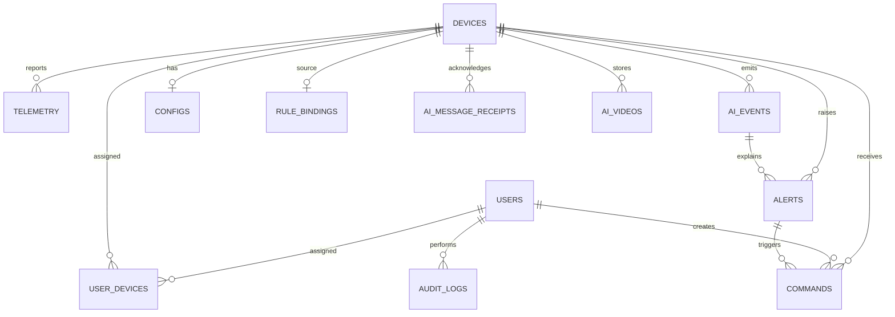

## Schema gọn đề xuất

Mình đề xuất **12 bảng nghiệp vụ**, bỏ các bảng danh mục/log cũ chỉ khi dữ liệu của chúng đã được chuyển và đối chiếu:

`RULE_BINDINGS` cũng tham chiếu một thiết bị đích `DEVICES`; quan hệ này không thể hiện đầy đủ trong sơ đồ ngắn trên. `AI_EVENTS` liên kết với `ALERTS` qua `source_event_id`; `AI_VIDEOS` liên kết sự kiện qua `message_id`. Nên cân nhắc thêm foreign key cho các liên kết đó sau khi dữ liệu đã được làm sạch.

| Bảng | Các thuộc tính cốt lõi | Mục đích |
|---|---|---|
| `users` | `id`, `username` **unique**, `hash_password`, `fullname`, `email`, `phone`, `role` | Đăng nhập và phân quyền. |
| `devices` | `id`, `device_code` **unique**, `model`, `name`, `device_type`, `lifecycle_state`, `status`, `firmware_version`, `ip_address`, `mac_address`, `last_seen`, `mqtt_username` | Đăng ký, trạng thái và thông tin thiết bị. Không lưu MQTT password lâu dài nếu luồng provisioning không cần. |
| `user_devices` | `id`, `user_id`, `device_id`, `assigned_at`, `unassigned_at` | Quyền xem/điều khiển và lịch sử gán thiết bị. |
| `telemetry` | `id`, `device_id`, `recorded_at`, `received_at`, `ear`, `perclos`, `angle_x/y/z`, `confidence`, `driver_state`, `face_detected`, `head_pose`, `model_version` | Số đo theo thời gian, lịch sử và dashboard. |
| `ai_events` | `id`, `event_id` **unique**, `device_id`, `event_type`, `occurred_at`, `received_at`, `model_version`, `state`, `state_duration_ms`, `payload_hash`, `payload`, `outcome` | Sự kiện AI, chống xử lý trùng và truy vết kết quả rule. |
| `alerts` | `id`, `device_id`, `source_event_id`, `alert_type`, `severity`, `status`, `description`, `created_at`, `resolved_at` | Cảnh báo và trạng thái xử lý. |
| `commands` | `id`, `request_id`, `device_id`, `alert_id`, `action`, `status`, `ack_status`, `dispatches`, `created_by_user_id`, `idempotency_key`, `request_hash`, các mốc thời gian và `error_message` | Lệnh, ACK, retry-safe và đo độ trễ. |
| `configs` | `id`, `device_id` **unique**, `revision`, `desired_config`, `applied_config`, `updated_at` | Theo dõi cấu hình mong muốn và đã áp dụng. |
| `rule_bindings` | `source_device_id`, `target_device_id`, `enabled`, `policy`, `last_triggered_at`, `updated_at` | Binding Vision Node → Alert Node và policy/cooldown. |
| `ai_message_receipts` | `id`, `device_id`, `message_id`, `topic`, `payload_hash`, `saved_at` | Đảm bảo retry MQTT không ghi trùng và chỉ ACK sau khi lưu. |
| `ai_videos` | `id`, `device_id`, `message_id`, `state`, `storage_key`, `sha256`, `size_bytes`, `created_at` | Metadata video; file video nằm trong storage riêng, không nằm trong PostgreSQL. |
| `audit_logs` | `id`, `user_id`, `action`, `entity_type`, `entity_id`, `details`, `created_at` | Nhật ký thao tác quan trọng, không chứa password/token/payload nhạy cảm. |

### Có thể bỏ bảng nào?

- **`event_types`**: bỏ được nếu chuyển tên/code loại event vào `ai_events.event_type` và lưu ý nghĩa lịch sử trong payload/archive.
- **`events`**: mô hình cũ; có thể hợp nhất vào `ai_events` sau khi chuyển dữ liệu và cập nhật tham chiếu alert.
- **`command_types`**: có thể bỏ bằng cách lưu mã lệnh trực tiếp trong `commands.action`; cần sửa code đang tra bảng này và bổ sung kiểm tra giá trị hợp lệ.
- **`command_acks`**: backend hiện lưu ACK trong `commands.ack_status`, `dispatches` và timestamp. Có thể bỏ nếu không cần lưu nhiều dòng ACK lịch sử riêng.
- **`captures`**: mô hình video cũ; luồng mới dùng `ai_videos` và file trong volume riêng. Chỉ bỏ sau khi xử lý các đường dẫn video cũ.

**Không nên bỏ** `ai_message_receipts`, `ai_events`, `user_devices` hay `audit_logs` chỉ vì bảng đang rỗng: code hiện tại dùng chúng cho ingest/idempotency, timeline/rule, phân quyền và audit.

## Chuyển dữ liệu cũ sang schema mới

1. **Giữ nguyên DB cũ và tạo backup đã thử restore.** Thực hiện trên database đích mới, không chạy `DROP SCHEMA` trên DB đang dùng.
2. **Tạo schema mới** bằng migration/baseline riêng, không dùng seed cũ như migration.
3. **Chuyển dữ liệu theo thứ tự**, trong transaction hoặc ETL có thể chạy lại an toàn:
   - Giữ nguyên `users`, `devices`, `user_devices`, `telemetry`; kiểm tra trùng username trước khi thêm unique constraint.
   - Map từng `events.id` thành ID ổn định như `legacy-event-<id>` trong `ai_events`; lưu type, thời gian, duration, warning và dữ liệu cũ trong `payload`.
   - Map `alerts.event_id` qua `events.id` tương ứng thành `alerts.source_event_id`. Giữ `resolved_at`; không tự đổi severity kiểu `WARNING` thành mức số nếu không có quy tắc được duyệt.
   - Map `commands.command_type_id` sang `commands.action` qua `command_types.code`. Chuyển ACK cũ sang các trường ACK trên `commands`. Nếu có nhiều ACK và cần lịch sử từng lần, archive hoặc giữ bảng ACK riêng.
   - Với `captures`, **chỉ** tạo `ai_videos` nếu file thực tế được xác nhận, copy vào storage mới và tính lại SHA-256/kích thước. Nếu file không còn, lưu metadata vào bảng archive/CSV; đừng tạo video giả khiến API trả link tải không tồn tại.
4. **Đối chiếu trước cutover:** số dòng từng bảng nguồn/đích, orphan foreign key, assignment, đăng nhập, API lịch sử/cảnh báo/lệnh, hash video và các trường legacy đã được giữ lại.
5. Sau khi xác nhận ứng dụng chạy trên DB mới, giữ DB cũ read-only một thời gian để rollback. Chỉ xóa sau khi được duyệt và backup được xác nhận.

## Tình trạng thực tế đã quan sát

Ở lần truy vấn chỉ đọc trước đó, DB dev có 17 bảng. Các bảng legacy vẫn có dữ liệu: `events` 9 dòng, `event_types` 9, `command_acks` 4, `captures` 3. `alerts.event_id` có 5 giá trị và `resolved_at` có 2 giá trị. Vì vậy xóa các bảng/cột này ngay sẽ làm mất dữ liệu, dù code backend mới không còn dùng trực tiếp một số bảng legacy.

Một vấn đề cần xử lý trước khi migrate: `users.username` chưa có unique constraint trong DB hiện tại, trong khi API dùng username để đăng nhập. Nên kiểm tra dữ liệu trùng rồi bổ sung ràng buộc unique trong migration.
