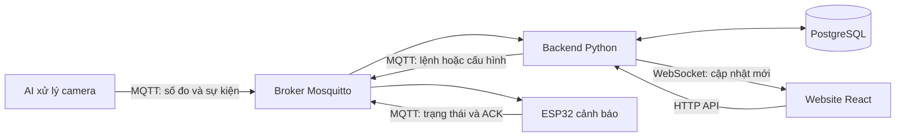

# TV2 tuần 3 — Hướng xử lý và giải thích logic code

**Bổ sung 21/10/2026:** [hợp đồng và logic event/video mới](ai-ingest-video-contract.md).
AI trên main mới dùng `main.py` và `service/message/publisher.py`, đã bỏ main2.py.
BE nhận SESSION_ENDED, có API upload riêng và công cụ đồng bộ DB/ACL/thiết bị.
Môi trường máy hiện tại đã áp dụng theo yêu cầu người dùng; xem [kết quả mới](BE-ai-event-video-ket-qua.md).

Tài liệu dành cho thành viên phụ trách Backend, bao phủ TV2-01 đến TV2-23 trong bảng nhiệm vụ: hoàn thiện tuần 2 và phát triển tuần 3. Code đang ở nhánh `feature/backend-week3`. Bản báo cáo và minh chứng đi kèm: [Kết quả thực hiện](TV2-tuan-3-bao-cao-ket-qua.md).

Nhóm **chưa chốt severity, cooldown và bảng W3**. Vì vậy bảng mức cảnh báo dưới đây là đề xuất để kiểm thử. `RULE_ENGINE_ENABLED=false` là mặc định: BE vẫn lưu sự kiện/cảnh báo hợp lệ, còn việc tự tạo lệnh điều khiển chỉ được bật sau khi nhóm xác nhận chính sách và kiểm tra thiết bị.

## 1. Những khái niệm cần hiểu trước

| Từ trong code | Hiểu đơn giản |
| --- | --- |
| Broker Mosquitto | Chương trình chuyển tin giữa AI, BE và ESP32. Broker Docker của dự án mở cổng 1884 trên máy phát triển. |
| Topic | Địa chỉ của một loại tin, ví dụ `driver/alert-01/command` chứa lệnh gửi cho alert-01. |
| ACL | Danh sách mỗi tài khoản được đọc/gửi ở topic nào. |
| ACK | Tin thiết bị phản hồi đã nhận, đang làm, hoàn tất hoặc bị lỗi. |
| Desired / applied | Cấu hình người dùng muốn thiết bị dùng / cấu hình thiết bị đã xác nhận áp dụng. |
| Severity | Mức cảnh báo 1, 2, 3. BE chuyển mức này thành WEAK, MEDIUM, STRONG cho firmware hiện có. |
| Cooldown | Khoảng chờ để không tạo liên tiếp nhiều cảnh báo từ một nguồn. |
| Idempotency key | Mã nhận diện một lần người dùng yêu cầu gửi lệnh. Gửi lại cùng mã và cùng thông số sẽ lấy lệnh cũ. |
| Rule Engine | Phần BE đọc sự kiện AI, kiểm tra điều kiện rồi quyết định có tạo cảnh báo và lệnh hay không. |
| Hàng đợi lệnh trong DB | Lưu ý định gửi lệnh trước khi gửi MQTT, giúp BE biết việc gì chưa gửi hoặc kết quả gửi còn chưa xác định sau khi khởi động lại. |

## 2. Luồng chung



HTTP thành công chỉ cho biết BE đã xử lý yêu cầu. Broker nhận tin chỉ chứng minh BE đã gửi được tin tới broker. Để hiển thị **thiết bị đã hoàn tất/đã áp dụng**, BE phải nhận ACK phù hợp từ thiết bị.

## 3. TV2-01 đến TV2-06: môi trường, đăng nhập và quyền MQTT

### 3.1. TV2-01: chạy các thành phần và nâng cấp DB có dữ liệu

Code chính: [docker-compose.yml](../deployment/docker-compose.yml), [Dockerfile BE](../deployment/backend/Dockerfile), [Dockerfile FE](../deployment/frontend/Dockerfile), [migration tuần 2](../database/migration_fe_be_week2.sql), [migration tuần 3](../database/migration_be_week3.sql).

Docker Compose là file hướng dẫn Docker mở các chương trình của dự án và nối chúng với nhau. Mỗi chương trình chạy trong một container, có thể hiểu là một môi trường chạy riêng.

| Thành phần | Nhiệm vụ và thứ tự chạy |
| --- | --- |
| `postgres` | Chứa DB. Dữ liệu nằm trong vùng lưu `postgres_data`, tách khỏi container. Compose chờ DB báo sẵn sàng trước khi chạy migration. |
| `migrate` | Chạy SQL tuần 2 rồi tuần 3 bằng `psql`; gặp lỗi thì dừng. Đây là thay đổi DB, không phải bộ test. |
| `mqtt-init` → `mosquitto` → `mqtt-setup` | Tạo kho tài khoản lần đầu nếu chưa có, mở broker rồi tạo tài khoản/quyền BE và AI. Kho tài khoản nằm trong `mqtt_data`. |
| `backend` | Chờ `migrate` và `mqtt-setup` chạy thành công rồi mới mở API. Trong Docker, BE dùng tên `postgres`, `mosquitto` để kết nối hai dịch vụ này. |
| `frontend` | Build giao diện rồi phục vụ ở cổng 5173 trên máy. Trình duyệt gọi BE ở cổng 8000. `depends_on: backend` chỉ bảo đảm thứ tự mở container, không kiểm tra API đã sẵn sàng. |

**Với DB cũ:** giữ vùng dữ liệu hiện có và chạy migration để bổ sung bảng/cột/chỉ mục. Không chạy `database/create.sql` thủ công trên DB có dữ liệu vì file đó tạo lại schema. Các file `create.sql/insert.sql` gắn vào PostgreSQL chỉ tự chạy khi khởi tạo vùng dữ liệu mới; DB đang dùng phải nâng cấp qua migration.

Lệnh chạy riêng bước nâng cấp:

```powershell
docker compose --env-file .env -f deployment/docker-compose.yml run --rm migrate
```

`--rm` xóa container tạm sau khi chạy; các thay đổi đã ghi vào DB vẫn còn. Chạy lại được với hai migration hiện tại; khi có migration mới phải chạy bước nâng cấp tương ứng trước bản BE mới. Cách tạo `.env`, mở cả bộ Compose và kiểm tra dịch vụ xem [deployment/README.md](../deployment/README.md).

**Cách xác nhận TV2-01:** không chỉ nhìn `config -q`. Cần mở đủ FE/BE/DB/broker, gọi `/api/health`, đăng nhập từ web và kiểm tra một thao tác đi qua FE → BE → DB/MQTT. Minh chứng hiện có xác nhận các thành phần, build và DB/BE/MQTT thật; chưa đủ để coi toàn bộ FE trong Compose đã được nghiệm thu chung.

### 3.2. TV2-02: đăng nhập, quyền API và WebSocket của ba role

Code chính: [users.py](../backend/app/api/routes/users.py), [deps.py](../backend/app/api/deps.py), [access.py](../backend/app/services/access.py), [ws.py](../backend/app/api/routes/ws.py), [websocket.py](../backend/app/api/routes/websocket.py), [websocket_manager.py](../backend/app/services/websocket_manager.py).

1. `GET /api/health` trả phản hồi cho biết API đang nhận yêu cầu; endpoint này không yêu cầu đăng nhập và không kiểm tra kết nối DB/MQTT.
2. `POST /api/login` nhận username/password. BE tìm user và so sánh mật khẩu nhập với bản hash; đúng thì cấp token, sai trả 401. Hash là bản biến đổi một chiều, không phải mật khẩu có thể giải mã để đọc lại.
3. FE gửi `Authorization: Bearer <token>` khi gọi API có bảo vệ. BE kiểm tra chữ ký/hạn token, lấy user theo ID và đọc role hiện tại từ DB. `GET /api/me` trả thông tin tài khoản, không trả hash mật khẩu.
4. `require_admin/operator/viewer` quyết định role được làm thao tác nào. `assigned_device(s)` kiểm tra thêm quan hệ `user_devices` chưa bị thu hồi. **Admin cũng cần được gán thiết bị**; có role không thay cho có quyền trên thiết bị cụ thể.
5. FE gọi `POST /api/ws-ticket`, rồi mở `/ws/telemetry?ticket=...`. Vé dùng một lần, có hạn. Trước mỗi sự kiện, BE kiểm tra lại role và thiết bị được gán để chỉ gửi dữ liệu đúng tài khoản. Phần xử lý reconnect và giới hạn bộ nhớ xem mục 10.

| Role trong DB | Xem thiết bị/API/WS được gán | Gửi lệnh, sửa config, xác nhận cảnh báo | Đăng ký/cấp kết nối/đổi vòng đời |
| --- | --- | --- | --- |
| Admin | Có | Có, nếu thỏa điều kiện của thiết bị | Có |
| Employee | Có | Có, nếu thỏa điều kiện của thiết bị | Không |
| Customer | Có | Không | Không |

Role không đủ cho thao tác trả 403; thiết bị không được gán trả 404; token sai/hết hạn trả 401. Riêng WebSocket, việc mở kết nối bị từ chối thể hiện ở bước bắt tay, không có response JSON như HTTP thông thường.

**Ma trận cần kiểm tra:** đăng nhập lần lượt từng role → `/api/me` → danh sách thiết bị → API thiết bị được gán/không được gán → thao tác được phép/bị cấm → WS có vé/không có vé và lọc sự kiện theo gán. Dùng dữ liệu thử, hai phiên trình duyệt riêng và một thiết bị chỉ gán cho một tài khoản để kiểm tra không gửi nhầm. Không cần ESP32 thật để kiểm tra lọc WS; có thể phát tin MQTT thử bằng tài khoản được phép.

Minh chứng hiện có: test role của cả ba nhóm trong [test_week2_contract.py](../backend/tests/test_week2_contract.py), test tích hợp 09/10/12 trong [kết quả kiểm tra](evidence/week3/integration-results.json). Chưa có bộ đăng nhập và HTTP/WS thật đầy đủ cho cả ba tài khoản, đặc biệt Employee; vì vậy báo cáo TV2-02 vẫn là một phần.

### 3.3. TV2-03: tạo tài khoản MQTT và bật ACL tại broker

Code chính: [prepare_env.py](../deployment/mqtt/prepare_env.py), [init.sh](../deployment/mqtt/init.sh), [mosquitto.conf](../deployment/mqtt/mosquitto.conf), [mqtt_bootstrap.py](../backend/app/services/mqtt_bootstrap.py), [mqtt_security.py](../backend/app/services/mqtt_security.py).

Tài khoản web và tài khoản MQTT là hai loại khác nhau. Tài khoản web dùng đăng nhập giao diện; tài khoản MQTT cho BE, AI, ESP32 đăng nhập vào chương trình trung chuyển tin. ACL quy định sau khi đăng nhập, mỗi tài khoản được gửi/nhận tin ở địa chỉ topic nào.

1. `prepare_env.py` bổ sung mật khẩu ngẫu nhiên còn thiếu vào `.env` riêng của máy. Không ghi mật khẩu thật vào tài liệu hoặc file mẫu.
2. `mqtt-init` chỉ tạo `dynamic-security.json` khi kho tài khoản chưa tồn tại. File này nằm trong vùng lưu Docker `mqtt_data`.
3. Mosquitto dùng `allow_anonymous false` và phần quản lý tài khoản Dynamic Security. Kết nối không tài khoản bị từ chối.
4. `mqtt-setup` chạy `mqtt_bootstrap.setup()`: mặc định chặn gửi/nhận/đăng ký topic, sau đó tạo role và tài khoản BE/AI nếu chưa có. Tên mặc định là `backend`, `vision-01`; giá trị thực lấy từ `.env`.
5. `BrokerSecurity` đăng nhập bằng tài khoản quản trị broker và gửi yêu cầu tạo/thu hồi tài khoản qua topic điều khiển riêng. HTTP provision không tự ghi một tên vào DB rồi coi là đã cấp: phải được broker xử lý thành công trước, như mục 3.5.

**Setup sau lần resolve PR #5:** `ensure_identity()` tạo role còn thiếu hoặc dùng `modifyRole` cập nhật ACL role đã có. Tài khoản có sẵn giữ mật khẩu và trạng thái bị thu hồi. Muốn áp dụng quyền mới phải build/chạy lại `mqtt-setup`; chỉ pull code chưa thay cấu hình đang lưu ở broker. Cấu trúc lệnh `modifyRole` đối chiếu theo [topic API chính thức của Mosquitto](https://github.com/eclipse-mosquitto/mosquitto/blob/master/plugins/dynamic-security/README.md#modify-role).

Broker Docker mở **1884 trên Windows**, bên trong container là **1883**. BE chạy trong Docker dùng `mosquitto:1883`; BE/AI trên Windows dùng host/cổng trong `.env`; ESP32 dùng IP máy chạy broker và cổng 1884. Nếu máy còn Mosquitto riêng ở 1883, kết nối được vào đó chưa chứng minh đã dùng broker Docker có ACL.

Minh chứng [ACL PASS](evidence/week3/acl-output.txt) kiểm tra broker thật: BE/AI đăng nhập được, anonymous bị chặn, thiết bị có quyền riêng và bị ngắt khi thu hồi. Bước TV1/TV3 điền credential vào ESP32/AI thật và chạy toàn luồng vẫn cần xác nhận.

### 3.4. TV2-04: quyền thực tế của Alert Node và Vision Node

Code chính: `device_acls()` trong [mqtt_security.py](../backend/app/services/mqtt_security.py), role `edge-ai` trong [mqtt_bootstrap.py](../backend/app/services/mqtt_bootstrap.py). Bản quyền mẫu không có mật khẩu: [acl-policy.json](evidence/week3/acl-policy.json).

Với Alert Node có mã `alert-01`, mẫu ACL hiện tại cho phép:

| Hướng | Topic được phép |
| --- | --- |
| Nhận từ BE | `driver/alert-01/command`, `driver/alert-01/config/update` |
| Gửi trạng thái/kết quả | `driver/alert-01/status`, `driver/alert-01/ack`, `driver/alert-01/config/applied` |
| Quyền bổ sung của mẫu thiết bị hiện tại | Gửi `driver/alert-01/telemetry`, `driver/alert-01/heartbeat` |

Thiết bị không được dùng quyền của mình để đọc lệnh/config hoặc gửi ACK/applied vào nhánh của mã thiết bị khác. BE cần cả quyền đăng ký topic và nhận tin; đăng ký xong nhưng không được nhận cũng chưa đạt yêu cầu đọc.

Với tài khoản AI mặc định `vision-01`, bộ quyền mới cho gửi `driver/vision-01/telemetry`, `/events`, `/status` và chỉ đọc `driver/vision-01/storage_ack`. Ba topic chung cũ `driver/telemetry`, `driver/events`, `driver/status` còn được cấp gửi để giữ tương thích. Vision Node khác được provision theo loại thiết bị chỉ có nhánh riêng của nó.

BE kiểm tra mã nguồn trong JSON khớp mã trên topic riêng. Broker kiểm tra quyền topic; BE kiểm tra thêm nội dung. Kênh chung cũ vẫn cho tài khoản AI khai báo mã nguồn bằng payload, nên chưa bảo đảm phân tách hoàn toàn nhiều camera nếu còn dùng kênh cũ.

Test [test_mqtt_security_integration.py](../backend/tests/test_mqtt_security_integration.py) dùng tài khoản thiết bị tạm theo cùng mẫu ACL: nhận command/config đúng topic, gửi ACK/applied đúng topic, bị chặn khi đọc/gửi chéo và AI không được gửi ACK/applied của thiết bị. Kết quả này chứng minh các ca quyền topic đã chạy trên broker thật; chưa thay cho thử đầy đủ với firmware `alert-01` và chương trình AI `vision-01` thật.

### 3.5. TV2-05 và TV2-06: kiểm tra gửi chéo, cấp và thu hồi tài khoản

Code chính: [mqtt_security.py](../backend/app/services/mqtt_security.py), [mqtt_provision_service.py](../backend/app/services/mqtt_provision_service.py), [mqtt_revoke_service.py](../backend/app/services/mqtt_revoke_service.py), [devices.py](../backend/app/api/routes/devices.py).

1. Admin đăng ký thiết bị; trạng thái quản lý ban đầu là `REGISTERED`.
2. `POST /api/devices/{id}/provision` kiểm tra Admin và thiết bị được gán cho tài khoản.
3. BE tạo tên đăng nhập, mật khẩu ngẫu nhiên và quyền tại broker. Với `vision-01`, BE dùng tài khoản AI đã khởi tạo để giữ các topic AI hiện có.
4. Chỉ sau khi broker xử lý thành công, BE mới lưu `mqtt_username` và chuyển thiết bị sang `PROVISIONED`. Cột `mqtt_password` được đặt `NULL`; mật khẩu chỉ nằm trong phản hồi cấp tài khoản cho Admin.
5. `decommission` thu hồi/vô hiệu hóa tài khoản ở broker, ngắt kết nối hiện tại rồi chuyển DB sang `DECOMMISSIONED`, `OFFLINE`.
6. API gửi lệnh/cấu hình chặn thiết bị đã ngừng sử dụng. Bộ gửi lệnh từ hàng đợi cũng kiểm tra thiết bị trước khi gửi.

| Bên kết nối | Được gửi | Được đọc |
| --- | --- | --- |
| BE | `driver/+/command`, `driver/+/config/update`, `driver/+/storage_ack` | `driver/#` |
| AI mới | `driver/{code}/telemetry`, `/events`, `/status` | Chỉ `driver/{code}/storage_ack` |
| ESP32 theo mã riêng | `status`, `ack`, `telemetry`, `heartbeat`, `config/applied` của chính nó | `command`, `config/update` của chính nó |

Test MQTT dùng tài khoản thử, gửi tin đúng topic và thử gửi chéo. Kết quả đúng gồm cả **được phép đúng nơi** và **bị chặn ở nơi khác**. Ví dụ quyền được xuất tại [acl-policy.json](evidence/week3/acl-policy.json), không chứa mật khẩu.

## 4. TV2-07 đến TV2-10: cấu hình từ web tới ESP32

Code chính: [configs.py](../backend/app/api/routes/configs.py), [config_publish_service.py](../backend/app/services/config_publish_service.py), [_save_applied_config trong mqtt_service.py](../backend/app/services/mqtt_service.py), [config_store.cpp của TV1](../firmware/esp32-alert-node/src/app/config_store.cpp).

### 4.1. Hình dạng dữ liệu đang triển khai

FE gọi `PUT /api/devices/{id}/config`, body có `timings`: ba đầu ra `led`, `buzzer`, `motor`; mỗi đầu ra có ba mức `1`, `2`, `3`. `on_ms` là số nguyên 50–5000; `off_ms` là số nguyên 50–10000. Giới hạn FE/BE đã được đồng bộ với firmware TV1 tại commit main `5e06f10`.

Ví dụ một phần để dễ đọc; request thật phải có đủ cả ba đầu ra và ba mức:

```json
{"timings":{"led":{"1":{"on_ms":700,"off_ms":1000},"2":{"on_ms":500,"off_ms":500},"3":{"on_ms":300,"off_ms":300}}}}
```

BE thêm `config_id`, `device_code` và `revision` khi gửi MQTT:

```json
{"device_code":"alert-01","config_id":"cfg-...","revision":2,"timings":{"led":{"1":{"on_ms":700,"off_ms":1000}}}}
```

Đây là hợp đồng đã được nối trong code FE/BE/firmware hiện tại. Nhóm cần xác nhận nó khi chốt TV1; tài liệu này không thay cho xác nhận của nhóm.

### 4.2. Thứ tự BE xử lý

1. Kiểm tra quyền Admin/Employee, đúng Alert Node, chưa ngừng sử dụng và body hợp lệ.
2. Khóa dòng thiết bị và cấu hình trong DB, tăng `revision`, tạo `config_id` mới rồi lưu desired với trạng thái `PENDING_APPLICATION`. Khóa thiết bị còn chặn hai request cùng tạo bản cấu hình đầu tiên.
3. Giữ thứ tự publish bằng khóa dòng: nếu một request mới hơn đã thay desired thì request cũ không được gửi đè tin retained.
4. Gửi tới `driver/{code}/config/update` với QoS 1 và `retain=true`. Retained nghĩa là broker giữ cấu hình cuối để thiết bị nhận khi kết nối lại.
5. Nếu publish lỗi, API trả `503`; DB giữ desired để xem lại, trạng thái `PUBLISH_FAILED`; applied không được tự đổi.
6. Nếu publish thành công, API trả `PENDING_APPLICATION`. Thiết bị offline vẫn có thể nhận cấu hình retained sau khi đăng ký lại topic.

### 4.3. Thứ tự firmware xử lý

Nhánh này giữ firmware tuần 3 của TV1 từ main `5e06f10`; không sử dụng bộ `config_manager` cũ của TV2 song song.

1. Môi trường PlatformIO `development` đăng ký `command` và `config/update` với QoS 1; vùng nhận MQTT là 1024 byte.
2. `parseConfig()` và `parseDeviceTimings()` kiểm tra mã cấu hình và đủ bảng thời gian; mức 1/2/3 tương ứng WEAK/MEDIUM/STRONG.
3. Dùng `Preferences` ghi cấu hình vào flash — bộ nhớ còn dữ liệu sau ngắt điện. Ghi lỗi trả `STORAGE_ERROR`; lưu được mới đổi RAM và gửi `APPLIED`.
4. Lệnh đang chạy đã giữ riêng `startMs/endMs` khi bắt đầu nên tiếp tục theo timing cũ. Lệnh tiếp theo lấy timing mới.
5. `APPLIED/REJECTED` được gửi tới `driver/{code}/config/applied` bằng QoS 0. Firmware hiện xác nhận lại ID đã áp dụng khi nhận trùng; chưa có vòng lặp ba lần gửi ACK config.
6. Khi khởi động lại, `loadSavedConfig()` đọc và kiểm tra bản ghi flash.

**Còn cần TV1 thống nhất:** firmware hiện chưa kiểm tra `revision` để từ chối config cũ đến lại; cùng ID thì trả APPLIED trước khi so sánh toàn bộ nội dung. BE có lưu revision và bỏ ACK cũ, nhưng việc đó không chứng minh ESP32 đã chống áp dụng lại config cũ. Vì vậy TV2-10 chưa hoàn tất toàn bộ phần tích hợp.

```json
{"device_code":"alert-01","config_id":"cfg-...","status":"APPLIED","error":null}
```

Nếu lỗi, status là `REJECTED` và có `error`. BE chỉ cập nhật applied khi đúng topic thiết bị, đúng `device_code`, đúng `config_id` đang desired và status là `APPLIED`. ACK sai/cũ/trùng được bỏ qua phù hợp; `REJECTED` không được coi là đã áp dụng. FE lấy trạng thái và lỗi từ BE; có nút gửi lại khi publish thất bại hoặc thiết bị từ chối.

## 5. TV2-11 đến TV2-13: lệnh cha, ACK và khởi động lại

Code chính: [commands.py](../backend/app/api/routes/commands.py), [command_dispatch.py](../backend/app/services/command_dispatch.py), [command_state.py](../backend/app/services/command_state.py), [background_tasks.py](../backend/app/services/background_tasks.py).

`TEST_ALERT` tạo một lệnh cha, ví dụ `cmd-10`, và ba lệnh con `cmd-10-led`, `cmd-10-buzzer`, `cmd-10-motor`. BE gửi ba lệnh tương thích firmware. Hai ACK con `COMPLETED` chưa đủ; cả ba hoàn tất mới có `status=ACKNOWLEDGED`, `ack_status=COMPLETED`.

BE đối chiếu mã lệnh con và thiết bị trên topic trước khi ghi ACK. Các cập nhật đi lùi như `STARTED` sau `COMPLETED`, ACK trùng hoặc ACK của thiết bị khác không làm lùi kết quả. Nếu ACK tới ngay khi BE còn chờ publish hoặc chưa trả HTTP, bộ publish đọc lại dòng DB rồi cập nhật, giữ ACK mới hơn.

ACK `INTERRUPTED` được BE ghi thành kết quả thất bại, giữ mã lỗi như `REBOOTED`, không báo COMPLETED. Test 16 đã kiểm tra payload này qua broker thật với ESP32 giả lập. Firmware TV1 có request log để phục hồi sau reboot; bằng chứng phần cứng của TV1 xem [bàn giao firmware](../firmware/esp32-alert-node/tuan3-ban_giao.md).

Sau thời gian mặc định 30 giây mà chưa có đủ ACK, BE đặt `TIMEOUT`. Hai ACK hoàn tất đến muộn vẫn giữ TIMEOUT; khi cả ba đã hoàn tất, BE mới có thể sửa thành COMPLETED. `TIMEOUT` thể hiện chưa xác định kết quả cuối.

Trong mỗi lệnh con, `dispatch_state` ghi tiến độ gửi:

| Giá trị | Logic khi chạy/khởi động lại |
| --- | --- |
| `QUEUED` | Đã lưu ý định vào DB, chưa bắt đầu gửi. Worker có thể nhận để gửi nếu còn hợp lệ. |
| `PUBLISHING` | Đã ghi dấu bắt đầu gửi trước khi gọi MQTT. Nếu BE dừng ở đây, việc tin đã tới thiết bị hay chưa có thể chưa xác định; BE không tự gửi lại. |
| `PUBLISHED` | Broker đã xác nhận publish; vẫn phải đợi ACK thiết bị. |
| `PUBLISH_FAILED` | Publish thất bại được ghi rõ. |

Worker và request HTTP cùng dùng khóa dòng DB để một lệnh con chỉ được lấy từ QUEUED một lần. Worker phục hồi việc chưa gửi và đánh dấu timeout; dữ liệu lệnh, ACK trong JSON, cấu hình, sự kiện và cảnh báo đều nằm trong PostgreSQL.

**Giới hạn:** backend không thể tự bảo đảm tải vật lý chỉ bật đúng một lần nếu broker gửi lặp theo QoS 1 và firmware chưa chống thực thi lệnh trùng. Không bật retry lệnh tự động trước khi TV1 kiểm chứng cơ chế này.

## 6. TV2-14 đến TV2-16: Rule Engine và chống sự kiện trùng

Code chính: [schemas/rules.py](../backend/app/schemas/rules.py), [rule_engine.py](../backend/app/services/rule_engine.py), [models/ai_event.py](../backend/app/models/ai_event.py), [routes/rules.py](../backend/app/api/routes/rules.py).

AI mới gửi lên `driver/{code}/events`; topic `driver/events` cũ vẫn được nhận. BE chấp nhận `message_id/device_code` mới hoặc `event_id/device_id` cũ; nếu thiếu event_id thì dùng message_id làm mã sự kiện. `timestamp` phải có múi giờ; có thêm model_version, trạng thái và thời lượng. `STATE_CHANGED` lưu diễn biến; `DROWSY_THRESHOLD_REACHED` được xét theo rule. `DISTRACTED_THRESHOLD_REACHED` được lưu với kết quả `POLICY_PENDING`, chờ nhóm chốt chính sách điều khiển.

1. Kiểm tra hình dạng dữ liệu và nguồn Vision Node đã đăng ký.
2. Khóa dòng nguồn, tìm `event_id` đã nhận trong bảng `ai_events`. DB có ràng buộc unique để chặn cả trường hợp nhận đồng thời.
3. Lưu thời gian gốc `occurred_at`, thời gian BE nhận `received_at` và bản băm nội dung. Cùng ID nhưng nội dung khác bị bỏ qua và ghi cảnh báo log.
4. Đọc liên kết Vision Node → Alert Node từ `rule_bindings`; đọc bảng mức và cooldown đã cấu hình.
5. Sự kiện dưới ngưỡng hoặc còn cooldown được lưu với kết quả quyết định tương ứng, không tạo thêm cảnh báo/lệnh.
6. Với sự kiện đủ điều kiện, lưu alert. Chỉ khi công tắc toàn hệ thống và liên kết đều bật, sự kiện còn mới và Alert Node ACTIVE/ONLINE/heartbeat mới, BE mới tạo lệnh `AUTO_ALERT`.
7. Event, alert và ý định gửi command được lưu trong cùng giao dịch DB. Liên kết là `ai_events.event_id → alerts.source_event_id → commands.alert_id → commands.request_id`.
8. Worker gửi lệnh đã xếp hàng; việc phát lại cùng event sau restart không tạo thêm alert/command.

Sự kiện cũ do lưu offline rồi gửi lại được giữ trong lịch sử nhưng không tự bật tải nếu quá tuổi cho phép. Các kết quả như `RULE_DISABLED`, `QUEUED`, `COOLDOWN_SUPPRESSED`, `STALE_RECORDED`, `TARGET_UNAVAILABLE` giúp giải thích quyết định của BE.

### Chính sách mẫu để nhóm thảo luận

| Mức | Buồn ngủ liên tục từ | Thời lượng lệnh | Intensity firmware |
| --- | --- | --- | --- |
| 1 | 3000 ms | 1000 ms | WEAK |
| 2 | 6000 ms | 2000 ms | MEDIUM |
| 3 | 10000 ms | 3000 ms | STRONG |

Cooldown mẫu: 30 giây; sự kiện quá 60 giây không tạo lệnh tự động. Đây là thông số thử, **chưa được TV1/TV3 xác nhận**.

**Giới hạn cần chốt với AI:** main2.py gửi một event cho mỗi đợt DROWSY/DISTRACTED vượt ngưỡng. Một event ở 3 giây không cho BE biết tình trạng tiếp tục kéo dài đến 6/10 giây. Các test mức 2/3 dùng event mang thời lượng tương ứng. Nhóm cần chốt nhịp gửi event và cách tăng mức; cooldown hiện chặn cả event mức cao hơn trong khoảng chờ. BE đã nhận/lưu sự kiện mất tập trung, nhưng chưa tự đặt chính sách bật tải cho nó.

### Xác nhận lưu SQLite của AI

1. Hàm gửi trong `edge-ai/main2.py` lưu JSON và message_id vào SQLite trước, rồi đánh thức worker trong `mqtt_client.py`. Worker là đường gửi duy nhất của luồng này.
2. BE khóa dòng Vision Node và tìm biên nhận theo cặp device_id/message_id trong `ai_message_receipts`. Bản gửi lại cùng nội dung không tạo thêm dữ liệu; trùng mã khác nội dung không được trả SAVED.
3. Telemetry hoặc event/alert/command và biên nhận được ghi trong cùng giao dịch DB. Chỉ khi commit thành công, callback MQTT mới gửi `{"message_id":"...","status":"SAVED"}` tới `driver/{code}/storage_ack`, QoS 1, không retained.
4. Mất ACK thì AI giữ SQLite và gửi lại cùng ID; BE trả lại SAVED từ biên nhận đã lưu. Cơ chế này còn sau restart BE. Dữ liệu telemetry cũ vẫn được lưu lịch sử nhưng không phát sự kiện thay thế số đo mới hơn.
5. AI chỉ xóa dòng đúng message_id sau khi nhận SAVED trên topic xác nhận của chính nó. Đóng chương trình sẽ dừng worker; file SQLite được giữ trên máy, không commit vào Git.

Các ca 17–21 kiểm tra mất ACK, trùng tin, lỗi commit, process mới, replay cũ, module SQLite/MQTT thật của AI và chuỗi topic mới → rule → lệnh/ACK → API/WS. Gọi hàm tạo payload hiện tại của main2.py mà không mở camera; chưa chạy pipeline OpenCV/MediaPipe hay tải ESP32 thật.

Mỗi mức có thêm `outputs`, chọn một hoặc nhiều phần tử `led`, `buzzer`, `motor`. Mẫu mặc định dùng cả ba đầu ra ở cả ba mức với cường độ khác nhau; nhóm có thể đổi danh sách tải của từng mức trong policy. TEST_ALERT thủ công vẫn luôn kiểm tra cả ba tải.

Admin được gán cả hai thiết bị có thể xem/sửa qua `GET/PUT /api/devices/{vision_id}/rule`. PUT nhận `target_device_id`, `enabled`, và `policy` có `levels`, `cooldown_seconds`, `max_event_age_seconds`. Bảng levels phải đủ 1/2/3 với ngưỡng tăng dần. `effective_enabled` phản ánh cả công tắc môi trường và cấu hình liên kết. Xem schema đầy đủ trong [OpenAPI](evidence/week3/openapi.json).

## 7. TV2-17: chống tạo lệnh trùng từ HTTP

FE tạo `Idempotency-Key` cho một lần gửi. Nếu mất kết nối, FE giữ khóa và thông số trong sessionStorage của tab theo tài khoản/thiết bị; khi người dùng thử lại cùng thông số, FE dùng lại khóa. FE không có vòng lặp tự retry POST.

```http
POST /api/devices/2/commands
Authorization: Bearer <token>
Idempotency-Key: <mã tạo cho một lần yêu cầu>
Content-Type: application/json
```

BE lưu khóa cùng user, device và SHA-256 của body chuẩn hóa. Cùng khóa + cùng body trả bản ghi lệnh cũ; cùng khóa nhưng khác body trả `409`. Kiểm tra quyền vẫn thực hiện trước khi trả lại lệnh cũ. PostgreSQL có chỉ mục unique nên cơ chế này còn sau restart và chặn request đồng thời.

Header hiện **không bắt buộc** để client tuần 2 vẫn gọi được; FE của dự án đã gửi header. Client ngoài không gửi khóa có thể tạo lệnh mới khi POST lại. Khóa hiện giữ theo bản ghi lệnh, chưa có chính sách tự xóa theo ngày.

## 8. TV2-18 và TV2-19: API lịch sử, diễn biến và thống kê

Code chính: [history.py](../backend/app/api/routes/history.py), [schemas/history.py](../backend/app/schemas/history.py), [history.js](../frontend/src/services/history.js), [DeviceHistoryPanel.jsx](../frontend/src/components/DeviceHistoryPanel.jsx).

| API GET | Kết quả |
| --- | --- |
| `/api/devices/{id}/telemetry/history` | Số đo, trạng thái, metadata AI, thời gian đo và nhận. |
| `/api/devices/{id}/history` | Lịch sử lệnh của thiết bị, trạng thái, liên kết cảnh báo và số đo thời gian. |
| `/api/devices/{id}/timeline` | Diễn biến sự kiện AI, cảnh báo và lệnh trực tiếp của thiết bị. |
| `/api/devices/{id}/metrics` | Số bản ghi, trung bình EAR/PERCLOS, số cảnh báo/lệnh theo trạng thái và độ trễ trung bình/p95. |

Admin, Employee, Customer đều chỉ được xem thiết bị đang được gán. Thiết bị không được gán trả `404`. Timeline chỉ lấy bản ghi thuộc thiết bị được hỏi; liên kết request của alert chỉ trả khi user có quyền xem thiết bị nhận lệnh.

Các tham số: `from`, `to` có múi giờ; `model_version`; `limit` 1–200; `offset` 0–10000; `order=asc|desc`. Mặc định xem 24 giờ gần nhất; khoảng tối đa 31 ngày; `from` được tính vào khoảng, `to` không tính. Response thời gian dùng UTC. Ba API danh sách trả `{items, limit, offset, has_more}`. Metrics tổng hợp toàn khoảng đã lọc, không lấy số liệu từ một trang danh sách.

Ví dụ: `/api/devices/2/telemetry/history?from=2026-10-18T00:00:00Z&to=2026-10-19T00:00:00Z&model_version=v1&limit=50`.

Để giữ biểu đồ AI mới của TV4, `GET /api/{id}/telemetry/history` trả response riêng `{device_id, device_code, total_samples, model_version, last_updated, items}`. Route này lấy tối đa 200 mẫu mới nhất rồi sắp tăng dần; dùng `from_time/to_time` có múi giờ, không đặt khoảng 24 giờ mặc định. FE `telemetryApi.js` gọi route này. API phân trang ở bảng trên vẫn dùng `/api/devices/{id}/...`, không có hai handler trùng đường dẫn.

FE thêm mục **Lịch sử và thống kê thiết bị** trong trang chi tiết. Người dùng mở mục này để chọn Số đo/Diễn biến/Lệnh/Thống kê và lọc thời gian, phiên bản AI. Giá trị thời gian nhập theo máy người dùng được chuyển thành UTC trước khi gọi BE.

## 9. TV2-20: đo thời gian bằng đồng hồ BE

Code chính: [latency.py](../backend/app/services/latency.py), middleware trong [main.py](../backend/app/main.py), bộ dispatch và bộ nhận ACK.

| Số đo | Điểm bắt đầu/kết thúc |
| --- | --- |
| `http_ms` | Middleware nhận HTTP → xử lý tới khi tạo phản hồi. Không phải thời gian mạng từ trình duyệt. |
| `mqtt_publish_ms` từng lệnh con | BE bắt đầu hàm publish → hoàn tất chờ xác nhận publish, gồm cả kết nối MQTT của lần gửi. |
| `ack_from_publish_ms` | BE bắt đầu publish → BE nhận ACK COMPLETED của lệnh con. |
| `total_to_completed_ms` | Lệnh cha được tạo → nhận đủ ACK COMPLETED. |

BE ghi timestamp UTC vào DB/JSON và dùng đồng hồ đo thời lượng cho HTTP/publish. Không lấy `elapsed_ms` do ESP32 gửi làm độ trễ mạng vì đồng hồ thiết bị và BE không đồng bộ. Giá trị có thể chưa có trong phản hồi POST đầu tiên; GET lịch sử/chi tiết lấy bản đã lưu sau middleware.

## 10. TV2-21: WebSocket, thay đổi quyền và giới hạn vận hành

FE xin vé bằng `POST /api/ws-ticket`, sau đó mở `/ws/telemetry?ticket=...`. Vé dùng một lần, mặc định hết hạn sau 30 giây. Reconnect phải xin vé mới. BE kiểm tra nguồn trang web và role khi mở socket; trước mỗi sự kiện, BE đọc lại quan hệ gán thiết bị và role trong DB nên việc thu hồi quyền gán có hiệu lực với socket đang mở.

Ticket và danh sách kết nối ở RAM của **một process**. Restart làm mất ticket chưa dùng và đóng kết nối; FE phải xin vé mới và tải lại snapshot. Dockerfile đã ghi `--workers 1`. Chạy nhiều worker hoặc nhiều bản BE cần thêm kho ticket dùng chung và kênh phát sự kiện chung; code hiện tại chưa cung cấp hai phần đó.

Giới hạn mặc định: 10000 ticket còn hiệu lực và 500 kết nối/process. Có thể đổi `MAX_WS_TICKETS`, `MAX_WS_CONNECTIONS`, `WS_TICKET_TTL_SECONDS`. Đây là ngưỡng bảo vệ bộ nhớ, chưa phải kết quả đo tải tối đa của máy.

## 11. TV2-22: bảng ca tích hợp đề xuất

Nhóm chưa cung cấp mô tả chính thức các W3. Bảng này là cách đối chiếu đề xuất của TV2, cần nhóm xác nhận lại mã; không tự thêm W3-09 vào phạm vi đã giao.

| Mã đề xuất | Nội dung | Test liên quan |
| --- | --- | --- |
| W3-01 | Cấp tài khoản, thu hồi và chặn thao tác | `test_01` |
| W3-02 | ACL chặn gửi/đọc chéo | `test_mqtt_security_integration.py` |
| W3-03 | Config offline/retained | `test_02` |
| W3-04 | Config lỗi, ACK sai/cũ/trùng | `test_02` |
| W3-05 | Publish lỗi hiển thị rõ | `test_03` |
| W3-06 | TEST_ALERT đủ ba ACK | `test_04`, `test_11` |
| W3-07 | Timeout và ACK muộn | `test_05` |
| W3-08 | Rule Engine, mức/cooldown và chuỗi AI → ACK | `test_06`, `test_13` |
| W3-10 | Event trùng/concurrent/restart | `test_07` |
| W3-11 | Command idempotency và dừng giữa publish | `test_08`, `test_14` |
| W3-12 | History/timeline/metrics, model_version, UTC, quyền | `test_09` |
| W3-13 | WS vé một lần, thay đổi quyền, restart Docker | `test_10`, `test_12` |

## 12. Chạy code và tái hiện minh chứng

Chạy từ thư mục gốc dự án bằng PowerShell. Đọc cấu hình DB của máy trong `.env`; không đưa mật khẩu vào tài liệu hoặc Git.

```powershell
python -m pip install -r backend/requirements-test.txt
python backend/scripts/migrate_week3.py
python -m uvicorn --app-dir backend app.main:app --reload
```

Migration tuần 3 bổ sung bảng/cột/chỉ mục, có thể chạy lại. DB cũ cần migration tuần 2 trước. Không dùng `database/create.sql` trên DB đang có dữ liệu vì file đó khởi tạo lại public schema. Docker Compose chạy tuần 2 rồi tuần 3 trước khi mở BE.

```powershell
python backend/tests/test_mqtt_security_integration.py -v
python backend/tests/run_week3_integration.py
```

Lệnh thứ hai tạo một database tên `codex_w3_...`, chạy migration hai lần để kiểm tra chạy lại, thực hiện HTTP/WS/MQTT bằng thiết bị giả lập và xóa DB thử sau khi chạy. Tài khoản MQTT thử cũng được thu hồi. Tài khoản PostgreSQL cần quyền tạo DB.

Muốn kiểm chứng cả restart Docker: Docker Desktop phải chạy, có image `deployment-mqtt-setup:latest` (tạo bằng `docker compose --env-file .env -f deployment/docker-compose.yml build mqtt-setup`), rồi chạy:

```powershell
$env:W3_DOCKER_TESTS = "1"
python backend/tests/run_week3_integration.py
python backend/scripts/verify_week3.py --firmware
python backend/scripts/export_week3_handoff.py
```

Đợt đối chiếu PR #5 dùng `python backend/tests/run_week3_isolated.py`: script tạo broker bảo mật, network và tài khoản thử riêng, dùng runner DB riêng ở trên rồi tự dọn. Cách này không cập nhật ACL của broker đang dùng. [runtime-readiness.json](evidence/week3/runtime-readiness.json) ghi kiểm tra chỉ đọc: DB ứng dụng và role broker hiện chưa được nâng lên hợp đồng storage_ack. Khi nhóm duyệt áp dụng, chạy migration tuần 3 mới, build/chạy lại mqtt-setup và khởi động lại BE theo [backend/README.md](../backend/README.md#áp-dụng-bản-đồng-bộ-ai-tuần-3).

Script verify lưu output BE/FE/build vào `docs/evidence/week3`. Cần Node dependencies đã cài và PlatformIO ở đường dẫn cài chuẩn nếu dùng `--firmware`. Test Docker tạo container BE riêng, dùng DB thử, restart container đó rồi dọn container; không restart broker hoặc BE đang dùng của nhóm.

Trên ESP32 thật, điền tài khoản MQTT/IP/cổng vào file riêng `network_config.h`, build/upload môi trường `development`, lưu cấu hình trên web rồi kiểm tra ACK APPLIED; khởi động lại kiểm tra Serial `[CONFIG] loaded config_id=...`. Đối chiếu checklist của [TV1](../firmware/esp32-alert-node/tuan3-ban_giao.md); kiểm tra tải vật lý và chống thực thi command trùng vẫn cần board thật.

## 13. TV2-23: các phần bàn giao

Hai tài liệu này, migration tuần 3, OpenAPI JSON, ACL mẫu, mã nguồn, bộ test và output nằm trong repo. Đối chiếu phiên bản qua lịch sử commit Git của nhánh `feature/backend-week3`. `.env`, cấu hình mạng riêng, bản sao firmware cũ và file băm nguồn riêng của máy được ignore; tài liệu báo cáo và minh chứng kiểm tra được giữ trong Git.

Nhóm cần hoàn tất xác nhận bảng mức/cooldown, hợp đồng config cuối cùng với TV1, tên các ca W3 và test phần cứng trước khi đánh dấu hoàn tất toàn bộ phần tích hợp.
