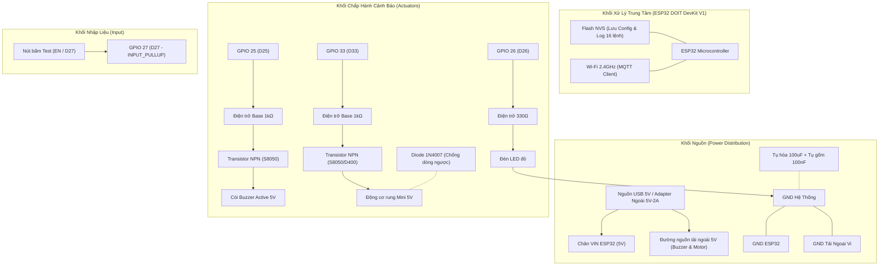

# Hướng dẫn Phần cứng, Sơ đồ Wiring & Hoàn thiện Prototype (W4-TV1-07 & W4-TV1-10)

> Tài liệu bàn giao phần cứng và hướng dẫn lắp ráp cho Node Cảnh báo Tài xế (Driver Alert Node) — Thành viên TV1 (IoT).
> Áp dụng cho phiên bản phần cứng Demo Tuần 4.

---

## 1. Sơ đồ khối phần cứng (Hardware Block Diagram)



---

## 2. Bảng phân bổ chân chi tiết (Pin Map)

| Linh kiện | Chân ESP32 | Chế độ GPIO | Điện áp hoạt động | Mạch đệm & Ghi chú kỹ thuật |
| :--- | :---: | :---: | :---: | :--- |
| **Đèn LED đỏ** | **GPIO 26 (D26)** | `OUTPUT` | 3.3V Logic | Nối tiếp điện trở $330\Omega$ để hạn dòng $< 10\text{ mA}$. |
| **Còi Buzzer** | **GPIO 25 (D25)** | `OUTPUT` | 5V Tải | Loại Active Buzzer. Điều khiển qua Transistor NPN (S8050), cực B có trở $1k\Omega$. Tuyệt đối không ăn nguồn trực tiếp từ GPIO. |
| **Motor Rung** | **GPIO 33 (D33)** | `OUTPUT` | 5V Tải | Động cơ rung mini. Cực Collector nối motor; mắc song song 1 Diode 1N4007 phân cực ngược (Cathode về 5V, Anode về Collector) để triệt tiêu sức điện động cảm ứng. |
| **Nút bấm** | **GPIO 27 (D27)** | `INPUT_PULLUP` | 3.3V Logic | Nút bấm vật lý gắn chân nối đất (GND); chống dội (debounce) bằng phần mềm 30ms. |

---

## 3. Nguyên lý chống sụt áp và ổn định nguồn (W4-TV1-07)

Trong các bài test tải thật với motor rung và còi:
1. **Hiện tượng Brownout Reset:** Động cơ rung khi khởi động có dòng tức thời (Inrush current) có thể vọt lên $200\text{ mA} - 400\text{ mA}$. Nếu kéo nguồn trực tiếp từ đường 3.3V của ESP32, điện áp sụt dưới $2.8\text{V}$, ESP32 sẽ lập tức reset với lỗi `Brownout detector was triggered`.
2. **Biện pháp xử lý vật lý:**
   * Cấp nguồn cho Motor rung và Còi qua chân **`VIN (5V)`** của mạch (hoặc nguồn ngoài 5V riêng biệt).
   * **Bắt buộc chung mass (GND):** Chân GND của nguồn tải và GND của ESP32 phải nối chung.
   * Mắc thêm 1 tụ hóa $100\mu\text{F} / 16\text{V}$ và 1 tụ gốm $100\text{nF}$ song song giữa đường nguồn 5V và GND ngay cạnh motor để bù áp tức thời.
   * Luôn gắn Diode dập xung ngược (Flyback Diode `1N4007`) song song hai đầu cuộn dây motor.

---

## 4. Hướng dẫn dọn dây & cố định linh kiện Prototype (W4-TV1-07)

1. **Bố trí linh kiện trên Breadboard/Mô hình:**
   * Cố định ESP32 chắc chắn ở giữa bo test.
   * Nhóm linh kiện công suất (Transistor, Diode, Motor) đặt về một góc, tách biệt khỏi ăng-ten Wi-Fi của module ESP32 (ít nhất $2\text{ cm}$) để tránh nhiễu sóng cao tần RF.
   * Dùng băng keo 2 mặt hoặc dây rút (zip-tie) cố định motor rung vào đế thử nghiệm (ví dụ mô hình vô lăng hoặc ghế lái), tránh hiện tượng motor rung di chuyển làm lỏng hoặc đứt dây jumper.
2. **Dọn dây (Cable Routing):**
   * Sử dụng dây bẹ nhiều màu chuẩn: Đỏ (+5V), Đen (GND), Vàng/Xanh lá (GPIO tín hiệu).
   * Đi dây sát mặt bo, bó gọn bằng ống co nhiệt hoặc dây thun, không để dây lơ lửng dễ va quẹt trong quá trình cắm rút cổng nạp.

---

## 5. Quy trình đưa vào vận hành (Setup & Operating Guide)

1. **Bước 1:** Kiểm tra đoản mạch bằng đồng hồ vạn năng giữa đường $5\text{V}$, $3.3\text{V}$ và $\text{GND}$ trước khi cắm điện.
2. **Bước 2:** Cắm cáp USB vào máy tính. Mở Serial Monitor với baudrate **`115200`**.
3. **Bước 3:** Quan sát log khởi động an toàn:
   ```text
   [BOOT] reset_reason=1
   [PINS] Actuators initialized to LOW
   [CONFIG] Loaded active config: cfg-baseline-01
   [REQLOG] Restored 0 pending requests
   [WIFI] Connecting to SSID: ...
   [WIFI] Connected; IP = 192.168.2.100
   [MQTT] Connecting to 192.168.2.100:1884... connected
   [MQTT] Subscribe topics OK
   ```
4. **Bước 4:** Thử nhấn nút vật lý D27, Serial Monitor phải in: `[BUTTON] PRESSED` và `[BUTTON] RELEASED`.
