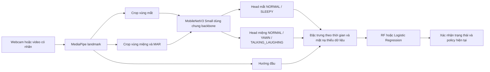

# AI mắt và miệng: ứng viên thử nghiệm

## Phạm vi và giới hạn

Ứng viên mới dùng ảnh vùng mắt, ảnh vùng miệng và diễn biến theo thời gian. Không tự thay RF đã thử camera; không tự bật rule, mở webcam hoặc điều khiển ESP32. Nhận diện khi đeo kính trên webcam RGB chưa được nghiệm thu. Xem [kết quả và giới hạn thực tế](ai-eye-mouth-results.md); không dùng số đo offline thay thử camera.

- `yaw`: hướng quay đầu; code hiện đo yaw/pitch dạng tỷ lệ hình học.
- `MAR`: khoảng mở dọc giữa môi chia cho khoảng cách hai khóe miệng, theo cùng mặt phẳng pixel.
- `YAWN`: ngáp; là kết quả nhận diện hành động, không đồng nghĩa MAR cao hay chắc chắn buồn ngủ.
- Nhãn mắt NTHU `SLEEPY` là biểu hiện mắt buồn ngủ, không phải nhãn đóng/mở mí tại từng thời điểm.

## Dữ liệu và nhãn

Ba ZIP NTHU do người dùng cung cấp chứa 376 bộ nhãn mắt/miệng/đầu/buồn ngủ. Nguồn bản Kaggle cụ thể chưa được người dùng cung cấp; không xác nhận đây là bản đã đối chiếu checksum tác giả. Dữ liệu có thể có video lỗi hoặc số frame không khớp; bộ trích mới chỉ nhận những video qua kiểm tra và ghi riêng các video bị loại.

Theo [nghiên cứu mô tả nhãn NTHU](https://www.csie.ntu.edu.tw/~fuh/personal/DetectionofDriverDrowsinessUsingMulti-TaskLearning.pdf): mắt 0 bình thường / 1 sleepy-eyes; miệng 0 bình thường / 1 ngáp / 2 nói-cười; đầu 0 bình thường / 1 gật / 2 nhìn sang bên; buồn ngủ 0/1. Nhãn được đọc nguyên bản và đối chiếu số frame, không suy ra từ tên video hoặc từ MAR.

`data-plan.json` khóa người cho bốn nhóm trước khi fit: CNN, fusion, validation và historical test. CNN không fit người của nhóm fusion; validation chọn checkpoint và ngưỡng. Nhóm historical test đã được xem trong các lượt nghiên cứu cũ, nên không gọi là test độc lập hoàn toàn mới. Cần người/phiên webcam mới để nghiệm thu cuối. Các cửa sổ chồng lấn không phải thử nghiệm độc lập.

Trong bản dữ liệu hiện có, cả 20 video của nhóm test gốc không khớp số frame/nhãn và bị loại. Có 354 video hợp lệ của 18 người development: CNN 199 video/10 người, fusion 75 video/4 người, validation 80 video/4 người. Có thêm một video development lỗi frame và một video lỗi nhãn phụ. **Chưa có test cuối hợp lệ**; điểm validation và replay trên cùng nhóm validation không thay test độc lập. Pipeline giữ nguyên lỗi để kiểm tra nguồn, không tự kéo giãn nhãn cho khớp video.

## Kiến trúc



Ảnh crop 96×96 được xử lý bằng cùng code khi trích dữ liệu và chạy thật; crop offline được lưu JPEG. Backbone khởi tạo bằng [trọng số MobileNetV3-Small của Torchvision](https://docs.pytorch.org/vision/main/models/generated/torchvision.models.mobilenet_v3_small.html), train hai head rồi fine-tune các block cuối và thử toàn bộ backbone. Validation giữ checkpoint tốt nhất. Crop có ảnh hoặc điểm mô hình cao chưa chứng minh mắt quan sát được qua kính; cổng crop chỉ loại số đo suy biến/ảnh trống. Kính râm không được dùng để giám sát nhãn mắt. Runtime chưa tự nhận biết kính râm, nên chưa hỗ trợ nghiệm thu điều kiện này.

Fusion dùng cửa sổ tối đa 5 giây, tối thiểu 2 giây lịch sử và kiểm tra khoảng quan sát. Mỗi kênh có độ phủ riêng; thiếu mắt không làm mất miệng. Điểm điền 0 cho đặc trưng thiếu luôn đi cùng mặt nạ coverage. Đây không phải giả định mắt mở/miệng đóng. Model âm tính với chỉ tín hiệu miệng chưa đủ kết luận ATTENTIVE; hướng đầu hợp lệ vẫn có thể xác nhận DISTRACTED. Các điểm mô hình chưa được hiệu chuẩn thành xác suất thực tế.

## Huấn luyện tái hiện

Môi trường nền theo `edge-ai/requirements-lock.txt`; dependency bổ sung theo `requirements-multisignal.txt`. Với GPU tương thích CUDA 12.6, cài từ kho PyTorch chính thức, giữ constraints nền. Nên đặt cache ở ổ có đủ dung lượng; không cập nhật NumPy/sklearn của RF cũ.

Từ thư mục `edge-ai`:

```powershell
./.venv/Scripts/python.exe -m pip install -r requirements-multisignal.txt -c requirements-lock.txt --index-url https://download.pytorch.org/whl/cu126
./.venv/Scripts/python.exe -m ml.multisignal_data --output-dir ml-runs/multisignal-20261110 --workers 3
$env:OPENBLAS_NUM_THREADS = '1'
$env:OMP_NUM_THREADS = '2'
./.venv/Scripts/python.exe -m ml.multisignal_train --data-dir ml-runs/multisignal-20261110 --batch-size 128 --head-epochs 1 --finetune-epochs 0 --regions-only
Copy-Item ml-runs/multisignal-20261110/candidate/regions.pt ml-runs/multisignal-20261110/stage-head.pt
./.venv/Scripts/python.exe -m ml.multisignal_train --data-dir ml-runs/multisignal-20261110 --batch-size 128 --initial-regions ml-runs/multisignal-20261110/stage-head.pt --head-epochs 0 --finetune-epochs 3 --regions-only
Copy-Item ml-runs/multisignal-20261110/candidate/regions.pt ml-runs/multisignal-20261110/stage-late.pt
./.venv/Scripts/python.exe -m ml.multisignal_train --data-dir ml-runs/multisignal-20261110 --batch-size 128 --initial-regions ml-runs/multisignal-20261110/stage-late.pt --head-epochs 0 --finetune-epochs 6 --unfreeze-blocks 13 --finetune-lr 0.0001
./.venv/Scripts/python.exe -m ml.multisignal_evaluate --data-dir ml-runs/multisignal-20261110
./.venv/Scripts/python.exe -m ml.multisignal_benchmark --data-dir ml-runs/multisignal-20261110 --device cpu
```

Máy chỉ dùng CPU có thể cài dependency từ `https://download.pytorch.org/whl/cpu`. Batch 128 là cấu hình đã đo trên MX550 của laptop này; máy ít bộ nhớ cần giảm batch. Recipe trên mô tả các giai đoạn đã thử; seed được khóa nhưng kernel CUDA có thể không tái tạo đúng từng bit. Bàn giao dùng checksum của artifact đã chốt, không coi mọi lượt train lại là cùng phiên bản.

Mọi ảnh crop, nhãn, log, checkpoint và model ở `ml-runs/`, được Git ignore. Không chia sẻ file mặt qua repository. `samples.json` lưu nguồn, checksum và kiểm tra decode đầy đủ; chạy lại dùng cache phù hợp. Không ép các video bị loại vào train bằng cách cắt nhãn hoặc sửa FPS tùy ý.

Artifact gồm `manifest.json`, `regions.pt`, `fusion.joblib`. Runtime kiểm tra checksum, phiên bản hình học, thư viện và tên/thứ tự đặc trưng. Chỉ nạp artifact do nhóm huấn luyện hoặc bàn giao đáng tin cậy; joblib có thể chạy code khi nạp. Manifest đánh dấu `EXPERIMENTAL_OFFLINE_ONLY`, chưa nghiệm thu kính/camera hoặc tải thật.

Máy khác cần nhận bundle riêng, giải nén ba file trên vào cùng một thư mục và dùng `./edge-ai/run-multisignal.ps1 -BundlePath 'DUONG_DAN_THU_MUC_BUNDLE' -Check`. Git không chứa checkpoint hoặc các phiên hiệu chuẩn cá nhân.

## Chạy ứng viên

Từ gốc repo:

```powershell
./edge-ai/run-multisignal.ps1 -Check
./edge-ai/run-multisignal.ps1
```

`-Check` không mở camera, không kết nối MQTT/HTTP, không phát âm hoặc sửa hàng đợi. Lệnh còn lại mở webcam, loa, ghi clip và gửi theo cấu hình Edge hiện có; Q để thoát. Launcher đổi biến môi trường trong tiến trình rồi khôi phục khi kết thúc; không sửa `.env`. Có thể chọn `-Device cuda` nếu đã kiểm tra GPU; mặc định CPU.

## Hợp đồng với Backend, FE và ESP32

Telemetry giữ nguyên `ear`, `perclos`, `head_pose`, `driver_state`, `model_version`; bổ sung `ai_signals` tùy chọn phiên bản `eye-mouth-v1`. Bản cũ không có trường này vẫn được chấp nhận. Dữ liệu mới gồm MAR, điểm ngáp/mắt, trạng thái mắt/miệng và cờ kênh khả dụng. Thiếu kênh giữ UNKNOWN/null. Backend lưu JSON riêng, trả qua snapshot/history và WebSocket; FE chỉ hiển thị số đo, không tính lại driver_state.

Migration `database/migration_ai_signals.sql` chỉ thêm cột JSON nullable. Compose migrate và script setup đã có migration; triển khai vào DB có sẵn phải áp dụng trước khi khởi động Backend mới. Không đổi thiết bị, assignment, binding hoặc dữ liệu cũ.

Sự kiện điều khiển vẫn dùng `driver-bench-20261107-v1`, session, episode, sequence, observed_at và model_version. Không thêm trạng thái điều khiển YAWN. Policy 3/6/10 giây, TTL, backfill, UNKNOWN, SESSION_ENDED và điều kiện binding giữ nguyên. ESP32 vẫn nhận LED_ON/BUZZER_ON/MOTOR_ON và phản hồi ACK theo giao thức cũ. Không giữ DROWSY thêm thời gian chỉ để đạt ngưỡng tải.

## Fine-tune tiếp theo và nghiệm thu

Để tải nhãn YawDD+ và đúng clip mẫu đã kiểm tra, từ gốc repo:

```powershell
./edge-ai/ml/fetch-yawdd.ps1
cd edge-ai
./.venv/Scripts/python.exe -m ml.yawdd_diagnostic --bundle ml-runs/multisignal-20261110/candidate
```

Script dùng commit và SHA-256 cố định, giữ kiểm tra TLS, không tải/chạy model của tác giả. Chỉ có archive nhãn và một clip công khai, không phải toàn bộ video YawDD. Dữ liệu dành cho nghiên cứu phi thương mại. Clip này chỉ kiểm tra nhánh miệng; không dùng lại để fine-tune rồi tiếp tục gọi nó là test chưa nhìn thấy.

Thu các phiên RGB riêng có kính/không kính: nhìn thẳng, chớp tự nhiên, nhắm mô phỏng, ngáp, nói/cười, quay đầu, phản sáng và che mắt/miệng. Phân chia người/phiên trước khi chọn ngưỡng; lượt dùng để fine-tune không được dùng làm test cuối. Nhãn mở/nhắm mắt cần ghi riêng nếu muốn huấn luyện bài toán đó.

Báo cáo riêng macro F1/confusion matrix mắt và miệng; theo điều kiện kính/ánh sáng; tỷ lệ loại mẫu/UNKNOWN; false alarm theo giờ, bỏ sót, delay và FPS/CPU/RAM. Đánh giá toàn video phải giữ các khoảng không quan sát được, không chỉ báo điểm của các cửa sổ dễ đã được chấp nhận. YawDD+ có thể bổ sung cho ngáp sau khi kiểm tra nhãn và giấy phép; MRL là ảnh IR nên không chứng minh hỗ trợ webcam RGB. Không tự train hoặc đổi model trong lúc demo/đang giám sát.
