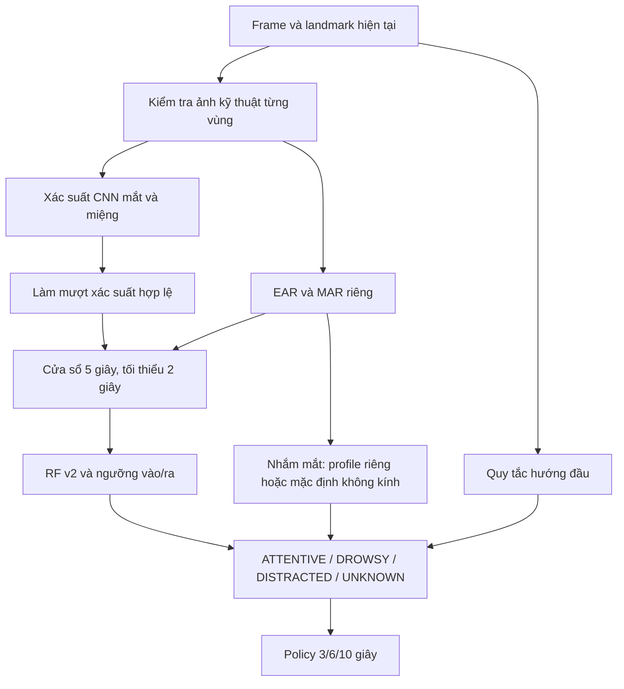

# AI v2: chất lượng ảnh, nhắm mắt có hiệu chuẩn và RF theo thời gian

## Bản chạy hiện tại

Lệnh demo: `./edge-ai/run-multisignal-v2.ps1 -Demo`. Launcher dùng bundle v2, profile kính v5 đã kiểm tra trên laptop hiện tại và [quy tắc cúi đầu kéo dài](head-motion-v1.md). Nhìn thẳng 5 giây đầu để lấy mốc. Không cần hiệu chuẩn cúi hoặc nhánh CEW; các nhánh thử không đạt đã được gỡ khỏi runtime.

Nhánh đếm chu kỳ gật vẫn ghi số đo `head_motion` để quan sát. Nhánh `head_down_policy` riêng mới quyết định cúi ≥12° trong 3 giây thành DROWSY, kể cả mắt mở; chủ động nhìn xuống cũng có thể kích hoạt. Schema lịch sử Backend/Frontend còn đọc các trường thử nghiệm cũ để không làm hỏng dữ liệu đã lưu.

V2 giữ CNN đã huấn luyện và fit lại RF với feature/chất lượng v2. Phần dưới giữ kết quả phát triển đã thu và giới hạn đánh giá; các số này không thay thế nghiệm thu quy tắc tư thế trên camera/tải thật.

## Luồng xử lý



- Xác suất CNN không bị xóa vì confidence dưới 0,6. Trạng thái lớp mắt/miệng vẫn có thể `UNKNOWN`, dù số đo và điểm mềm còn được dùng. Confidence phân loại và tính khả dụng của ảnh là hai thông tin riêng.
- EAR kiểm tra riêng, không phụ thuộc confidence CNN. Cổng ảnh chỉ kiểm tra crop, chi tiết ảnh, tương phản và mức bão hòa; **chưa chứng minh quan sát được mắt qua kính phản sáng/che khuất**. Kính râm chưa được nghiệm thu.
- Đặc trưng v2 gồm 9 kênh × mean/std/p90/coverage = 36 giá trị, thêm confidence riêng. Dùng EMA nhân quả 0,4 giây cho ba xác suất; thiếu kênh thì ngắt ngay lịch sử làm mượt của kênh đó. Không làm mượt EAR của nhánh nhắm mắt.
- CNN chạy tối đa 5 Hz; tuổi của kết quả được gửi bằng `sample_age_ms`, dưới 200 ms. Mỗi frame vẫn kiểm tra ảnh và EAR hiện tại; crop hỏng xóa ngay xác suất cache. Không thêm khoảng đệm để kéo dài trạng thái qua mất mặt.
- Mất mặt hoặc gap >0,5 giây ngắt cửa sổ, hysteresis và nhánh nhắm mắt; trả `UNKNOWN`. Policy không cộng khoảng thiếu quan sát vào thời gian nguy cơ.

## Hiệu chuẩn riêng

Từ gốc repo, trên đúng camera/người/điều kiện kính:

```powershell
./edge-ai/.venv/Scripts/python.exe -X utf8 edge-ai/calibrate_eye_guard.py --v2 --profile-id operator-01-webcam-0 --condition glasses
```

Bấm lần lượt 1 mở/nhìn thẳng 8 giây, 2 nhắm 8 giây, 3 mở/nhìn thẳng và nói bình thường 30 giây, 4 nhắm 8 giây. Mỗi lượt chuẩn bị 2 giây. Công cụ chỉ lưu CSV và JSON, không lưu ảnh/video hoặc mở MQTT.

Profile `eye-guard-calibration-v5` khóa mã node, nhãn người/setup do người dùng khai báo, camera index, độ phân giải, điều kiện kính, phiên bản hình học và cách fit. Không tự nhận diện người hoặc tự biết camera đã được thay. Người vận hành phải chọn đúng profile và vị trí ngồi.

Chỉ hai lượt FIT quyết định ngưỡng: lấy trung điểm giữa trung vị mở và trung vị nhắm, để chừa khoảng cho dao động ở cả hai phía. Đuôi phân bố nhắm vẫn phải tách được khỏi mức mở điển hình. Sau đó kiểm tra guard trên cả FIT và hai lượt validation: mở/chớp/nói không được kích hoạt nhắm kéo dài; các lượt nhắm phải quan sát được ít nhất 90% thời gian hợp lệ. Ngưỡng còn phải cách mức mở lặp lại một khoảng tối thiểu. Tiêu chí thời gian cho phép chớp ngắn thay vì loại mọi profile có các mẫu mở thấp. Báo cáo cũ bị từ chối hoặc phiên thử bị lỗi giữ nguyên; loader chỉ nhận v5 đúng phương pháp mới.

V4 trước đó lấy p90 nhắm cộng 10% khoảng tới trung vị mở. Phiên kính mới có mở khoảng 0,302 và nhắm khoảng 0,199; ngưỡng v4 0,222 khiến lượt nhắm lặp lại chỉ có 88,6% thời gian hợp lệ nằm dưới ngưỡng và phải chờ 3,86 giây mới kích hoạt. Người dùng xác nhận nhắm kín tới bíp cả hai lượt. V5 tính ngưỡng 0,250 chỉ từ hai lượt FIT. Trên chính số đo này, hai lượt nhắm có guard kích hoạt lần đầu khoảng 1,01 và 1,07 giây; mở/nói không kích hoạt nhầm. **Thiết kế phương pháp đã tham khảo lỗi trên bộ số đo này, nên đây là kết quả phát triển, chưa phải đánh giá độc lập.** Không hạ điều kiện 90% hoặc sửa trạng thái của report bị từ chối.

Công cụ `reanalyze_eye_calibration.py` tạo thư mục profile mới từ CSV đã có, giữ hash nguồn, định dạng cũ và trạng thái cũ; đánh dấu `DEVELOPMENT_REANALYSIS_FRESH_TRIAL_REQUIRED`. Công cụ từ chối dữ liệu đổi hình học và không cho chuyển đổi để né một review thử mới đã `FAILED`. Profile thử kính mới nằm riêng tại `edge-ai/ml-runs/eye-calibration/20261110T113633Z-c1a71e6e-v5/report.json`; cần thử phiên camera mới với đúng kính/setup. Trọng số CNN/RF, ngưỡng RF và nhánh mặc định không kính không đổi.

Phiên camera mới `20261110T114556Z-glasses` đã hoàn tất bốn lượt với profile này, runtime `eye-mouth-v2-guard-2450ae55e409707a`. Đã xem log và ảnh mẫu mở/nhắm/nói; trạng thái ứng viên và trạng thái xác nhận khớp nhau trong toàn bộ khoảng MEASURING đã ghi:

| Lượt | Thời gian quan sát | Trạng thái xác nhận |
|---|---:|---|
| Mở mắt/chớp tự nhiên | 24,96 giây | ATTENTIVE |
| Nhắm mắt | 8,03 giây | DROWSY, lý do EYE_CLOSURE_RISK |
| Mở lại | 15,02 giây | ATTENTIVE |
| Nói bình thường | 11,99 giây | ATTENTIVE |

Không có gap >0,5 giây trong các khoảng đo. Policy tạo các sự kiện cảnh báo mức 1/2/3 cục bộ; không phát MQTT/HTTP hoặc điều khiển tải. Nhắm có thể bắt đầu trong PREP nên không suy ra độ trễ từ đầu MEASURING. `fresh-trial-review.json` cạnh profile ghi `PASSED` với hash report và phạm vi **một phiên thử mắt ở cùng người/kính/camera/setup**. Đây chưa phải đánh giá người/kính khác hoặc nghiệm thu ngáp/quay đầu/mất mặt và toàn luồng thiết bị. Số đếm frame không phải Accuracy/F1.

Phiên đầy đủ tiếp theo `20261110T115214Z-glasses` hoàn tất cả chín lượt với cùng profile v5. Đã đối chiếu log và ảnh mẫu; người dùng xác nhận lượt 5 là ngáp tự nhiên:

| Tình huống | Kết quả trong khoảng MEASURING |
|---|---|
| Mở mắt/chớp tự nhiên 60,02 giây | ATTENTIVE, không DROWSY/UNKNOWN |
| Nhắm 8,01 giây | 1,04 giây đầu ứng viên ATTENTIVE; sau đó DROWSY; trạng thái xác nhận DROWSY khoảng 6,45 giây |
| Mở lại 14,94 giây | ATTENTIVE |
| Nói 12,01 giây | ATTENTIVE, không báo nhầm DROWSY |
| Ngáp tự nhiên 11,99 giây | DROWSY; lý do RF_POSITIVE khoảng 11,55 giây, EAR khoảng 0,45 giây; crop miệng hợp lệ ở toàn bộ 282 mẫu đo |
| Quay hai bên, khoảng 10 giây mỗi bên | DISTRACTED |
| Che camera 6,01 giây | UNKNOWN, không còn EAR/xác suất/fusion cũ |
| Bỏ che, nhìn thẳng 15,02 giây | 0,16 giây đầu còn UNKNOWN, sau đó ATTENTIVE |

Ở lượt nhắm này, ứng viên DROWSY đầu tiên xuất hiện tại giây 1,057 của phần đo; policy xác nhận tại giây 1,577. Đây là thời gian theo lượt được hướng dẫn, không phải độ trễ đo từ nhãn đóng mí độc lập. Không có gap >0,5 giây trong các khoảng đo. Review `full-trial-review.json` ghi PASSED với phạm vi **một phiên camera đủ chín tình huống ở setup hiện tại**, đồng thời được gắn vào review profile. MQTT/HTTP/tải vật lý vẫn tắt; còn nghiệm thu toàn luồng web/Backend/upload/ESP32. Không suy ra độ chính xác trên người, kính hoặc ánh sáng khác.

### Lỗi nhịp nhắc IoT phát hiện trong lượt chạy thật

Log ngày 10/11 theo giờ Việt Nam cho thấy AI phát các sự kiện mức 3 khoảng 20:00:12, 17, 22, 27, 33, 38. Backend chỉ đưa các đợt 12/22/33 vào hàng đợi; các đợt xen kẽ bị `REPEAT_TOO_EARLY`. Thời điểm MQTT publish muộn hơn thời điểm tạo sự kiện vài trăm mili giây khiến bộ giới hạn 5 giây thứ hai loại cả đợt nhắc; thiết bị có thể chỉ nhận khoảng 10 giây/lần. Còi máy tính phát theo sự kiện AI nên nghe dày hơn. Các lệnh 62–64 có ACK COMPLETED; lệnh 60–61 bị COMMAND_EXPIRED. Đây là bằng chứng giao nhận từng lệnh, chưa phải nghiệm thu tải vật lý toàn phiên.

Bản sửa Backend giữ đợt nhắc mới còn hợp lệ trong hàng đợi khi chỉ sớm tối đa 1 giây do lệch lịch gửi, gắn `policy_guard.not_before` để dispatcher đợi đủ khoảng cách 5 giây từ lần publish trước. Lệnh quá sớm, quá hạn, mất phiên/nguy cơ, đổi binding hoặc thiết bị offline vẫn bị chặn. Thời hạn gốc không được gia hạn. Hàng đợi được kiểm tra mỗi 0,2 giây thay cho 1 giây để giảm phần thời gian chờ trong cửa sổ freshness 2 giây. Các mốc 3/6/10 giây, thời lượng 1/2/3 giây và giao thức ESP32 giữ nguyên.

Ba kiểm thử SQL mới kiểm tra chuỗi nhắc 5 giây có publish trễ 0,4 giây, hủy đợt đang đợi khi nguy cơ ngừng, và không gửi đợt quá hạn hoặc nhận dồn đợt quá sớm. Backend có 89 bài đạt/67 bài skip; hồi quy PostgreSQL/MQTT tạm cũng đạt. Đã build và thay container Backend, API trả 200, xác minh code mới cùng chu kỳ 0,2 giây trong container. Chưa đo lại nhịp thật sau triển khai vì Vision Node đã offline khi kiểm tra.

Lệnh COMMAND_EXPIRED cần kiểm tra tiếp sau bản sửa. Giờ PostgreSQL và Windows khi đo lệch khoảng 1,9 ms. UDP 123 trên Windows đang có tiến trình svchost giữ và probe NTP localhost timeout; thử xuất cổng dịch vụ NTP Docker gặp xung đột, sau đó đã khôi phục container về trạng thái chạy nội bộ như trước. Không đổi giờ máy tính, firewall hoặc dừng tiến trình giữ cổng. Không suy ra giờ ESP32 đã đồng bộ chỉ từ heartbeat ONLINE.

Để nghe riêng IoT trong lần thử tiếp theo, đặt `$env:AI_LOCAL_ALERT_ENABLED = 'false'` trong terminal trước khi chạy launcher có `-Demo` và profile kính v5. Biến này áp dụng cho tiến trình mới; không tắt còi ESP32 hoặc tự thay `.env`. Gỡ biến bằng `Remove-Item Env:AI_LOCAL_ALERT_ENABLED` khi muốn quay về cấu hình âm thanh ban đầu. Khi mất quan sát UNKNOWN, âm thanh lỗi giám sát cục bộ và cảnh báo tải IoT có hành vi khác nhau; không giữ DROWSY cũ qua mất quan sát để tạo thêm lệnh.

```powershell
./edge-ai/run-multisignal-v2.ps1 -EyeTrial -Condition glasses -CalibrationPath 'edge-ai/ml-runs/eye-calibration/20261110T113633Z-c1a71e6e-v5/report.json' -ProfileId operator-01-webcam-0
```

Mốc đầu lấy bằng trung vị yaw/pitch trong lượt FIT nhìn thẳng, yêu cầu đủ số đo và tư thế ổn định. Main và công cụ thử dùng mốc này thay vì lấy trung bình lúc cửa sổ camera đang chờ. Profile được gửi dưới dạng mã hash trong telemetry, không gửi tên người/setup.

`READY_FOR_TRIAL` chỉ cho phép thử phiên mới, chưa phải nghiệm thu. Với `glasses` hoặc chưa khai báo điều kiện, nhánh nhắm mắt cần profile phù hợp. Với `no-glasses` được khai báo rõ và chưa có profile, runtime khôi phục quy tắc demo cũ: EAR <0,20 liên tục ≥1 giây bổ sung nguy cơ; mở liên tục ≥1 giây xóa tín hiệu. Đây là ngưỡng mặc định chưa hiệu chuẩn cá nhân, cần kiểm tra trên phiên mới. Profile hợp lệ được ưu tiên khi cung cấp. Tư thế không phù hợp, ảnh mắt không hợp lệ, mất mặt hoặc gap ngắt guard. PERCLOS trên luồng demo dùng ngưỡng của guard đang hoạt động.

Nếu một lượt thử mới đã được người thao tác xác nhận và rà soát là thất bại, lưu `fresh-trial-review.json` cạnh report gốc, gồm `format=eye-guard-trial-review-v1`, hash SHA256 của report và `status=FAILED`. Loader từ chối profile đó; report hiệu chuẩn gốc được giữ nguyên. Review sai hash hoặc sai định dạng cũng bị từ chối. Review không thay thế việc nghiệm thu và không tự bật guard.

## Chạy thử và chạy demo

```powershell
# Bản tích hợp: camera, loa, upload, MQTT và ESP32 theo binding.
./edge-ai/run-multisignal-v2.ps1 -Demo

# Cùng cấu hình; không mở camera hoặc mạng.
./edge-ai/run-multisignal-v2.ps1 -Demo -Check
```

`-EyeTrial` / `-HeadTrial` chạy riêng với clip/log cục bộ, không gửi MQTT/HTTP/tải. Điều kiện kính mặc định tự chọn cùng profile đã kiểm tra trên laptop. `-Condition no-glasses` dùng nhánh EAR mặc định 0,20/1 giây khi không có profile riêng. Không cần chạy lại hiệu chuẩn trước mỗi lượt; chỉ thực hiện [hiệu chuẩn nhìn thẳng](eye-guard-calibration.md) khi đổi setup.

`-BundlePath`, `-CalibrationPath`, `-ProfileId` và `-Camera` nhận giá trị thực trên máy khác. Không dùng các đường dẫn mẫu chưa tồn tại. Launcher đặt biến cho tiến trình rồi khôi phục khi thoát.

Guard kính dùng profile v5; guard không kính mặc định là quy tắc demo chưa hiệu chuẩn cá nhân. `CLOSING` tích lũy nhắm, `CLOSED_RISK/EYE_CLOSURE_RISK` tham gia DROWSY. Policy xác nhận thêm 0,5 giây, rồi tính các mức 3/6/10 giây. Mở lại cần 1 giây xóa guard và 2 giây ATTENTIVE ổn định nếu không còn tín hiệu nguy cơ. Model version băm riêng model, profile và quy tắc để không gộp các runtime khác nhau.

### Kiểm tra hồi quy quy tắc không kính

Đã chạy lại nhánh guard và policy trên số đo đã lưu của phiên không kính `20261110T101458Z-no-glasses-eye-comparison`, dùng nguyên ngưỡng cũ 0,20/1 giây. Trong 8,04 giây đo nhắm, trạng thái ứng viên là `DROWSY`; mở tự nhiên, mở hồi phục và nói không phát sinh `DROWSY` trong các khoảng đo tương ứng. Nguy cơ có thể bắt đầu trong thời gian PREP, nên kết quả không đo độ trễ từ thời điểm bắt đầu nhắm. Đây là replay của số đo/crop/head/RF đã lưu, chưa chạy lại inference và chưa thay thế phiên camera mới. Báo cáo riêng trong `.local-backups/ai-v2-20261110/no-glasses-ear-restoration-replay.json`.

Đã kiểm tra thêm bằng replay toàn bộ nhận diện: đọc video gốc, tính lại landmark/EAR, CNN, RF và policy cho hai runtime dùng cùng bundle. Bản RF-only giữ `ATTENTIVE` trong 8,04 giây nhắm; bản có guard chuyển toàn bộ khoảng này thành `DROWSY`. Các khoảng mở tự nhiên 24,86 giây, mở hồi phục 15,01 giây và nói 11,75 giây được lấy mẫu đều `ATTENTIVE`; lượt nói không có mẫu DONE ở nhịp replay nên vẫn được đánh dấu chưa hoàn tất. Đây là video đã xem, không phải nghiệm thu mới. Báo cáo ở `.local-backups/ai-v2-20261110/no-glasses-ear-full-replay/comparison.json`. Đã kiểm tra 521 payload của runtime mới qua schema Backend; bộ kiểm thử Edge có 156 bài đạt.

Lệnh tái hiện, dùng tên output chưa tồn tại:

```powershell
./edge-ai/.venv/Scripts/python.exe -X utf8 edge-ai/replay_eye_guard_trial.py --trial edge-ai/ml-runs/live-diagnostics/20261110T101458Z-no-glasses-eye-comparison --output .local-backups/ai-v2-20261110/ear-restoration-review-new.json
```

Phiên nghiệm thu có lượt mở mắt/chớp 60 giây rồi nhắm, mở lại, nói, ngáp, quay hai bên, che camera và hồi phục. Bấm 1–9 theo hướng dẫn, cuối lượt 9 tự đóng; Q dừng sớm. Không gộp lượt bị dừng hoặc lặp lại thành một lượt đạt. Clip/log chứa mặt ở `ml-runs/`, Git ignore.

## Dữ liệu và tái hiện

Giữ nguyên CNN và split người của NTHU đã khóa: RF fit 75 video/4 người, validation 80 video/4 người. Người fit CNN tách khỏi RF. Tái dùng xác suất CNN gắn đúng checksum và đọc crop riêng để tính chất lượng kỹ thuật; không dùng phiên camera cá nhân làm dữ liệu train. Các video test gốc lỗi nhãn/frame vẫn bị loại; **chưa có test cuối độc lập hợp lệ**.

Từ `edge-ai/`:

```powershell
./.venv/Scripts/python.exe -X utf8 -m ml.multisignal_v2_train --source ml-runs/multisignal-20261110 --output ml-runs/multisignal-v2-20261110
./.venv/Scripts/python.exe -X utf8 -m ml.multisignal_v2_select --data-dir ml-runs/multisignal-v2-20261110 --output ml-runs/multisignal-v2-20261110/selected --max-false-per-hour 5.12
./.venv/Scripts/python.exe -X utf8 -m ml.multisignal_evaluate --data-dir ml-runs/multisignal-v2-20261110 --bundle ml-runs/multisignal-v2-20261110/selected
```

Không chạy đè bundle đã có manifest: dùng thư mục output mới. Train tạo RF 200 cây, depth 8. Lượt chọn ngưỡng đầu theo điểm cửa sổ làm tăng cảnh báo nhầm; pipeline tiếp theo xét 18 cặp ngưỡng vào/ra trên toàn video validation, với ngân sách cảnh báo nhầm định trước 5,12 đợt/giờ âm tính. Chọn và đóng băng artifact trước phiên webcam v2. Đây vẫn là chọn tham số trên validation đã được dùng nhiều lần, không phải điểm test độc lập.

### Kết quả replay validation đã đo

| Chỉ số | V1 | V2 đã chọn |
|---|---:|---:|
| Thời gian `UNKNOWN` | 36,42% | 29,27% |
| Đoạn dương dài được phát cảnh báo | 61/82 | 63/82 |
| Đợt cảnh báo nhầm | 4 | 4 |
| Cảnh báo nhầm / giờ âm tính | 5,11 | 5,11 |
| Tỷ lệ thời gian dương nhận DROWSY | 54,22% | 44,07% |
| Độ trễ cảnh báo trung vị | 5,05 giây | 6,00 giây |
| Độ trễ cảnh báo p95 | 25,66 giây | 38,90 giây |

V2 giảm thiếu kết luận và bắt được thêm hai đoạn dài, nhưng độ phủ DROWSY và độ trễ xấu hơn ở replay này. **Chưa đủ căn cứ thay v1 làm mặc định hoặc tuyên bố v2 tốt hơn toàn diện.** Replay dataset không bật guard cá nhân vì không có nhãn đóng/mở/profile phù hợp cho các video đó. Hiệu quả guard đeo kính phải được đánh giá riêng trên phiên mới.

Artifact thử hiện tại: `eye-mouth-v2-d2cdce081cdfb4c9`, ngưỡng RF vào 0,85, ra 0,75. Chỉ nạp bundle do nhóm tự huấn luyện/bàn giao tin cậy; runtime kiểm tra hash, phiên bản thư viện, đặc trưng, chất lượng và policy. Không đưa trọng số, dữ liệu mặt hoặc profile cá nhân lên Git.

### Thử camera đeo kính ngày 10/11/2026

Các số dưới đây mô tả từng lượt có hướng dẫn, chưa phải accuracy hay test độc lập. Các clip đã được xem để chẩn đoán; không dùng làm dữ liệu train RF hoặc chọn ngưỡng RF.

- Lượt đầy đủ với profile v4: mở/chớp tự nhiên 60 giây và nói 12 giây đều `ATTENTIVE`; nhắm có `DROWSY`, mở lại hồi phục; quay trái/phải có `DISTRACTED`, che camera có `UNKNOWN`, bỏ che hồi phục. Tuy nhiên, ngáp chưa ổn vì thường mất crop miệng.
- Lượt riêng nói/ngáp sau khi chỉnh vị trí: nói bình thường vẫn bị xác nhận `DROWSY` khoảng **8,76/12 giây**, lý do nhánh EAR. Người thử xác nhận mắt mở và ngáp tự nhiên. EAR trung vị lúc nói khoảng 0,275, sát ngưỡng profile 0,272; dữ liệu hiện có chưa xác định riêng được ảnh hưởng của kính, ánh sáng, vị trí và landmark.
- Trong lượt ngáp riêng, có tín hiệu phân loại `YAWN` ở phần crop hợp lệ; **98/266 frame** mất crop vì phần ảnh cần lấy vượt khung. Đây là tỷ lệ frame trong lượt đã xem, không phải tỷ lệ lỗi trên quần thể. Có `DROWSY` không chứng minh mọi thời điểm đó đều nhận được ngáp.
- Profile v4 này đã được ghi review `FAILED` và bị loader chặn. **Chưa nghiệm thu nhánh nhắm mắt đeo kính; chưa chạy thử tải thật bằng v2.** Không dùng lại profile chỉ vì report hiệu chuẩn ban đầu có `READY_FOR_TRIAL`.

Đã thử thêm một ứng viên nhận diện mắt mở/nhắm riêng trên hai clip cũ để chẩn đoán. [Open Model Zoo open-closed-eye-0001](https://docs.openvino.ai/2023.3/omz_models_model_open_closed_eye_0001.html) là model hai lớp, huấn luyện trên MRL; [nguồn dữ liệu MRL](https://mrl.cs.vsb.cz/eyedataset.html) mô tả ảnh hồng ngoại. Probe này không tách được lượt nhắm khỏi lượt mở của webcam hiện tại, nên không được nối vào runtime. Kết quả debug không đủ để kết luận về toàn bộ model hoặc dataset.

Bước tiếp theo cho mắt là dữ liệu có nhãn **mở/nhắm** phù hợp camera RGB và kính, kiểm tra riêng từng mắt/che khuất, rồi fit hoặc fine-tune nhánh đó. Các phiên huấn luyện, chọn tham số và nghiệm thu phải tách nhau. Cần thử thay đổi vị trí ngồi và ánh sáng, thay vì chỉ hạ ngưỡng EAR trên cùng clip. Chỉ nối lại tải thật sau lượt camera mới đạt cả mở/nói và nhắm.

Đã thử điều chỉnh đầu phân loại logistic trên embedding CNN cố định bằng lượt quay đầu tiên, tách các lượt quay sau khỏi fit. Ứng viên học được lượt nhắm ở dữ liệu fit nhưng bỏ sót lượt nhắm ở lượt quay sau và nhầm một hướng quay đầu. Đây là bằng chứng ứng viên chưa tổng quát được qua phiên, nên cũng không được tích hợp. Chỉ thay đầu phân loại bằng số clip hiện có chưa giải quyết lỗi kính/quan sát. Dữ liệu và artifact cá nhân này chỉ lưu trong vùng Git ignore.

### Các nhánh thử đã loại khỏi bản chạy

Bốn ứng viên CEW và thử nghiệm kết hợp mắt theo tư thế cúi chưa đạt các lượt kính nên đã được gỡ cùng lệnh probe/hiệu chuẩn tương ứng. Bản nguồn trước khi dọn được lưu riêng cục bộ; dữ liệu và artifact nghiên cứu không đưa lên Git. CNN mắt/miệng và RF v2 đã chọn không dùng các ứng viên này.

CEW đã được dùng nghiên cứu theo điều kiện tác giả, không dùng để fit trên các phiên camera cá nhân. Kết quả validation trên ảnh tĩnh không chứng minh hiệu quả qua kính trên webcam. Hướng phát triển sau là dữ liệu RGB có nhãn mở/nhắm ở nhiều người/setup và phiên nghiệm thu riêng; không hạ cổng chất lượng hoặc ép profile bị từ chối thành đạt.

Benchmark CPU trên hai đoạn NTHU 20 giây, lấy mẫu 5 Hz: pipeline trung bình khoảng 20–22 ms/mẫu, p95 khoảng 33–42 ms/mẫu. Phép đo gồm landmark, CNN, hình học, fusion và policy; không gồm thời gian chờ realtime, mạng, dựng UI, encode video hoặc audio. Đây không phải FPS toàn ứng dụng khi demo.

## Backend, giao diện và ESP32

`ai_signals` nhận đồng thời `eye-mouth-v1` và `eye-mouth-v2`, phân biệt theo `schema_version`. V2 thêm chất lượng từng vùng, confidence, EAR khả dụng độc lập, lý do quyết định, tuổi mẫu, mã hash profile và trạng thái guard. Pydantic từ chối trường lạ, số vô hạn, trạng thái mâu thuẫn hoặc cache quá cũ. JSON lưu ở cột đã có; không cần migration mới.

Snapshot/history/WebSocket giữ metadata; giao diện giải thích lý do thiếu quan sát, phân vân lớp và guard. FE không tính lại trạng thái từ EAR/MAR. Mất mặt xóa các số đo hiện tại; số đo cũ được đánh dấu cũ.

V2 có thêm `eye_crop_reason` và `mouth_crop_reason` tùy chọn. Khi crop miệng là `OUTSIDE_FRAME`, giao diện nhắc lùi lại/chỉnh camera để thấy trọn miệng và cằm. Không nới hoặc cắt lại crop riêng ở runtime để ép model nhận ảnh khác cách huấn luyện. Backend kiểm tra reason không được mâu thuẫn với chất lượng ảnh hợp lệ.

Policy, session/episode/sequence, TTL, backfill, ACK và lệnh LED/còi/motor giữ giao thức hiện có. Dữ liệu chất lượng không trở thành lệnh thiết bị. Cần kiểm tra tải thật sau khi phiên camera đạt; kiểm thử phần mềm không chứng minh motor/LED/còi đã chạy đúng.
