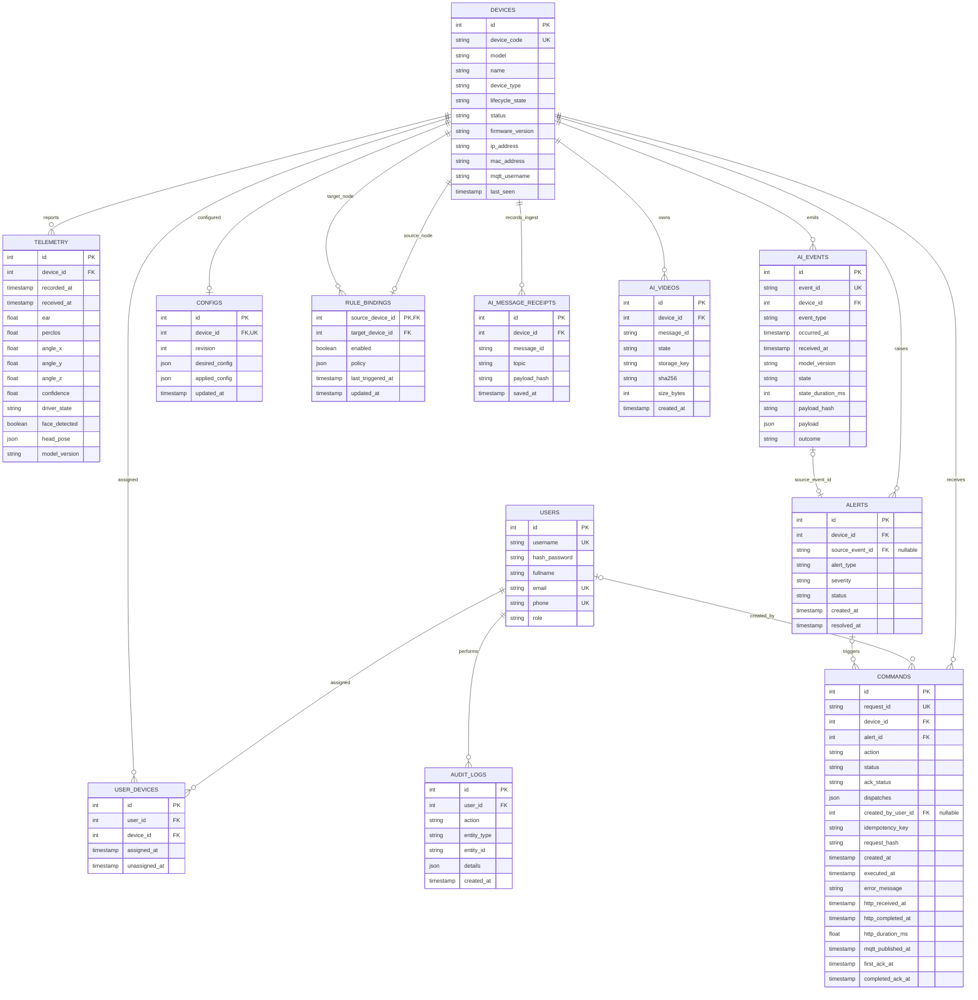
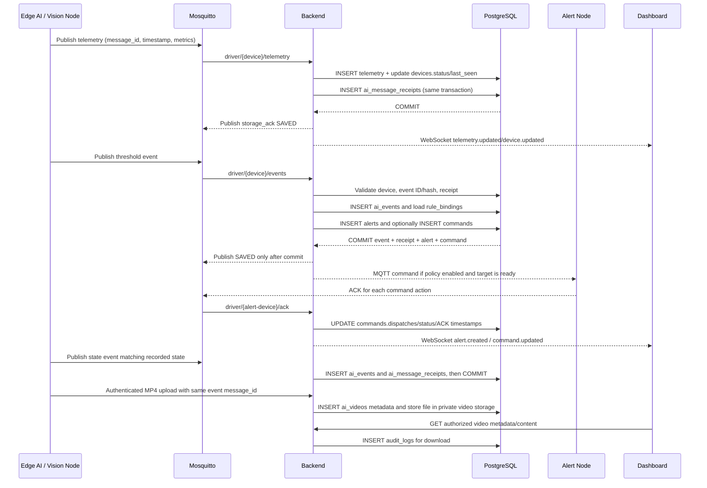

# Ví dụ đối tượng và luồng dữ liệu cho schema DB đề xuất

> **Tài liệu minh họa, không phải schema đã triển khai.** Tên, ID, email, mã
> thiết bị, timestamp, payload và giá trị cấu hình bên dưới đều là giả định.
> Không dùng chúng để provision thiết bị thật hoặc bật rule trên môi trường dùng
> chung. Schema logic này giản lược từ báo cáo rà soát database; cần migration,
> cập nhật ORM/API và kiểm thử trước khi áp dụng.

## 1. Sơ đồ quan hệ



### Ý nghĩa của các liên kết

- Một user có thể được gán nhiều thiết bị; `user_devices` giữ cả assignment đã
  thu hồi để lưu lịch sử.
- Thiết bị Vision phát telemetry và AI event. Một threshold event có thể tạo
  alert; alert có thể dẫn tới command.
- `rule_bindings.source_device_id` là Vision Node, `target_device_id` là Alert
  Node. Cả hai là FK tới `devices`.
- `ai_message_receipts` dùng khóa duy nhất `(device_id, message_id)` để nhận
  biết retry. `ai_events.event_id` duy nhất để không xử lý lại cùng event.
- Video bytes không nằm trong PostgreSQL. `ai_videos.storage_key` trỏ tới file
  private trong storage; `message_id` liên kết với event video tương ứng.

## 2. Bản ghi giả định xuyên suốt

Tất cả giá trị dưới đây được tạo để minh họa. `created_by_user_id = NULL` trong
command là do lệnh tự động từ rule, không phải người dùng bấm gửi.

### `users`

| id | username | hash_password | fullname | email | phone | role |
|---:|---|---|---|---|---|---|
| 7 | `demo_operator` | `<argon2-hash-demo-only>` | Minh An (giả định) | `operator@example.test` | `0900000007` | `Employee` |

### `devices`

| id | device_code | model | name | device_type | lifecycle_state | status | firmware_version | ip_address | mac_address | mqtt_username | last_seen |
|---:|---|---|---|---|---|---|---|---|---|---|---|
| 21 | `vision-demo-01` | `EdgeCam-Sim` | Camera mô phỏng | `VISION_NODE` | `ACTIVE` | `ONLINE` | `ai-demo-1.0` | `192.0.2.21` | `02:00:00:00:00:21` | `vision-demo-01` | `2026-11-05T14:00:05Z` |
| 31 | `alert-demo-01` | `ESP32-Sim` | Cảnh báo mô phỏng | `ALERT_NODE` | `ACTIVE` | `ONLINE` | `fw-demo-1.0` | `192.0.2.31` | `02:00:00:00:00:31` | `alert-demo-01` | `2026-11-05T14:00:04Z` |

Các địa chỉ IP nằm trong dải TEST-NET dành cho ví dụ tài liệu. Mật khẩu MQTT
không có trong bảng mẫu; chỉ username được minh họa.

### `user_devices`

| id | user_id | device_id | assigned_at | unassigned_at |
|---:|---:|---:|---|---|
| 101 | 7 | 21 | `2026-11-01T09:00:00Z` | `NULL` |
| 102 | 7 | 31 | `2026-11-01T09:01:00Z` | `NULL` |

### `telemetry`

| id | device_id | recorded_at | received_at | ear | perclos | angle_x/y/z | confidence | driver_state | face_detected | head_pose | model_version |
|---:|---:|---|---|---:|---:|---|---:|---|---|---|---|
| 5001 | 21 | `2026-11-05T14:00:00Z` | `2026-11-05T14:00:01Z` | 0.18 | 0.42 | `4.0 / 1.2 / -0.5` | 0.96 | `DROWSY` | true | `{"pitch":4.0,"yaw":1.2,"roll":-0.5}` | `ai-demo-1.0` |

`recorded_at` là thời điểm Edge AI đo; `received_at` là lúc backend nhận/lưu.
Chênh lệch giúp nhận ra trễ mạng hoặc dữ liệu gửi lại.

### `ai_events`

| id | event_id | device_id | event_type | occurred_at | received_at | model_version | state | state_duration_ms | payload_hash | payload | outcome |
|---:|---|---:|---|---|---|---|---|---:|---|---|---|
| 7001 | `evt-demo-drowsy-001` | 21 | `DROWSY_THRESHOLD_REACHED` | `2026-11-05T14:00:00Z` | `2026-11-05T14:00:01Z` | `ai-demo-1.0` | `DROWSY` | 7000 | `<sha256-canonical-event>` | `{"message_id":"evt-demo-drowsy-001","device_id":"vision-demo-01","event_type":"DROWSY_THRESHOLD_REACHED","timestamp":"2026-11-05T14:00:00Z","model_version":"ai-demo-1.0","state":"DROWSY","state_duration_ms":7000}` | `QUEUED` |
| 7002 | `evt-demo-video-001` | 21 | `STATE_CHANGED` | `2026-11-05T14:00:00Z` | `2026-11-05T14:00:02Z` | `ai-demo-1.0` | `DROWSY` | `NULL` | `<sha256-canonical-state>` | `{"message_id":"evt-demo-video-001","device_id":"vision-demo-01","event_type":"STATE_CHANGED","timestamp":"2026-11-05T14:00:00Z","model_version":"ai-demo-1.0","state":"DROWSY"}` | `RECORDED` |

Ví dụ payload đầy đủ được rút gọn; trong DB thật `payload_hash` là SHA-256 và
`payload` là JSON gốc đã validate.

### `ai_message_receipts`

| id | device_id | message_id | topic | payload_hash | saved_at |
|---:|---:|---|---|---|---|
| 8001 | 21 | `evt-demo-drowsy-001` | `driver/vision-demo-01/events` | `<sha256-raw-drowsy-message>` | `2026-11-05T14:00:01Z` |
| 8002 | 21 | `evt-demo-video-001` | `driver/vision-demo-01/events` | `<sha256-raw-state-message>` | `2026-11-05T14:00:02Z` |

`message_id` của event được alias thành `event_id` theo hợp đồng ingest. Retry
cùng message và cùng raw payload hash chỉ lặp ACK; cùng ID nhưng payload khác bị
từ chối. Hash event là hash canonical của dữ liệu event, nên khác raw message hash
của receipt.

### `alerts`

| id | device_id | source_event_id | alert_type | severity | status | created_at | resolved_at |
|---:|---:|---|---|---|---|---|---|
| 9001 | 21 | `evt-demo-drowsy-001` | `DROWSY_THRESHOLD_REACHED` | `2` | `ACKNOWLEDGED` | `2026-11-05T14:00:00Z` | `NULL` |

### `commands`

| id | request_id | device_id | alert_id | action | status | ack_status | dispatches | created_by_user_id | idempotency_key | request_hash | created_at | executed_at | error_message | http_received_at | http_completed_at | http_duration_ms | mqtt_published_at | first_ack_at | completed_ack_at |
|---:|---|---:|---:|---|---|---|---|---:|---|---|---|---|---|---|---|---:|---|---|---|
| 10001 | `cmd-10001` | 31 | 9001 | `AUTO_ALERT` | `ACKNOWLEDGED` | `COMPLETED` | `{led: COMPLETED, buzzer: COMPLETED}` | `NULL` | `NULL` | `NULL` | `2026-11-05T14:00:01.010Z` | `2026-11-05T14:00:01.450Z` | `NULL` | `NULL` | `NULL` | `NULL` | `2026-11-05T14:00:01.030Z` | `2026-11-05T14:00:01.100Z` | `2026-11-05T14:00:01.450Z` |

Ví dụ `dispatches` của command:

```json
{
  "led": {
    "request_id": "cmd-10001-led",
    "status": "COMPLETED",
    "dispatch_state": "PUBLISHED",
    "payload": {"command": "LED_ON", "duration": 1500, "intensity": "MEDIUM"},
    "completed_ack_at": "2026-11-05T14:00:01.450Z",
    "publish_ms": 12.4
  },
  "buzzer": {
    "request_id": "cmd-10001-buzzer",
    "status": "COMPLETED",
    "dispatch_state": "PUBLISHED",
    "payload": {"command": "BUZZER_ON", "duration": 1500, "intensity": "MEDIUM"},
    "completed_ack_at": "2026-11-05T14:00:01.450Z",
    "publish_ms": 13.1
  }
}
```

Trong schema rút gọn, `action` lưu mã loại lệnh trực tiếp, thay cho bảng
`command_types` của schema hiện hành. Backend hiện tại còn tra `command_types`;
muốn bỏ bảng đó phải sửa code và migration tương ứng trước.

### `configs`

| id | device_id | revision | desired_config | applied_config | updated_at |
|---:|---:|---:|---|---|---|
| 1101 | 31 | 4 | `{"config_id":"cfg-demo-4","timings":{"buzzer_ms":1500},"status":"APPLIED"}` | `{"config_id":"cfg-demo-4","timings":{"buzzer_ms":1500},"status":"APPLIED"}` | `2026-11-05T13:50:00Z` |

### `rule_bindings`

| source_device_id | target_device_id | enabled | policy | last_triggered_at | updated_at |
|---:|---:|---|---|---|---|
| 21 | 31 | `true` | `{"levels":{"1":{"threshold_ms":3000,"duration_ms":1000,"outputs":["led"]},"2":{"threshold_ms":6000,"duration_ms":1500,"outputs":["led","buzzer"]},"3":{"threshold_ms":10000,"duration_ms":2000,"outputs":["led","buzzer","motor"]}},"cooldown_seconds":30,"max_event_age_seconds":60}` | `2026-11-05T14:00:01Z` | `2026-11-05T13:45:00Z` |

Policy là số liệu giả định, **chưa phải khuyến nghị y tế/an toàn hoặc policy đã
được nhóm phê duyệt**. Chỉ khi `RULE_ENGINE_ENABLED=true`, binding được bật và
target hợp lệ thì code mới được phép phát lệnh.

### `ai_videos`

| id | device_id | message_id | state | storage_key | sha256 | size_bytes | created_at |
|---:|---:|---|---|---|---|---:|---|
| 1201 | 21 | `evt-demo-video-001` | `DROWSY` | `f00ba4c0-demo-video.mp4` | `<sha256-demo-mp4>` | 245760 | `2026-11-05T14:00:03Z` |

File giả định ở private storage; tên và hash trên không trỏ tới file thật.

### `audit_logs`

| id | user_id | action | entity_type | entity_id | details | created_at |
|---:|---:|---|---|---|---|---|
| 1301 | 7 | `ACKNOWLEDGE_ALERT` | `Alert` | `9001` | `{"alert_type":"DROWSY_THRESHOLD_REACHED","correlation_id":"corr-demo-001"}` | `2026-11-05T14:02:00Z` |

Audit chỉ lưu metadata được allowlist; không ghi token, password hay payload AI.

## 3. Luồng dữ liệu thực tế theo schema



### Diễn giải từng bước

1. **Telemetry:** Edge AI gửi số đo và `message_id`. Backend xác thực Vision Node,
   lưu `telemetry` và `ai_message_receipts`, cập nhật trạng thái/heartbeat thiết
   bị; sau commit mới gửi ACK lưu thành công. Dashboard nhận snapshot realtime.
2. **AI event:** Backend kiểm tra schema, thiết bị, timestamp và event ID/hash.
   `ai_events` giữ event gốc/outcome; `rule_bindings` xác định mức, cooldown và
   Alert Node đích. Alert được lưu cùng event; command chỉ được tạo/phát nếu
   policy và môi trường cho phép. Nếu rule đang tắt, event vẫn có thể được lưu
   và alert được ghi với outcome thích hợp, nhưng không gửi tải vật lý.
3. **ACK:** Alert Node trả ACK theo từng action con. Backend cập nhật
   `commands.dispatches`, trạng thái tổng, `ack_status` và mốc thời gian; không
   tạo thêm một row trong bảng `command_acks` của schema rút gọn.
4. **Video:** Event `STATE_CHANGED` được lưu trước. AI upload MP4 có xác thực
   thiết bị; backend đối chiếu `device_id`, `message_id`, state, hash và kích
   thước. File nằm trong storage riêng, `ai_videos` chỉ lưu metadata. API tải
   kiểm tra assignment rồi ghi audit.
5. **Phân quyền:** API/WS đều kiểm tra `user_devices` đang active; `audit_logs`
   ghi các thao tác nhạy cảm cần truy vết.

## 4. Giới hạn và điều kiện trước khi dùng schema này

- Sơ đồ là **mô hình đích**, không phải mô tả chính xác ORM/schema hiện tại.
  Backend hiện vẫn có bảng `command_types`; các FK/cột của mô hình legacy còn
  trong DB. Bỏ chúng cần thay đổi code, schema, API/seed và migration cùng lúc.
- Nên đặt unique constraint cho `users.username`; unique `(user_id, device_id)`
  chỉ nên áp dụng cho assignment đang active bằng partial unique index để vẫn
  giữ lịch sử thu hồi.
- `alerts.source_event_id` nên tham chiếu `ai_events.event_id` nếu mọi alert đều
  phát sinh từ event AI. Nếu còn loại alert không có AI event, giữ nullable và
  xác định constraint phù hợp.
- `ai_videos.message_id` liên kết logic với event; trước khi thêm FK cần thống
  nhất trường hợp upload đến trước event và bảo đảm event/state trong hợp đồng
  khớp.
- Không dùng dữ liệu mẫu trong [insert.sql](../database/insert.sql) làm migration
  cho DB đang chạy. `create.sql` hiện có `DROP SCHEMA public CASCADE`, nên chạy
  nó sẽ xóa schema và dữ liệu hiện tại.
- Chuyển dữ liệu nên dùng database mới hoặc migration additive, backup có thử
  restore, mapping ID rõ ràng, kiểm tra row count/orphan/hash và cutover có
  rollback. Archive dữ liệu legacy trước khi xóa `events`, `event_types`,
  `command_acks`, `captures` hoặc các cột `alerts.event_id`/`resolved_at`.
