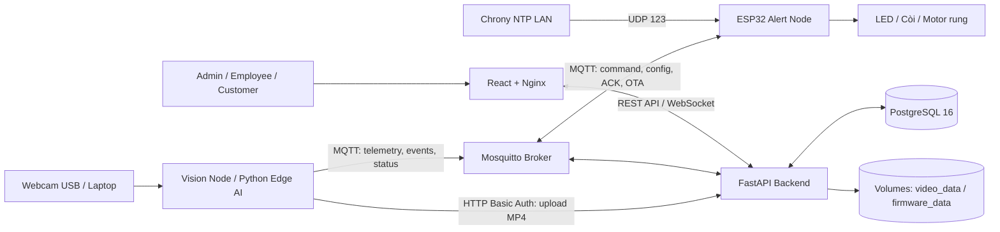
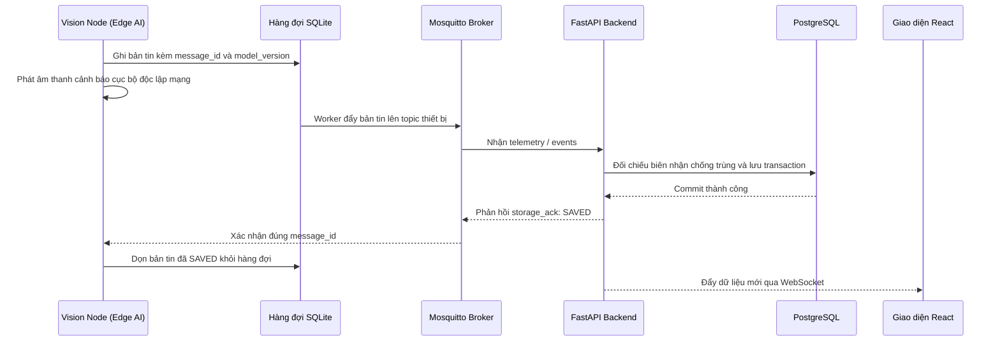
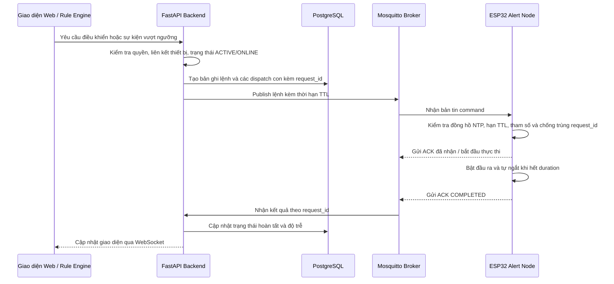
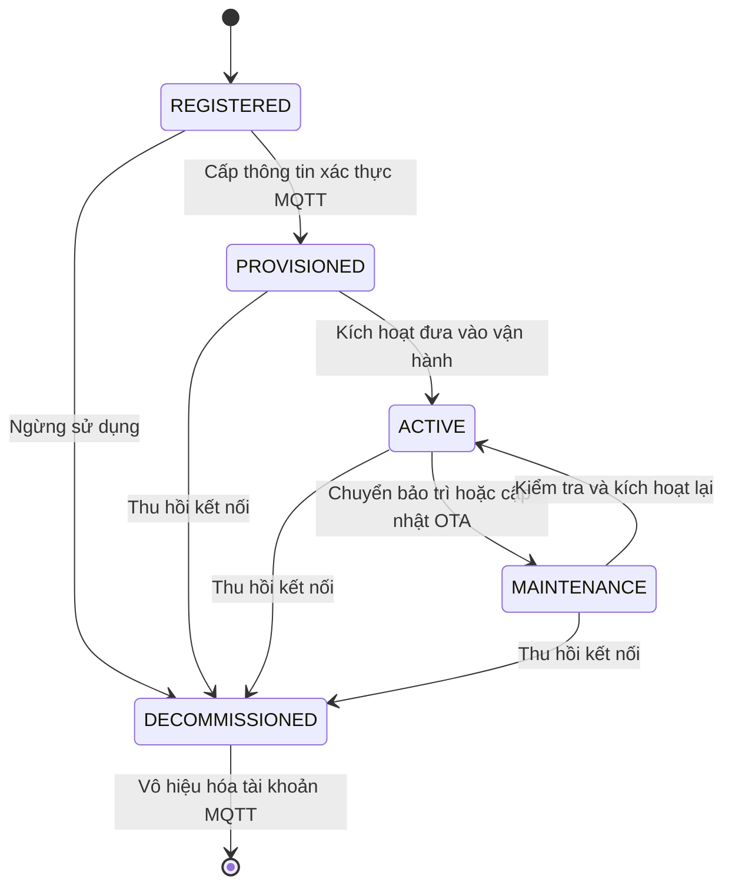
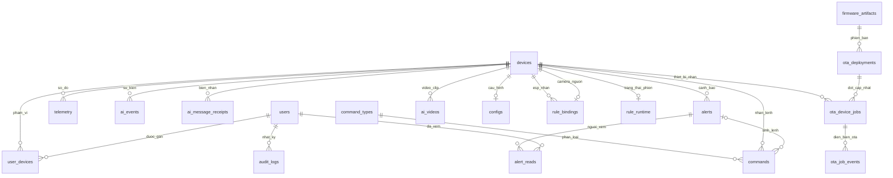

# Kiến trúc hệ thống, mô hình dữ liệu và bảo mật

Tài liệu trình bày sơ đồ kiến trúc tổng thể, luồng xử lý dữ liệu đầu-cuối, vòng đời quản lý thiết bị, lược đồ cơ sở dữ liệu quan hệ (ERD) và các lớp kiểm soát bảo mật của hệ thống.

---

## 1. Kiến trúc triển khai tổng thể

- **Tầng Edge & Thiết bị vật lý:** Tiến trình Python chạy trực tiếp trên máy trạm để truy cập webcam độ trễ thấp; vi điều khiển **ESP32** kết nối cùng mạng Wi-Fi 2.4 GHz điều khiển cơ cấu chấp hành và đồng bộ giờ qua dịch vụ NTP nội bộ.
- **Tầng Trung tâm (Docker Compose):** Đóng gói PostgreSQL, Mosquitto, FastAPI, Nginx/React, dịch vụ thời gian `chrony` và tùy chọn mở rộng HTTPS / OTA Gateway / Prometheus-Grafana.

---

## 2. Luồng thu thập dữ liệu và đồng bộ bù khi mất mạng

- Khi mất kết nối tới Broker hoặc Backend, Edge AI vẫn tiếp tục phân tích hình ảnh, phát cảnh báo âm thanh tại chỗ và xếp hàng bản tin/video trên ổ cứng cục bộ. Khi mạng khôi phục, dữ liệu cũ được gửi bù để bảo toàn lịch sử mà không phát lại lệnh kích hoạt tải muộn xuống ESP32.
- Luồng tải video sự kiện (`.mp4`) hoạt động trên worker HTTP riêng biệt, liên kết chính xác với sự kiện qua `clip_message_id` / `episode_start_event_id`.

---

## 3. Luồng điều khiển thiết bị và xác nhận (`Command` & `ACK`)

---

## 4. Mô hình trạng thái vòng đời thiết bị

- Trạng thái quản lý (`lifecycle_state`) được theo dõi độc lập với trạng thái kết nối mạng (`ONLINE` / `OFFLINE`). Thiết bị ở chế độ `MAINTENANCE` vẫn có thể `ONLINE` để nhận gói cập nhật OTA nhưng không nhận lệnh cảnh báo tự động thường ngày.

---

## 5. Lược đồ quan hệ dữ liệu chính (ERD)

Chi tiết định nghĩa cột, khóa ngoại và chỉ mục xem tại `database/create.sql` cùng các tệp `database/migration_*.sql`.

---

## 6. Các mối đe dọa chính và biện pháp kiểm soát bảo mật

| Mối đe dọa / Rủi ro | Biện pháp kiểm soát trong hệ thống |
|---|---|
| **Truy cập trái phép thiết bị hoặc video của người khác** | Kiểm tra phân quyền vai trò kết hợp bảng `user_devices` tại mọi endpoint REST API, vé WebSocket dùng một lần và trình phát video |
| **Lộ mật khẩu người dùng hoặc sử dụng lại phiên cũ** | Băm mật khẩu có salt bằng `pwdlib`; tăng `session_version` để thu hồi tức thời các JWT cũ khi đăng xuất, đổi mật khẩu, khóa hoặc đổi vai trò |
| **Giả mạo thiết bị hoặc gửi chéo topic MQTT** | Cấp tài khoản/mật khẩu MQTT riêng cho từng node khi `Provision`; cấu hình ACL trên Mosquitto khóa chặt quyền đọc/ghi vào đúng `driver/{device_code}/...` |
| **Bản tin lặp hoặc sự kiện cũ làm kích hoạt còi muộn** | Chống lưu trùng bằng `ai_message_receipts`, chống chạy lặp bằng bộ nhớ `request_id` trên NVS, kiểm tra hạn `TTL` và chặn kích tải đối với dữ liệu đồng bộ bù (`backfill`) |
| **Can thiệp gói cập nhật Firmware OTA** | Xác minh chữ ký số **RSA-2048** và mã băm **SHA-256** ở cả Backend và ESP32; tải ảnh qua kết nối HTTPS đi kèm token ngắn hạn theo từng công việc |
| **Rò rỉ thông tin nhạy cảm lên kho mã nguồn** | Tách biệt toàn bộ mật khẩu, khóa ký, cấu hình Wi-Fi và dữ liệu cá nhân vào `.env`, `network_config.h`, `.local-backups/` nằm trong `.gitignore`; ghi `audit_logs` cho các thao tác quản trị |
