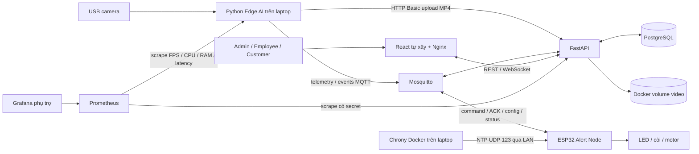
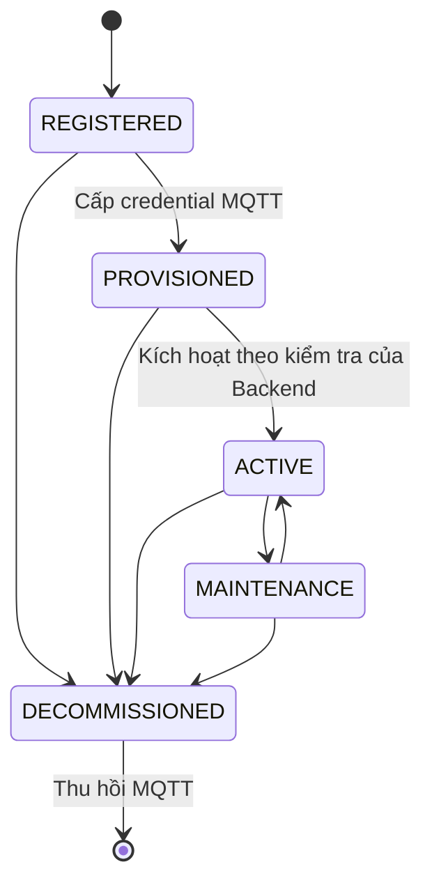
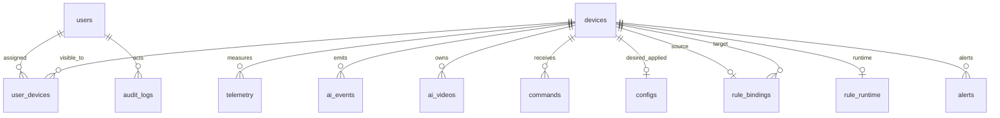

# Kiến trúc, dữ liệu và bảo mật bản nộp

## Thành phần và triển khai



Laptop chạy Docker Desktop: PostgreSQL, Mosquitto, FastAPI, Nginx/React, chrony và tùy chọn Prometheus/Grafana. Camera/MediaPipe chạy Python native để truy cập webcam; exporter đọc số đo thật từ tiến trình AI. ESP32 là board riêng trong cùng Wi-Fi 2,4 GHz.

## Số đo, event và lưu bù

```mermaid
sequenceDiagram
  participant AI as Edge AI
  participant SQ as SQLite cục bộ
  participant MQ as MQTT broker
  participant BE as Backend
  participant DB as PostgreSQL
  participant FE as React
  AI->>SQ: Lưu event bất biến + message_id + model_version
  AI->>AI: Cảnh báo local độc lập network
  SQ->>MQ: Worker gửi bản tin
  MQ->>BE: telemetry / events
  BE->>DB: Kiểm tra idempotency và lưu
  DB-->>BE: Commit thành công
  BE-->>MQ: storage ACK SAVED
  MQ-->>AI: Xác nhận đúng message_id
  AI->>SQ: Xóa bản tin đã SAVED
  BE-->>FE: WebSocket cập nhật
  Note over AI,BE: Mất mạng: giữ SQLite; reconnect gửi backfill để lưu lịch sử, không kích tải cũ
```

MQTT PUBACK không thay storage ACK SAVED. Upload MP4 dùng hàng đợi/worker riêng, HTTP phải xác thực riêng dù MQTT đã đăng nhập. Video liên kết qua `clip_message_id`/`episode_start_event_id` tới event bắt đầu clip.

## Lệnh và xác nhận

```mermaid
sequenceDiagram
  participant S as Web / AI event
  participant BE as Backend
  participant DB as PostgreSQL
  participant MQ as Broker
  participant E as ESP32
  S->>BE: Yêu cầu điều khiển / policy event
  BE->>BE: Quyền + binding + ACTIVE/ONLINE + event mới
  BE->>DB: Lưu command và dispatch request_id
  BE->>MQ: Publish lệnh với TTL
  MQ->>E: command
  E->>E: Kiểm tra clock, TTL, tham số, mã lệnh trùng
  E-->>MQ: ACK RECEIVED / REJECTED
  E->>E: Chạy tải và tự tắt theo duration
  E-->>MQ: ACK COMPLETED
  MQ-->>BE: Kết quả theo request_id
  BE->>DB: Cập nhật trạng thái / thời gian
  BE-->>S: WebSocket kết quả
  Note over BE,E: Retry giữ mã và nội dung; timeout là chưa có xác nhận, không khẳng định tải đã chạy
```

TEST_ALERT gồm các lệnh con; tổng thành công khi đủ ACK COMPLETED. Config có config_id, revision tăng; thiết bị xác nhận APPLIED sau khi lưu NVS. Desired và applied có thể khác nhau khi chưa kết nối hoặc bị từ chối.

## Vòng đời



ONLINE/OFFLINE biểu diễn kết nối, độc lập vòng đời. ACTIVE không bảo đảm hiện đang online. MAINTENANCE có thể vẫn online nhưng không được vận hành như ACTIVE.

## RBAC và phạm vi thiết bị

| Vai trò | Tài khoản | Thiết bị/dữ liệu | Điều khiển/cấu hình |
|---|---|---|---|
| Admin | Tạo, đổi vai trò, khóa/mở; không tự hạ quyền/khóa mình | Toàn hệ thống, gán/thu hồi assignment | Toàn hệ thống |
| Employee | Hồ sơ/mật khẩu cá nhân | Các thiết bị được gán | Theo quyền operator/manager trên thiết bị được gán |
| Customer | Tự đăng ký; hồ sơ/mật khẩu cá nhân | Xem thiết bị được gán | Không gửi lệnh, sửa cấu hình hoặc xóa video |

Vai trò mô tả quyền phần mềm. Schema hiện chưa có tenant/company riêng; assignment nhiều-nhiều `user_devices` là phạm vi truy cập. Không tuyên bố có cách ly tổ chức tự động nếu chưa xây company/tenant.

Đăng xuất/đổi mật khẩu/khóa/đổi vai trò tăng session_version, thu hồi JWT và vé WebSocket cũ; socket của người bị thu hồi quyền được đóng. MQTT dùng credential riêng theo node, ACL giới hạn topic. Thu hồi node không xóa lịch sử.

## Quan hệ dữ liệu chính



Đây là lược đồ quan hệ chính, không thay DDL chi tiết. Dispatch nằm trong dữ liệu JSON của command, không phải bảng `command_dispatches`. Video/event ghép bằng message/event ID theo hợp đồng; không thêm đường FK giả trên hình. Xem `database/create.sql` và migration cho tên/cột thực tế.

## Rủi ro và giới hạn bảo mật

| Nguy cơ | Biện pháp hiện có | Phần cần lưu ý |
|---|---|---|
| Đọc node/clip của người khác | Kiểm tra assignment tại BE; JWT/WS ticket; ACL MQTT | Không chỉ ẩn nút trên React |
| Gửi lặp do QoS/reconnect | message_id chống lưu trùng; request_id và firmware cache | Cache firmware hữu hạn; TTL vẫn cần kiểm tra |
| Event/lệnh cũ gây còi muộn | Backfill không actuation; event age/observation/command TTL | Clock ESP32 phải đồng bộ; từ chối nếu chưa có giờ |
| Lộ mật khẩu | Hash người dùng; `.env` và network_config.h ngoài Git; lọc log | Không quay modal cấp credential vào video nộp |
| Lộ hình mặt | Quyền xem/xóa, không public static video; no-store; quota | Chính sách giữ thủ công; nhóm phải xin đồng ý người ghi hình |
| Đầy đĩa | Giới hạn clip/queue/storage, cảnh báo dung lượng; giữ pending | Không cam kết lưu vô hạn; người vận hành giải phóng thủ công |
| Nghe lén LAN | Có cổng HTTPS 8443 cho React/API/WSS; monitoring loopback | HTTP cũ và MQTT vẫn tồn tại cho LAN; chưa có MQTTS hoặc triển khai Internet |
| Giả mạo giờ LAN | Chỉ dùng NTP trong LAN tin cậy, kiểm tra giờ laptop | NTP này chưa xác thực; không mở UDP 123 ra Internet |

Đây là nguyên mẫu thử nghiệm trên bàn; chất lượng nhận biết và an toàn vận hành trên xe chưa được nghiệm thu thực địa.
