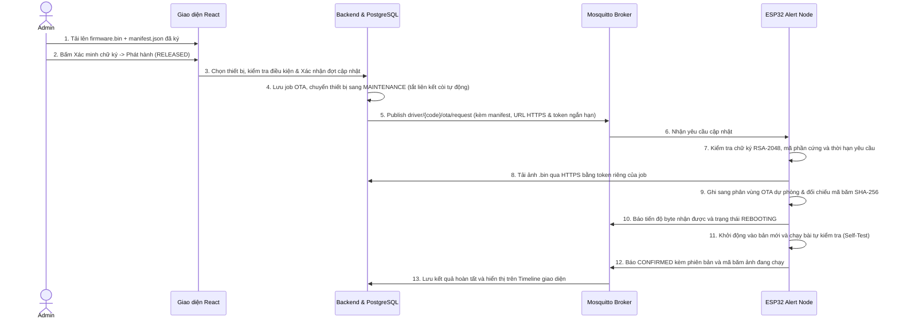

# Cập nhật Firmware từ xa (OTA) cho ESP32 Alert Node

Tài liệu mô tả kiến trúc bảo mật, cơ chế phân vùng kép, quy trình ký số gói cập nhật và các bước vận hành tính năng **Firmware / OTA** trên giao diện quản trị.

---

## 1. Kiến trúc và Luồng cập nhật OTA

Tính năng OTA cho phép quản trị viên (`Admin`) nâng cấp chương trình cho các mạch **ESP32 (`ALERT_NODE`)** qua mạng Wi-Fi mà không cần nạp lại qua cổng USB, đồng thời đảm bảo tính xác thực nguồn phát hành và tính toàn vẹn của tệp nhị phân.



### Cơ chế xác thực, toàn vẹn và an toàn vận hành
- **Chữ ký số bất đối xứng (`RSA-2048`, `PKCS#1 v1.5`, `SHA-256`):** Tệp `.manifest.json` ràng buộc phiên bản, mã phần cứng (`esp32doit-devkit-v1`), dung lượng byte và mã băm `SHA-256` của toàn bộ tệp `.bin`. Khóa bí mật (`private key`) chỉ lưu tại máy đóng gói bản build; cả Backend và ESP32 đều dùng khóa công khai (`public key`) để xác minh chữ ký trước khi chấp nhận cài đặt.
- **Đường truyền HTTPS & Token dùng riêng:** ESP32 chỉ tải firmware từ địa chỉ HTTPS tin cậy đã cấu hình chứng chỉ CA trong `ota_trust.h`, sử dụng token ngắn hạn gắn chặt với đúng `job_id` và `device_id`.
- **Phân vùng kép & Tự kiểm tra sau khởi động (`Self-Test`):** Dữ liệu mới được ghi vào phân vùng OTA không hoạt động nên không ghi đè chương trình đang chạy. Sau khi khởi động sang phân vùng mới, firmware kiểm tra bộ nhớ, cấu hình tải, đồng hồ và kết nối MQTT rồi mới khóa xác nhận **`CONFIRMED`** (hỗ trợ cơ chế quay lui phân vùng cũ `Rollback` của ESP-IDF nếu bản mới không vượt qua bước kiểm tra).
- **Cách ly tải trong lúc nạp Flash:** Khi bắt đầu đợt OTA, thiết bị tự động được đưa vào trạng thái bảo trì **`MAINTENANCE`** và tạm ngắt liên kết cảnh báo tự động từ Camera AI. Sau khi thiết bị báo `CONFIRMED`, Admin kiểm tra phiên bản mới và bấm **Kích hoạt** để đưa thiết bị trở lại trạng thái `ACTIVE`.

> **Kết quả thực nghiệm trên phần cứng:** Thiết bị `alert-01` đã thực hiện nâng cấp qua HTTPS từ bản nền **`0.4.0` lên `0.4.1`** (dung lượng `981.760 byte`, hoàn tất và xác nhận `CONFIRMED` sau `34,85 giây`, giữ nguyên cấu hình NVS và các chân GPIO điều khiển tải).

---

## 2. Quy trình thao tác trên giao diện Admin

Đăng nhập bằng tài khoản **Admin**, mở mục **Firmware / OTA** trên thanh điều hướng:

1. **Tab Kho firmware:**
   - Chọn tệp chương trình `.bin` và tệp `.manifest.json` tương ứng, nhập ghi chú phiên bản rồi bấm **Upload bản nháp** (`DRAFT`).
   - Bấm **Xác minh chữ ký** (`VERIFIED`) → bấm **Phát hành** (`RELEASED`).
2. **Tab Cập nhật thiết bị:**
   - Chọn phiên bản firmware mục tiêu đã phát hành, tích chọn một hoặc nhiều mạch ESP32 cần nâng cấp (tối đa 50 thiết bị/đợt).
   - Bấm **Kiểm tra điều kiện** để hệ thống rà soát trạng thái kết nối, mã phần cứng, dung lượng phân vùng và khóa công khai → bấm **Xác nhận cập nhật**.
3. **Tab Theo dõi cập nhật:**
   - Quan sát thanh tiến trình byte tải thực tế và mục **Diễn biến cập nhật** (`QUEUED → DOWNLOADING → VERIFYING → REBOOTING → CONFIRMED` — tự động làm mới mỗi 5 giây).
   - Khi hoàn tất, bấm **Mở thiết bị / kết thúc bảo trì** → chọn **Kích hoạt** để đưa mạch về chế độ vận hành chính (`ACTIVE`).
   - **Bật lại cảnh báo tự động (nếu dùng):** Do Backend tự động tắt liên kết cảnh báo khi thiết bị vào chế độ cập nhật OTA, sau khi kích hoạt lại ESP32 cần mở chi tiết thiết bị Camera AI (`vision-01`) → tích chọn **Bật cảnh báo tự động** và bấm **Lưu thiết lập** để khôi phục luồng kích tải tự động.

---

## 3. Hướng dẫn biên dịch và ký số phiên bản Firmware mới

Khi phát triển bản nâng cấp mới (ví dụ môi trường `ota-release` hoặc `ota-demo-043`), tăng số `APP_FIRMWARE_VERSION` trong cấu hình build rồi thực hiện biên dịch và ký manifest tại thư mục gốc dự án:

```powershell
$pythonExe = "./backend/.venv/Scripts/python.exe"
$pio = "$env:USERPROFILE\.platformio\penv\Scripts\pio.exe"

# 1. Biên dịch tệp nhị phân firmware.bin
& $pio run -d firmware/esp32-alert-node -e ota-release

# 2. Ký số tạo tệp manifest JSON đi kèm
& $pythonExe backend/scripts/ota_firmware.py sign `
  --private-key .local-backups/ota-signing-key.pem `
  --image firmware/esp32-alert-node/.pio/build/ota-release/firmware.bin `
  --version 0.4.1 --hardware esp32doit-devkit-v1 `
  --output .local-backups/firmware-0.4.1.manifest.json
```

---

## 4. Thiết lập ban đầu cho môi trường mới

Khi cài đặt tính năng OTA lần đầu trên một máy chủ hoặc mạch ESP32 mới:

```powershell
$pythonExe = "./backend/.venv/Scripts/python.exe"

# 1. Sinh cặp khóa RSA-2048 (giữ private key ngoài Git, đặt public key vào deployment/ota/)
& $pythonExe backend/scripts/ota_firmware.py init-key `
  --private-key .local-backups/ota-signing-key.pem `
  --public-key deployment/ota/public.pem

# 2. Sinh chứng chỉ TLS cho cổng HTTPS tải firmware (thay bằng địa chỉ IP LAN thực tế của máy chủ)
& $pythonExe deployment/tls/prepare_certs.py --host 192.168.1.10 --legacy-ip-dns-san

# 3. Tạo file header nhúng khóa công khai và chứng chỉ CA cho firmware nền của ESP32
& $pythonExe backend/scripts/ota_firmware.py configure-device `
  --public-key deployment/ota/public.pem `
  --origin https://192.168.1.10:9443 `
  --ca deployment/tls/certs/ca.crt `
  --header firmware/esp32-alert-node/include/ota_trust.h
```

Sau khi nạp bản firmware nền đầu tiên qua cáp USB, bật các biến `OTA_ENABLED=true`, `OTA_PUBLIC_BASE_URL=https://<IP-LAN>:9443`, `OTA_HTTPS_PORT=9443` trong `.env`, khởi tạo lại `backend` để nhận cấu hình mới và bật Gateway HTTPS:

```powershell
docker compose --env-file .env -f deployment/docker-compose.yml --profile ota up -d --force-recreate backend ota-gateway
docker compose --env-file .env -f deployment/docker-compose.yml exec -T backend python scripts/setup_ota_acl.py
```

### Tài liệu tham khảo
- [Espressif ESP-IDF Over The Air Updates (OTA)](https://docs.espressif.com/projects/esp-idf/en/v4.4.8/esp32/api-reference/system/ota.html)
