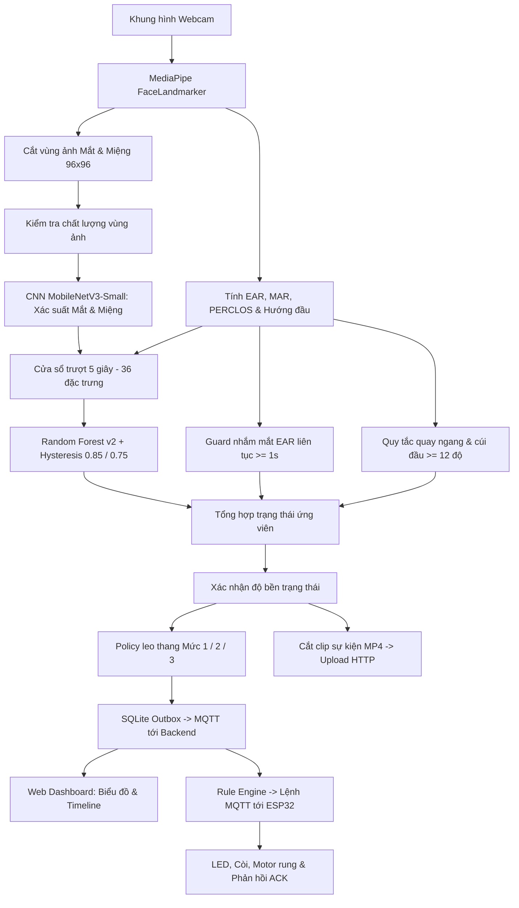

# Thiết kế luồng xử lý AI v2: Dữ liệu, Mô hình và Quy tắc Cảnh báo

Tài liệu trình bày chi tiết kiến trúc mô hình nhận diện trạng thái tài xế phiên bản v2 (khởi chạy qua `edge-ai/run-multisignal-v2.ps1`), bao gồm nguồn dữ liệu huấn luyện, phương pháp tiền xử lý, mô hình kết hợp CNN + Random Forest, các nhánh bảo vệ hình học và cơ chế tích hợp vào hệ thống IoT.

---

## 1. Kiến trúc tổng quan của Pipeline AI v2

Hệ thống xử lý hình ảnh trực tiếp tại biên (Edge AI trên máy trạm) bằng cách kết hợp 4 tầng thông tin bổ trợ lẫn nhau:

1. **MediaPipe FaceLandmarker & Hình học khuôn mặt:** Định vị điểm mốc khuôn mặt, tính toán tỷ lệ độ mở mắt (`EAR`), độ mở miệng (`MAR`), tỷ lệ nhắm mắt (`PERCLOS`) và góc hướng đầu.
2. **Mạng CNN `MobileNetV3-Small` hai đầu phân loại:** Trích xuất đặc trưng ảnh vùng mắt và vùng miệng kích thước `96 × 96` để dự đoán xác suất mắt lờ đờ buồn ngủ, ngáp và nói chuyện/cười.
3. **Mô hình kết hợp theo thời gian `Random Forest` (36 đặc trưng):** Tổng hợp thống kê của 9 kênh tín hiệu trên cửa sổ trượt `5 giây` để đánh giá quá trình buồn ngủ diễn tiến theo thời gian.
4. **Các nhánh bảo vệ hình học & tư thế độc lập:** Nhánh kiểm tra nhắm mắt liên tục có hiệu chuẩn (`Eye Closure Guard`), nhánh phát hiện quay đầu ngang (`DISTRACTED`) và quy tắc cúi đầu kéo dài (`HEAD_DOWN_RISK`).



---

## 2. Nguồn dữ liệu và Phương pháp phân chia tập huấn luyện

### 2.1. Tập dữ liệu NTHU-DDD
Mô hình được huấn luyện trên tập dữ liệu hành vi tài xế **NTHU-DDD** gồm các kịch bản có đeo kính / không đeo kính trong điều kiện ánh sáng ban ngày và ban đêm, sử dụng 3 nhóm nhãn gốc:
- **Vùng mắt (2 lớp):** `NORMAL` (Bình thường), `SLEEPY` (Biểu hiện mắt buồn ngủ).
- **Vùng miệng (3 lớp):** `NORMAL` (Khép miệng/bình thường), `YAWN` (Ngáp), `TALKING_LAUGHING` (Nói chuyện hoặc cười — giúp tách biệt hành vi giao tiếp bình thường với ngáp).
- **Trạng thái tổng hợp (2 lớp):** `NOT_DROWSY` (Tỉnh táo), `DROWSY` (Buồn ngủ).

### 2.2. Phân chia tập dữ liệu tách biệt theo người (Subject-Disjoint Split)
Để ngăn hiện tượng rò rỉ đặc trưng khuôn mặt của cùng một người giữa tập huấn luyện và kiểm định, dữ liệu được khóa cứng theo từng cá nhân trong `data-plan.json`:

| Tập dữ liệu | Số người | Số video hợp lệ | Quy mô mẫu trích xuất | Mục đích sử dụng |
|---|---:|---:|---:|---|
| **CNN Train** | 10 | 199 | 19.594 mẫu vùng ảnh | Huấn luyện mạng MobileNetV3-Small phân loại mắt & miệng |
| **Fusion Train** | 4 | 75 | 13.603 cửa sổ 5 giây | Huấn luyện Random Forest trên đầu ra của CNN đối với người mới |
| **Validation** | 4 | 80 | 32.489 vùng ảnh / 14.083 cửa sổ | Lựa chọn checkpoint, đánh giá mô hình kết hợp và chọn ngưỡng |

*(Lưu ý dữ liệu nguồn: 20 video thuộc nhóm test gốc của bản dữ liệu bị lệch độ dài frame so với tệp nhãn nên đã được bộ kiểm tra loại bỏ tự động; vì vậy các chỉ số định lượng bên dưới được đo trên tập Validation, chưa có tập Final Test độc lập hoàn toàn mới).*

---

## 3. Tiền xử lý và Trích xuất đặc trưng

1. **Điểm mốc & Hình học (`face_detection.py`, `eye.py`, `regions.py`, `head_pose.py`):**
   - **EAR (Eye Aspect Ratio):** Tổng hai khoảng cách dọc mí mắt chia cho hai lần bề ngang mắt (lấy trung bình hai mắt).
   - **PERCLOS:** Tỷ lệ thời gian mắt nhắm trong cửa sổ quan sát `10 giây` phục vụ hiển thị và thống kê vận hành.
   - **MAR (Mouth Aspect Ratio):** Khoảng cách mở dọc giữa hai môi chia cho chiều rộng khóe miệng.
   - **Hướng đầu (`yaw`, `pitch`, `roll`):** Đo độ lệch ngang và dọc so với mốc nhìn thẳng; lệch ngang vượt ngưỡng liên tục `2 giây` sinh tín hiệu `DISTRACTED`.
2. **Cắt vùng ảnh & Kiểm tra chất lượng (`Quality Gate`):**
   - Cắt riêng vùng mắt và vùng miệng kích thước `96 × 96`, chuyển sang `RGB` và chuẩn hóa theo `mean` / `std` của ImageNet.
   - Kiểm tra độ nét, độ tương phản và tỷ lệ điểm ảnh bão hòa sáng/tối. Nếu vùng ảnh không đạt chất lượng kỹ thuật hoặc tràn khung hình (`OUTSIDE_FRAME`), kênh đó được đánh dấu không khả dụng thay vì gán giá trị `0` giả tạo.
3. **Làm mượt chuỗi xác suất:** Mạng CNN chạy ở nhịp tối đa `5 Hz`; ba chuỗi xác suất (`eye_sleepy`, `mouth_yawn`, `mouth_talk`) được làm mượt nhân quả bằng trung bình trượt hàm mũ (**EMA `0.4 giây`**) để khử nhiễu tức thời.

---

## 4. Chi tiết Mô hình học máy & Các nhánh bảo vệ

### 4.1. Mạng CNN `MobileNetV3-Small` (`ml/region_net.py`)
- Khởi tạo từ trọng số tiền huấn luyện ImageNet, trích xuất vector đặc trưng `576 chiều` dùng chung cho 2 đầu tuyến tính (Đầu mắt 2 lớp và Đầu miệng 3 lớp).
- Huấn luyện bằng trình tối ưu **AdamW**, hàm mất mát **Weighted Cross-Entropy** và tăng cường dữ liệu (lật ngang, biến thiên độ sáng/tương phản); lựa chọn checkpoint tại **Epoch 4** đạt điểm Macro F1 trung bình tốt nhất trên tập Validation.

### 4.2. Bộ kết hợp `Random Forest v2` (`ml/multisignal_v2_train.py`)
- Nhận đầu vào từ **9 kênh tín hiệu**: `eye_sleepy`, `mouth_yawn`, `mouth_talk`, `ear`, `mar`, `yaw`, `pitch`, `eye_confidence`, `mouth_confidence`.
- Trên cửa sổ trượt tối đa `5 giây` (yêu cầu tối thiểu `2 giây` lịch sử hợp lệ và không đứt quãng quá `0.5 giây`), mỗi kênh được tính 4 đặc trưng: **`mean`, `std`, `percentile 90` và `coverage`** → tạo thành **$9 \times 4 = 36$ đặc trưng**.
- Cấu hình rừng gồm **200 cây quyết định** (`max_depth = 8`, `min_samples_leaf = 8`, cân bằng trọng số lớp), áp dụng cặp **ngưỡng trễ kép (Hysteresis)**:
  - Vào trạng thái nguy cơ khi điểm xác suất đạt **`≥ 0.85`**.
  - Duy trì cho tới khi điểm giảm xuống dưới **`< 0.75`** (tránh hiện tượng bật/tắt trạng thái liên tục quanh một ranh giới đơn).

### 4.3. Nhánh bảo vệ nhắm mắt có hiệu chuẩn (`service/eye_closure_guard.py`)
- Do nhãn `SLEEPY` trong tập NTHU mô tả biểu hiện mắt lờ đờ chứ không đồng nhất hoàn toàn với mí mắt nhắm kín, nhánh `EAR` độc lập đảm bảo bắt nhạy hành vi nhắm mắt ngủ gật:
  - Khi `EAR` thấp hơn ngưỡng hiệu chuẩn liên tục **`≥ 1.0 giây`** → kích hoạt `DROWSY` (`EYE_CLOSURE_RISK`).
  - Khi mắt mở trên ngưỡng liên tục **`≥ 1.0 giây`** → xóa cờ nhắm mắt.
- Với người đeo kính, ngưỡng được đọc từ hồ sơ hiệu chuẩn cá nhân (ví dụ profile `v5` có ngưỡng `EAR ≈ 0.250`); ở chế độ không kính chưa hiệu chuẩn riêng, ngưỡng mặc định là `EAR < 0.20`.

---

## 5. Kết quả đánh giá và Thực nghiệm

### 5.1. Chỉ số trên tập Validation & Hiệu năng CPU
- **Phân loại vùng ảnh CNN:** Đầu Miệng (3 lớp) đạt **Accuracy `86.62%`**, **Macro F1 `83.30%`**; Đầu Mắt (2 lớp) đạt **Accuracy `66.98%`**, **Macro F1 `66.92%`** (riêng nhóm đeo kính ban ngày có recall lớp `SLEEPY` đạt `45.75%` do bóng lóa trên mắt kính).
- **Phân loại cửa sổ Random Forest (14.083 cửa sổ):** Tại ngưỡng ứng viên `0.70`, đạt **Accuracy `77.22%`**, **Macro F1 `76.99%`** (Ma trận nhầm lẫn `[TN=4736, FP=369; FN=2839, TP=6139]`).
- **Đánh giá Replay toàn chuỗi thời gian (80 video Validation với ngưỡng chốt `0.85 / 0.75`):**
  - Tỷ lệ phát hiện trúng các đợt nguy cơ kéo dài: **`63 / 82` đợt (`76.83%`)**.
  - Tỷ lệ thời gian dương tính được nhận diện duy trì là `DROWSY`: **`44.07%`** (do ngưỡng vào `0.85` được đặt chặt để giảm báo nhầm, mô hình thường bắt trúng đoạn cao trào nhưng không giữ dương tính suốt toàn bộ đoạn nhãn).
  - Tỷ lệ thời gian rơi vào trạng thái thiếu quan sát (`UNKNOWN`): **`29.27%`** (bao gồm giai đoạn khởi động tích lũy cửa sổ đầu video, lúc người lái quay mặt khuất landmark hoặc vùng ảnh không qua cổng chất lượng).
  - Số đợt cảnh báo nhầm: **`4 đợt`** (tương đương **`5.11 đợt/giờ`** trên phần thời gian âm tính); độ trễ phát hiện trung vị đạt **`6.00 giây`** (`p95 ≈ 38.90 giây`).
- **Tốc độ xử lý trên CPU:** Thời gian suy luận trung bình đạt **`~20–22 ms/mẫu`** (phân vị `p95` khoảng `33–42 ms`), mức tiêu thụ RAM đỉnh khoảng **`0.85 GB`**.

### 5.2. Kiểm thử chức năng trên Webcam thực tế (9 kịch bản có đeo kính)
Trên phiên kiểm thử trực tiếp với hồ sơ kính `v5` (`20261110T115214Z-glasses`), hệ thống phản hồi đúng trên cùng cấu hình người/camera ở cả 9 tình huống: nhìn thẳng & chớp mắt tự nhiên 60 giây giữ ổn định `ATTENTIVE`; nhắm mắt 8 giây chuyển `DROWSY`; mở mắt lại hồi phục `ATTENTIVE`; nói chuyện bình thường giữ `ATTENTIVE` (không nhầm với ngáp); ngáp thực tế kích hoạt `DROWSY` qua nhánh RF; quay đầu hai bên báo `DISTRACTED`; che camera báo `UNKNOWN` (xóa số đo cũ) và tự khôi phục khi bỏ tay che.

### 5.3. Hạn chế thực tế và Hướng cải thiện
- **Chưa có tập Final Test độc lập:** Tập Validation đã tham gia vào bước chọn ngưỡng `0.85 / 0.75`, còn phiên thử webcam hiện thực hiện trên một người/cặp kính đã hiệu chuẩn; để đánh giá khả năng tổng quát hóa cần thu thập thêm dữ liệu có gán nhãn trên nhiều người và điều kiện ánh sáng khác nhau.
- **Ảnh hưởng của kính phản quang & góc nhìn:** Tỷ lệ `UNKNOWN` (`29.27%`) trên replay và độ nhạy thấp của nhánh CNN mắt khi lóa kính cho thấy camera RGB thông thường vẫn bị hạn chế khi gặp phản xạ ánh sáng mạnh hoặc kính râm (hướng phát triển thực tế là dùng camera hồng ngoại IR kết hợp dữ liệu mở/nhắm mí mắt chuyên biệt).

---

## 6. Xác nhận trạng thái và Điều phối cảnh báo IoT

1. **Độ bền xác nhận trạng thái (`service/alert_policy.py`):** Ứng viên `DROWSY` cần duy trì `0.5 giây`, `DISTRACTED` cần `0.3 giây`, và `ATTENTIVE` cần ổn định `2.0 giây` để kết thúc đợt nguy cơ.
2. **Các cấp độ cảnh báo (`driver-bench-20261107-v1`):**
   - **Mức 1 (`3 giây` nguy cơ):** Bật LED + Còi trong `1000 ms`.
   - **Mức 2 (`6 giây` nguy cơ):** Bật LED + Còi + Motor rung trong `2000 ms`.
   - **Mức 3 (`10 giây` nguy cơ):** Bật cả 3 đầu ra trong `3000 ms` (nhắc lại mỗi `5 giây` nếu tài xế vẫn chưa hồi phục).
3. **Tùy chọn tắt loa laptop khi muốn nghe riêng còi trên mạch ESP32:**
   ```powershell
   $env:AI_LOCAL_ALERT_ENABLED = "false"
   ./edge-ai/run-multisignal-v2.ps1 -Demo -Condition glasses
   ```
   *(Khôi phục lại âm thanh máy trạm bằng `Remove-Item Env:AI_LOCAL_ALERT_ENABLED`).*

### Tài liệu tham khảo
- [MediaPipe Face Landmarker Documentation](https://developers.google.com/edge/mediapipe/solutions/vision/face_landmarker)
- [Torchvision MobileNetV3-Small Architecture](https://docs.pytorch.org/vision/stable/models/generated/torchvision.models.mobilenet_v3_small.html)
- [NTHU Driver Drowsiness Detection Dataset Paper](https://www.csie.ntu.edu.tw/~fuh/personal/DetectionofDriverDrowsinessUsingMulti-TaskLearning.pdf)
