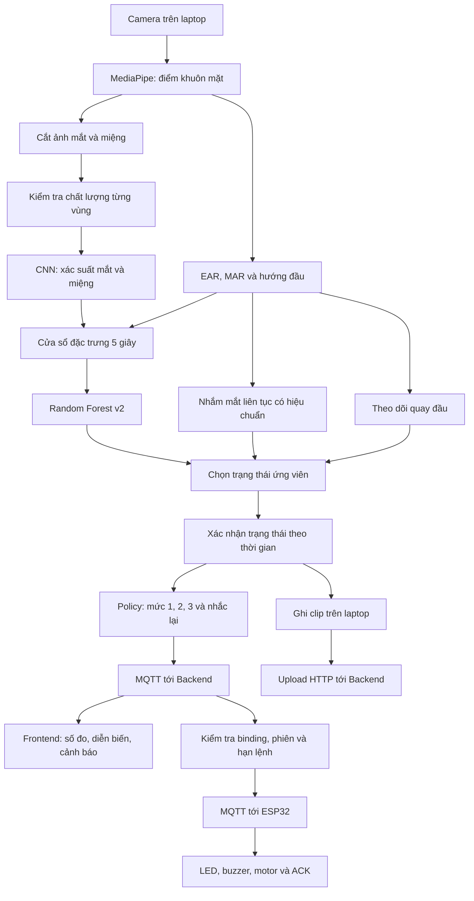

# Luồng xử lý AI v2: dữ liệu, kỹ thuật và logic cảnh báo

Cập nhật ngày **10/11/2026**. Tài liệu mô tả bản chạy bằng `run-multisignal-v2.ps1`, với profile kính v5 đã thử trên camera hiện tại. Bản v2 được chọn qua launcher riêng; model mặc định của các đường chạy cũ chưa được thay tự động.

**Bổ sung cho demo:** `./edge-ai/run-multisignal-v2.ps1 -Demo` tự nạp profile kính v5 cục bộ và bật [quy tắc cúi đầu kéo dài](head-motion-v1.md): cúi ≥12° trong 3 giây → `DROWSY`, lý do `HEAD_DOWN_RISK`. Đây là quy tắc tư thế theo yêu cầu, có thể kích hoạt khi chủ động nhìn xuống. Nhánh này độc lập với ngưỡng mắt nhìn thẳng; không cần hiệu chuẩn mắt lúc cúi. Nhìn thẳng 5 giây đầu để lấy mốc góc.

## 1. Tổng quan

AI chạy trên laptop và kết hợp ba nhóm tín hiệu:

1. **MediaPipe và hình học:** tìm các điểm trên khuôn mặt, tính độ mở mắt EAR, độ mở miệng MAR và hướng đầu.
2. **CNN và Random Forest:** CNN phân tích ảnh vùng mắt/miệng; Random Forest kết hợp các tín hiệu trong một cửa sổ thời gian để đánh giá buồn ngủ.
3. **Quy tắc theo thời gian:** nhánh nhắm mắt liên tục có hiệu chuẩn, nhánh quay đầu, xác nhận trạng thái và tăng mức cảnh báo.

ESP32 nhận lệnh để điều khiển đèn, còi và motor. CNN/Random Forest chạy trên laptop.

Đã bổ sung [nhánh quan sát gật đầu v1](head-motion-v1.md): đo góc đầu riêng, đếm chu kỳ và gửi qua Backend/DB tới giao diện. Nhánh mới đang ở chế độ `OBSERVE_ONLY`, chưa dùng gật đầu để tự đổi trạng thái hoặc tạo lệnh tải.

Nhánh thử hiệu chuẩn mắt theo góc cúi và ứng viên CEW chưa đạt đã được gỡ khỏi bản chạy. Backend/Frontend giữ khả năng đọc trường lịch sử cũ; cảnh báo cúi hiện tại đi qua `head_down_policy` và policy chung.



## 2. Dùng dataset nào?

### 2.1. NTHU-DDD: dữ liệu chính

Dữ liệu huấn luyện hiện tại được khai báo là **NTHU Driver Drowsiness Detection Dataset**, lấy qua bản sao Kaggle. Metadata cục bộ chưa có URL listing chính xác hoặc checksum đối chiếu với tác giả, nên nguồn bản sao chưa được xác thực đầy đủ.

Các nhãn được sử dụng:

| Nhóm | Nhãn |
|---|---|
| Mắt | `NORMAL`, `SLEEPY` |
| Miệng | `NORMAL`, `YAWN`, `TALKING_LAUGHING` |
| Buồn ngủ | `NOT_DROWSY`, `DROWSY` |

Nguồn dữ liệu còn có nhãn hướng đầu, nhưng CNN đang chạy chỉ có hai nhánh mắt và miệng. Hướng đầu trong runtime hiện tại được xử lý bằng hình học.

**`SLEEPY` không đồng nghĩa với mí mắt đang nhắm.** Vì vậy, không thể chỉ nhìn nhãn CNN mắt để kết luận đã phát hiện mọi lần nhắm mắt. Đây là lý do có thêm nhánh EAR độc lập.

Phân chia dữ liệu theo người:

| Phần | Số người | Số video | Vai trò |
|---|---:|---:|---|
| CNN train | 10 | 199 | Huấn luyện CNN vùng mắt/miệng |
| Fusion/RF train | 4 | 75 | Huấn luyện bộ kết hợp theo thời gian |
| Validation | 4 | 80 | Chọn checkpoint, RF và ngưỡng |

Người giữa ba nhóm được tách riêng. Nhóm test lịch sử dự kiến có bốn người khác nhưng dữ liệu lỗi đã bị loại; **chưa có kết quả test cuối độc lập hợp lệ**. Validation đã được dùng để chọn mô hình/ngưỡng nên không được gọi là test độc lập.

Artifact huấn luyện CNN ghi nhận **19.594 mẫu train** và **32.489 mẫu validation**. RF v2 dùng **13.603 cửa sổ train** và **14.083 cửa sổ validation**; các cửa sổ có thể chồng lấn nên không phải từng ấy mẫu độc lập.

### 2.2. Các nguồn dữ liệu khác

| Nguồn | Được dùng vào việc gì? | Có trong runtime v2 hiện tại? |
|---|---|---|
| ImageNet | Trọng số khởi tạo backbone MobileNetV3-Small | Có, qua CNN đã fine-tune |
| CEW — Closed Eyes in the Wild | Thử huấn luyện bốn ứng viên nhận mở/nhắm mắt | Chưa tích hợp; các ứng viên chưa qua thử kính |
| Các lượt camera của người dùng | Hiệu chuẩn EAR và kiểm tra mở/nhắm/nói/ngáp/quay đầu | Profile số đo được dùng; clip thử không dùng huấn luyện CNN/RF |

Hiệu chuẩn cá nhân là tính ngưỡng và mốc tư thế từ số đo. Quá trình này không huấn luyện lại trọng số CNN.

## 3. MediaPipe đo những gì?

### 3.1. Phát hiện điểm khuôn mặt

[face_detection.py](../edge-ai/face_detection.py) sử dụng MediaPipe Tasks FaceLandmarker ở chế độ video, theo dõi một khuôn mặt. Ngưỡng detection, presence và tracking hiện là `0.5`.

MediaPipe cung cấp các điểm hình học. Việc kết luận `DROWSY` là logic kết hợp của dự án.

### 3.2. EAR: độ mở mắt

[eye.py](../edge-ai/eye.py) tính EAR từ sáu điểm quanh mỗi mắt, rồi lấy trung bình hai mắt:

```text
EAR = (khoảng dọc thứ nhất + khoảng dọc thứ hai)
      / (2 × khoảng ngang mắt)
```

EAR nhỏ thường tương ứng mí khép hơn. Kính, phản chiếu, góc camera hoặc landmark sai có thể làm EAR thay đổi dù người thao tác giữ cùng trạng thái mắt.

PERCLOS là tỷ lệ thời gian mắt được xem là nhắm trong cửa sổ quan sát khoảng 10 giây, có thời gian khởi động. Khoảng gián đoạn quá 0,5 giây không được nối thành thời gian nhắm liên tục. Khi guard hoạt động, ngưỡng EAR của guard được dùng cho phép đo này.

**PERCLOS được tính và gửi lên hệ thống, nhưng không nằm trong 36 đầu vào của RF v2.** Không nên nhầm quy tắc PERCLOS của bản baseline cũ với bộ kết hợp v2.

### 3.3. MAR và yawn

[regions.py](../edge-ai/ml/regions.py) tính MAR bằng khoảng cách giữa hai môi chia cho bề ngang miệng.

- **MAR:** một số đo hình học, mô tả miệng mở rộng đến đâu.
- **Yawn:** hành vi ngáp, được CNN và bộ kết hợp theo thời gian đánh giá.

Nói hoặc cười cũng có thể làm MAR tăng. Hệ thống kết hợp MAR với xác suất `YAWN`, `TALKING_LAUGHING` và các tín hiệu khác, thay vì coi mọi lần há miệng là ngáp.

### 3.4. Hướng đầu

[head_pose.py](../edge-ai/head_pose.py) theo dõi độ lệch đầu so với mốc nhìn thẳng:

- `yaw`: độ lệch ngang của mũi so với trung điểm hai mắt, chuẩn hóa theo khoảng cách mắt.
- `pitch`: tỷ lệ khoảng cách dọc mũi–miệng so với chiều cao mặt.
- `roll`: góc nghiêng để quan sát; không dùng làm đầu vào RF hiện tại.

`yaw` và `pitch` ở đây là tỷ lệ, không phải góc độ. Ngưỡng lệch hiện tại là `0.20` cho yaw và `0.05` cho pitch. Lệch liên tục khoảng **2 giây** tạo tín hiệu mất tập trung.

Profile hợp lệ cung cấp mốc nhìn thẳng từ lượt hiệu chuẩn. Khi không có profile, bộ theo dõi cần khoảng 5 giây để lấy mốc trung tính.

`yaw` là hướng đầu; `yawn` là ngáp.

## 4. CNN hoạt động thế nào?

[region_net.py](../edge-ai/ml/region_net.py) dùng **MobileNetV3-Small** làm backbone, sau đó có hai đầu phân loại:

| Đầu ra | Các lớp |
|---|---|
| Mắt | `NORMAL`, `SLEEPY` |
| Miệng | `NORMAL`, `YAWN`, `TALKING_LAUGHING` |

Ảnh crop được đưa về **96 × 96**, chuyển BGR sang RGB và chuẩn hóa theo ImageNet. Backbone tạo vector 576 chiều để các đầu phân loại tính điểm.

Quá trình huấn luyện sử dụng transfer learning, AdamW, Cross Entropy có trọng số lớp và tăng cường ảnh bằng lật ngang, thay đổi độ sáng/tương phản. Lượt fine-tune lưu sáu epoch, chọn checkpoint epoch 4. Bản v2 giữ trọng số CNN đã chọn và huấn luyện lại RF theo đặc trưng mới.

### Tách chất lượng ảnh khỏi confidence

[multisignal_v2_features.py](../edge-ai/ml/multisignal_v2_features.py) kiểm tra crop, độ nét, tương phản và tỷ lệ pixel cực sáng/tối trước khi dùng tín hiệu.

- Confidence dưới `0.6` có thể khiến nhãn mắt/miệng trên màn hình là `UNKNOWN`.
- Nếu ảnh vẫn hợp lệ, các xác suất mềm vẫn được đưa vào bộ kết hợp.
- EAR được đánh giá riêng, không bị xóa chỉ vì CNN phân vân.
- Dữ liệu thiếu được giữ là thiếu; không coi là mắt mở hoặc một phép đo bằng 0.

Kiểm tra kỹ thuật này chưa chứng minh mắt thật sự nhìn rõ qua kính phản chiếu. Đó vẫn là giới hạn cần thử trên từng điều kiện.

CNN chạy tối đa khoảng **5 lần/giây**. Frame hiện tại vẫn kiểm tra crop và EAR; crop hỏng sẽ xóa kết quả CNN cache. Ba xác suất mắt buồn ngủ/ngáp/nói được làm mượt nhân quả khoảng `0.4` giây. EAR dùng cho nhánh nhắm mắt không bị làm mượt theo cách này.

## 5. Random Forest kết hợp theo thời gian

RF nhận chín kênh:

```text
eye_sleepy, mouth_yawn, mouth_talk,
ear, mar, yaw, pitch,
eye_confidence, mouth_confidence
```

Mỗi kênh tạo bốn đặc trưng có trọng số theo thời gian:

```text
mean, standard deviation, percentile 90, coverage
```

Tổng cộng **9 × 4 = 36 đặc trưng**. Cửa sổ dài 5 giây, cần tối thiểu 2 giây lịch sử và ít nhất một kênh mắt hoặc miệng có coverage đạt `0.6`. Gap quá `0.5` giây làm ngắt cửa sổ.

[multisignal_v2_train.py](../edge-ai/ml/multisignal_v2_train.py) cấu hình RF với 200 cây, độ sâu tối đa 8, tối thiểu 8 mẫu ở lá và cân bằng trọng số lớp. RF dự đoán hai lớp `NOT_DROWSY`/`DROWSY`.

Ngưỡng quyết định có hysteresis:

- Đi vào nguy cơ: xác suất RF đạt **0.85**.
- Khi đã dương tính: giữ cho tới khi xuống dưới **0.75**.

Hai ngưỡng khác nhau giúp tránh nhảy trạng thái liên tục khi xác suất dao động sát ranh giới.

Bundle được chọn có mã cơ sở `eye-mouth-v2-d2cdce081cdfb4c9`. Khi thêm cấu hình guard, runtime tạo mã phiên bản riêng để Backend nhận biết đúng tổ hợp đang chạy.

## 6. Nhánh nhắm mắt liên tục

[eye_closure_guard.py](../edge-ai/service/eye_closure_guard.py) bổ sung nhánh EAR độc lập, vì CNN `SLEEPY` không phải bộ phân loại mí đóng/mở.

| Điều kiện | Cách xử lý |
|---|---|
| EAR dưới ngưỡng liên tục ít nhất 1 giây | Bật tín hiệu nguy cơ nhắm mắt |
| Mắt mở theo ngưỡng liên tục ít nhất 1 giây | Xóa tín hiệu nhắm mắt |
| Mất mặt, số đo lỗi hoặc gap quá 0,5 giây | Ngắt bộ đếm |
| Tư thế lệch hoặc vùng mắt không hợp lệ | Không dùng số đo đó để tích lũy guard |

[multisignal_eye_guard.py](../edge-ai/service/multisignal_eye_guard.py) chọn ngưỡng theo điều kiện:

- Khai báo `no-glasses`, chưa có profile: ngưỡng demo mặc định **EAR < 0.20**. Đây chưa phải ngưỡng hiệu chuẩn cho mọi người.
- Khai báo `glasses` hoặc chưa xác định điều kiện: cần profile phù hợp để bật nhánh nhắm mắt.
- Có profile hợp lệ: ưu tiên ngưỡng của profile.

### Profile kính v5 hiện tại

Quy trình mở 8 giây → nhắm 8 giây → mở/nói 30 giây → nhắm 8 giây. Hai lượt đầu dùng để fit; hai lượt sau kiểm tra lặp lại.

Ngưỡng được tính bằng trung điểm giữa trung vị EAR mở và trung vị EAR nhắm của hai lượt FIT. Profile phải vượt kiểm tra tách biệt tín hiệu và thời gian: không kích hoạt nhầm nhắm kéo dài khi mở/nói; quan sát được ít nhất 90% thời gian hợp lệ dưới ngưỡng trong lượt nhắm.

Profile đang dùng:

```text
edge-ai/ml-runs/eye-calibration/20261110T113633Z-c1a71e6e-v5/report.json
```

- Định dạng: `eye-guard-calibration-v5`.
- Điều kiện: đeo kính, camera 0, độ phân giải 640 × 480.
- Profile ID: `operator-01-webcam-0`.
- Ngưỡng EAR: khoảng **0.25026**.
- Runtime có guard: `eye-mouth-v2-guard-2450ae55e409707a`.

Profile gắn với node, camera, độ phân giải, điều kiện kính và nhãn setup do người dùng khai báo. Hệ thống không tự nhận diện người hoặc tự biết bạn đổi kính. Profile bị đánh giá thất bại trên phiên mới sẽ bị loader chặn; không sửa report cũ thành đạt.

## 7. Từ tín hiệu đến bốn trạng thái

Thứ tự chọn trạng thái ứng viên hiện tại:

1. Guard nhắm mắt đang hoạt động → **DROWSY**, lý do `EYE_CLOSURE_RISK`.
2. RF dương tính và còn kênh mắt dùng được hoặc xác suất ngáp đạt ít nhất `0.6` → **DROWSY**, lý do `RF_POSITIVE`.
3. Hướng đầu hợp lệ, đã có mốc và lệch đủ thời gian → **DISTRACTED**.
4. RF âm tính, kênh mắt dùng được và hướng đầu hợp lệ đã có mốc → **ATTENTIVE**.
5. Chưa đủ điều kiện trên → **UNKNOWN**, kèm lý do như đang tích lũy cửa sổ, thiếu coverage hoặc chưa có hướng đầu hợp lệ.

Vì có nhiều nhánh, nhãn CNN mắt `NORMAL` vẫn có thể đi cùng trạng thái tổng `DROWSY`. Cần xem lý do quyết định để biết trạng thái đến từ EAR hay RF.

Sau đó [alert_policy.py](../edge-ai/service/alert_policy.py) xác nhận theo thời gian:

| Trạng thái ứng viên | Thời gian liên tục trước khi đổi trạng thái xác nhận |
|---|---:|
| DROWSY | 0,5 giây |
| DISTRACTED | 0,3 giây |
| ATTENTIVE | 2 giây |
| UNKNOWN | Ngay khi không đủ quan sát |

Mất quan sát không được cộng vào thời gian nguy cơ. UNKNOWN kéo dài ít nhất 2 giây tạo `MONITORING_FAULT`, với nhắc lại tối đa một lần mỗi 30 giây khi vẫn thiếu quan sát.

## 8. Khi nào IoT kêu?

Policy hiện tại là `driver-bench-20261107-v1`. Sau khi xác nhận `DROWSY` hoặc `DISTRACTED`, bộ đếm nguy cơ liên tục mới bắt đầu:

| Thời gian nguy cơ đã xác nhận | Mức | Đầu ra được yêu cầu | Thời lượng đợt |
|---|---:|---|---:|
| 3 giây | 1 | LED và buzzer | 1.000 ms |
| 6 giây | 2 | LED, buzzer và motor | 2.000 ms |
| 10 giây | 3 | LED, buzzer và motor | 3.000 ms |
| Tiếp tục nguy cơ sau mức 3 | 3 | Nhắc lại khoảng mỗi 5 giây | 3.000 ms/đợt |

Các mốc trên tính từ lúc nguy cơ được xác nhận, không phải đúng lúc người bắt đầu khép mí. Khi candidate thay đổi hoặc mất quan sát, bộ đếm nguy cơ bị ngắt; các đợt chưa gửi có thể bị hủy. Tải đã chạy có thể hoàn tất thời lượng của đợt hiện tại.

Nếu nhắm mắt liên tục hai phút và quan sát vẫn hợp lệ, hệ thống dự kiến tăng lên mức 3 rồi nhắc lại. Nó không yêu cầu còi/motor chạy không nghỉ cả hai phút. Nhịp bật/tắt trong mỗi đợt còn phụ thuộc cấu hình từng đầu ra trên ESP32.

### Tại sao còi laptop có thể nghe nhiều hơn?

Âm thanh laptop phát theo sự kiện AI cục bộ. ESP32 chỉ phát sau khi Backend chấp nhận sự kiện và lệnh được giao hợp lệ. Thiết bị offline, binding tắt, sự kiện cũ, hết hạn hoặc mất phiên có thể khiến tải không chạy dù laptop đã kêu.

Đã phát hiện lỗi Backend loại xen kẽ các đợt nhắc mức 3 vì lệch lịch publish vài trăm mili giây, làm nhịp thực tế gần 10 giây. Bản sửa đã được triển khai: giữ đợt mới còn hạn, đợi đủ khoảng cách 5 giây rồi gửi; không gia hạn lệnh. Dispatcher kiểm tra hàng đợi mỗi 0,2 giây.

Kiểm thử Backend và PostgreSQL/MQTT tạm đã đạt. **Nhịp tải vật lý sau bản sửa chưa được nghiệm thu lại.** Một số lệnh cũ còn có `COMMAND_EXPIRED`; cần kiểm tra lại hạn lệnh và đồng bộ giờ ESP32 trong lượt chạy thật.

## 9. AI, Backend, Frontend và ESP32 nối với nhau thế nào?

### 9.1. Telemetry và sự kiện qua MQTT

Ví dụ với `vision-01`:

```text
driver/vision-01/telemetry
driver/vision-01/events
```

Telemetry gửi khoảng mỗi giây: EAR, PERCLOS, trạng thái, phiên bản model, thời điểm quan sát và nhóm `ai_signals` có MAR, xác suất, chất lượng/lý do. Sự kiện mô tả đổi trạng thái, đạt mức cảnh báo, kết thúc phiên hoặc lỗi giám sát.

AI lưu bản tin vào SQLite outbox trước khi gửi. MQTT gửi thành công chưa chứng minh Backend đã lưu; hệ thống có storage ACK riêng. Bản tin gửi bù có thể được lưu làm lịch sử nhưng không được dùng để phát lại cảnh báo cũ xuống tải.

### 9.2. Backend quyết định có tạo lệnh không

Backend kiểm tra:

- Rule Engine và binding giữa Vision Node/Alert Node.
- Trạng thái quản lý, kết nối thiết bị và policy.
- Phiên, episode, độ mới của quan sát và hạn lệnh.
- Khoảng cách giữa các đợt gửi và lệnh trước còn đang xử lý.

Các phần chính: [ai_policy.py](../backend/app/services/ai_policy.py), [command_dispatch.py](../backend/app/services/command_dispatch.py).

ESP32 phản hồi ACK như `ACCEPTED`, `COMPLETED`, `FAILED`. `COMPLETED` cho biết firmware hoàn tất xử lý lệnh; nếu không có cảm biến phản hồi tải, nó chưa tự chứng minh motor thật sự quay hoặc dây điện nối đúng.

Frontend hiển thị số đo/diễn biến từ dữ liệu Backend. Lịch sử lệnh phản ánh lệnh gửi tới Alert Node; có sự kiện AI chưa chắc đã có lệnh nếu điều kiện điều khiển không đạt.

### 9.3. Video qua HTTP

Video được ghi trên laptop, sau đó worker upload bằng HTTP với credential của thiết bị nguồn. Tài khoản đăng nhập web không thay thế credential này.

Clip có thể kết thúc khi đổi trạng thái hoặc đạt giới hạn khoảng 60 giây/32 MB. Vì vậy clip có thể dài 2 giây hoặc hơn chục giây. Luồng demo có thể ghi nhiều trạng thái, không chỉ DROWSY. File cần hoàn tất và upload/ghép với sự kiện thành công thì web mới xem được.

MQTT gửi số đo/sự kiện và HTTP upload video là hai đường riêng. Có telemetry không bảo đảm video upload thành công.

## 10. Kết quả đã kiểm tra và phạm vi

Phiên kính đầy đủ `20261110T115214Z-glasses` hoàn thành chín lượt ở cùng người, kính và camera:

| Thao tác | Kết quả quan sát |
|---|---|
| Mở mắt/chớp tự nhiên khoảng 60 giây | ATTENTIVE, không báo nhầm DROWSY/UNKNOWN trong khoảng đo |
| Nhắm mắt khoảng 8 giây | Chuyển DROWSY; lần xác nhận đầu khoảng giây 1,58 của lượt đo |
| Mở lại | ATTENTIVE |
| Nói bình thường | ATTENTIVE |
| Ngáp tự nhiên, được người thao tác xác nhận | DROWSY, chủ yếu do nhánh RF |
| Quay trái/phải | DISTRACTED |
| Che camera | UNKNOWN, xóa số đo cũ |
| Bỏ che và nhìn thẳng | Hồi phục ATTENTIVE |

Review ghi `PASSED` cho **một phiên camera có hướng dẫn trên setup hiện tại**. Thời điểm thao tác có thể bắt đầu trong phần chuẩn bị; số giây theo lượt không phải phép đo độ trễ từ nhãn đóng mí độc lập. Số frame hoặc số giây đạt không được gọi là Accuracy/F1.

Các lượt camera riêng này không gửi MQTT/HTTP hoặc bật tải. Phần còn phải nghiệm thu là toàn luồng AI → Backend → web/video → ESP32 sau các thay đổi mới, cùng khả năng hoạt động trên người, kính, góc ngồi và ánh sáng khác. Chưa có test cuối độc lập để công bố độ chính xác tổng quát.

Nhật ký kỹ thuật chi tiết: [AI v2 — chất lượng và hiệu chuẩn](ai-v2-quality-calibration.md).

## 11. Lệnh chạy

Chạy từ thư mục gốc repo bằng PowerShell. Profile dưới đây nằm cục bộ; máy khác pull code chưa chắc có profile hoặc bundle đã huấn luyện.

### Kiểm tra artifact

```powershell
./edge-ai/run-multisignal-v2.ps1 -Check
```

### Thử kính riêng trên camera

Chạy đủ chín tình huống, lưu log/clip riêng trên máy; không gửi lệnh ESP32:

```powershell
$taskCalibration = 'edge-ai/ml-runs/eye-calibration/20261110T113633Z-c1a71e6e-v5/report.json'
./edge-ai/run-multisignal-v2.ps1 -Condition glasses -CalibrationPath $taskCalibration -ProfileId operator-01-webcam-0
```

Thêm `-EyeTrial` nếu chỉ cần lượt mắt ngắn gồm mở → nhắm → mở lại → nói.

### Demo toàn luồng

Lệnh này mở camera, MQTT và luồng upload; có thể điều khiển ESP32 theo binding đang bật:

```powershell
$taskCalibration = 'edge-ai/ml-runs/eye-calibration/20261110T113633Z-c1a71e6e-v5/report.json'
./edge-ai/run-multisignal-v2.ps1 -Demo -Condition glasses -CalibrationPath $taskCalibration -ProfileId operator-01-webcam-0
```

Muốn nghe riêng còi IoT, đặt biến sau **trước khi mở tiến trình AI mới**:

```powershell
$env:AI_LOCAL_ALERT_ENABLED = 'false'
```

Biến này tắt âm thanh AI trên laptop cho tiến trình mới, không tắt còi ESP32. Gỡ biến khi cần dùng lại cấu hình âm thanh ban đầu:

```powershell
Remove-Item Env:AI_LOCAL_ALERT_ENABLED
```

Bấm `Q` để đóng cửa sổ AI cũ trước khi mở phiên mới dùng cùng camera.

## 12. Cách trình bày ngắn khi bảo vệ

> Hệ thống xử lý camera tại laptop. MediaPipe tìm các điểm khuôn mặt để tính EAR, MAR và hướng đầu. MobileNetV3-Small phân loại ảnh mắt, miệng; Random Forest kết hợp các xác suất và số đo trong cửa sổ năm giây. Nhánh EAR có hiệu chuẩn riêng bổ sung phát hiện nhắm mắt kéo dài. Hệ thống xác nhận trạng thái theo thời gian rồi gửi telemetry và sự kiện qua MQTT tới Backend. Backend kiểm tra liên kết và hạn lệnh trước khi điều khiển ESP32. Video được upload riêng bằng HTTP. Bản kính hiện tại đã qua một phiên thử đủ tình huống trên setup của nhóm; chưa có đánh giá độc lập để khẳng định độ chính xác trên mọi người và mọi điều kiện kính.

## 13. Tài liệu tham khảo

- [MediaPipe Face Landmarker — tài liệu chính thức](https://developers.google.com/edge/mediapipe/solutions/vision/face_landmarker).
- [Torchvision MobileNetV3-Small — kiến trúc và trọng số ImageNet](https://docs.pytorch.org/vision/stable/models/generated/torchvision.models.mobilenet_v3_small.html).
- [Detection of Driver Drowsiness Using Multi-Task Learning — mô tả nhóm nhãn NTHU-DDD](https://www.csie.ntu.edu.tw/~fuh/personal/DetectionofDriverDrowsinessUsingMulti-TaskLearning.pdf).
- [CEW — trang dữ liệu chính thức](https://parnec.nuaa.edu.cn/_upload/tpl/02/db/731/template731/pages/xtan/ClosedEyeDatabases.html).

Thông số runtime và kết quả phiên thử trong tài liệu này lấy từ code/artifact cục bộ của dự án tại ngày cập nhật. Các nguồn ngoài giải thích công cụ và dataset, không xác nhận kết quả nghiệm thu riêng của nhóm.
