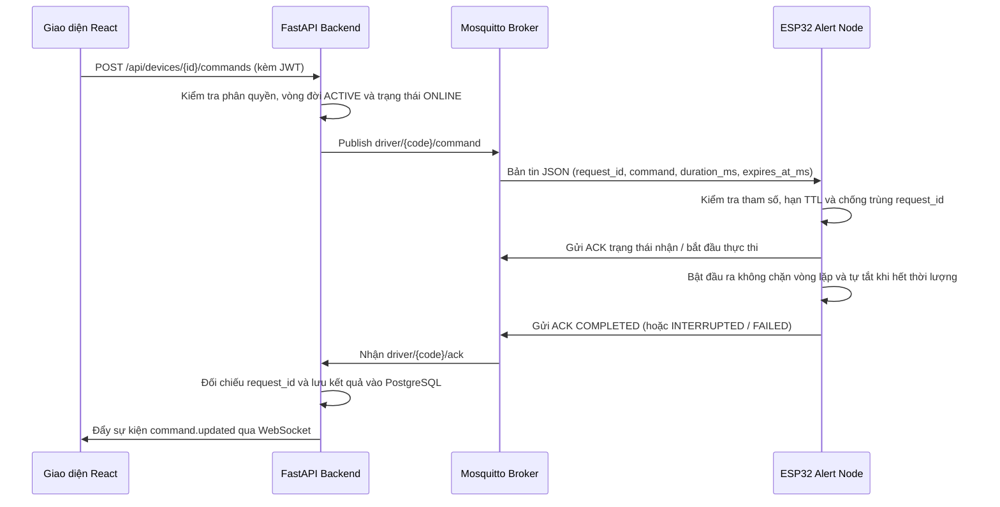

# Luồng giao tiếp MQTT trên ESP32 Alert Node

Tài liệu mô tả chu trình nhận lệnh điều khiển, phản hồi `ACK` và đồng bộ cấu hình từ xa của firmware trong `src/app/`.

---

## 1. Xử lý lệnh điều khiển và xác nhận (`Command` & `ACK`)

- **Tập lệnh phần cứng hỗ trợ:** `LED_ON` / `LED_OFF`, `BUZZER_ON` / `BUZZER_OFF`, `MOTOR_ON` / `MOTOR_OFF`.
- **Gộp lệnh kiểm tra (`TEST_ALERT`):** Một yêu cầu kiểm tra từ giao diện Web được Backend tách thành 3 lệnh con tương ứng với 3 đầu ra; lệnh tổng trên hệ thống được tính là hoàn tất khi nhận đủ cả 3 phản hồi `COMPLETED`.
- **Kiểm tra hợp lệ & Chống chạy lặp:**
  - Firmware kiểm tra định dạng lệnh, giới hạn thời lượng (`duration`), đồng bộ đồng hồ và hạn sử dụng bản tin (`expires_at_ms`); nếu quá hạn hoặc sai tham số sẽ từ chối ngay kèm mã lỗi trong gói `FAILED`.
  - Nhật ký `request_id` được lưu trong bộ nhớ NVS giúp thiết bị nhận biết gói tin gửi lại do mạng chập chờn: trả lại đúng trạng thái `ACK` đã lưu mà không kích hoạt lại còi/motor lần thứ hai.
- **Điều khiển không chặn (`Non-blocking`):** Quá trình bật/nhấp nháy tải sử dụng bộ đếm thời gian `millis()` trong vòng lặp chính, đảm bảo ESP32 vẫn duy trì kết nối MQTT và nhận được lệnh ngắt ưu tiên cao hơn bất kỳ lúc nào.

---

## 2. Đồng bộ cấu hình từ xa và duy trì kết nối

- **Cấu hình nhịp cảnh báo (`Config Shadow`):** Backend phát cấu hình mới gồm `config_id`, `revision` và bảng thời gian bật/tắt 3 mức tới topic `driver/{code}/config/update` (cờ `retained`, `QoS 1`). ESP32 kiểm tra tính hợp lệ và số thứ tự `revision` (bỏ qua nếu `revision` cũ hơn bản đang lưu), ghi xuống bộ nhớ Flash **NVS** rồi gửi phản hồi `APPLIED` hoặc `REJECTED` lên `driver/{code}/config/applied`.
- **Kết nối & Đồng bộ thời gian:** Thiết bị gửi heartbeat định kỳ mỗi **5 giây** lên `driver/{code}/status`, tự động kết nối lại Wi-Fi/MQTT khi mất sóng và ưu tiên đồng bộ giờ qua máy chủ NTP nội bộ trong mạng LAN trước khi dùng máy chủ NTP Internet dự phòng.

Tham khảo thêm: [Hướng dẫn biên dịch & nạp Firmware](README.md) · [Kịch bản Demo hệ thống](../../README.md#4-kịch-bản-demo-tổng-thể-10-bước-nghiệm-thu).
