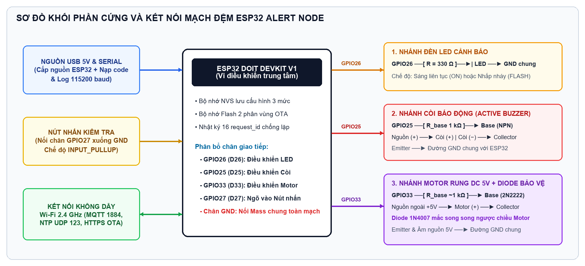
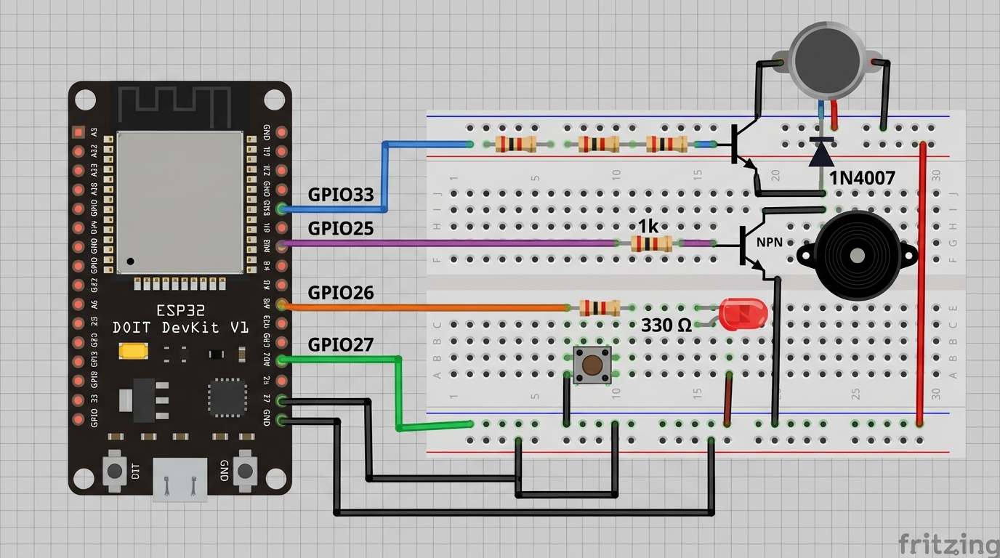
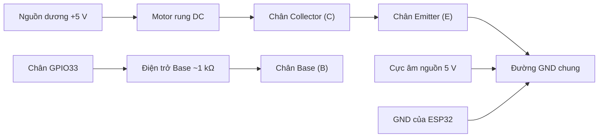

# Thiết kế phần cứng — ESP32 Alert Node

Tài liệu này mô tả danh sách linh kiện, phân bổ chân GPIO, nguyên lý cấp nguồn và sơ đồ đấu nối trên breadboard cho mạch cảnh báo **ESP32 Alert Node**.

---

## 1. Danh mục linh kiện và phân bổ chân GPIO

| Linh kiện | Chân ESP32 / Thông số | Vai trò và cách kết nối |
|---|---|---|
| **Vi điều khiển** | `ESP32 DOIT DevKit V1` | Kết nối Wi-Fi 2.4 GHz, nhận lệnh MQTT và điều khiển các cơ cấu chấp hành; giao tiếp Serial `115200 baud` |
| **Đèn LED cảnh báo** | `GPIO26` (`D26`) | Mắc nối tiếp qua điện trở hạn dòng `330 Ω` xuống `GND` |
| **Còi báo động (Active Buzzer)** | `GPIO25` (`D25`) | Điều khiển đóng/ngắt mức thấp (low-side switch) qua transistor NPN và điện trở cực Base `~1 kΩ` |
| **Motor rung DC (5 V)** | `GPIO33` (`D33`) | Điều khiển qua transistor NPN (`2N2222`), điện trở cực Base `~1 kΩ` và diode dập xung ngược `1N4007` |
| **Nút nhấn kiểm tra** | `GPIO27` (`D27`) | Cấu hình `INPUT_PULLUP` nội; một chân nối `GPIO27`, chân còn lại nối xuống `GND` |

---

## 2. Nguyên tắc cấp nguồn và đấu nối trên Breadboard

- **Cấu trúc hàng lỗ Breadboard:** Trên mỗi hàng ngang, 5 lỗ **A–E** thông nhau thành một nút điện; 5 lỗ **F–J** bên đối diện là nút điện riêng biệt, ngăn cách qua rãnh giữa.
- **Thanh nguồn dọc (`+` / `−`):** Hai dải nguồn hai bên mép breadboard không tự thông nhau; một số loại breadboard còn ngắt đôi thanh nguồn ở vạch giữa nên cần kiểm tra thông mạch hoặc nối dây cầu cùng cực (`+` với `+`, `−` với `−`) khi chia nguồn.
- **Nguyên tắc chung Mass (`GND`):** Chân `GND` của ESP32, chân `Emitter (E)` của các transistor điều khiển và cực âm (`−`) của nguồn cấp ngoài cho motor **bắt buộc phải nối chung một đường `GND`**.
- **Tách nguồn công suất cho Motor 5 V:** Không cấp trực tiếp nguồn của motor rung từ chân `3V3` hoặc chân GPIO của ESP32 để tránh quá dòng hoặc sụt áp khởi động (`Brownout`). Nguồn dương `+5 V` cấp riêng cho nhánh motor, chỉ nối chung cực âm `GND`.
- **An toàn thao tác:** Luôn ngắt cáp USB và nguồn ngoài trước khi cắm rút dây hoặc thay đổi linh kiện trên breadboard.

---

## 3. Sơ đồ khối, sơ đồ đấu nối và vị trí cắm nhánh Motor rung

### Sơ đồ khối phần cứng

### Sơ đồ đấu nối trên Breadboard 30 hàng (minh họa)

> *Ghi chú: Hình trên là sơ đồ đấu nối minh họa nguyên lý và phân bổ chân GPIO (`GPIO25`, `GPIO26`, `GPIO27`, `GPIO33`) trên Breadboard 30 hàng; khi lắp mạch vật lý thực tế cần đối chiếu đúng thứ tự chân `E–B–C` theo vỏ transistor và đảm bảo đường `GND` chung.*

### Sơ đồ nguyên lý nhánh Motor rung

- **Diode chống xung ngược (`1N4007`):** Mắc song song ngược chiều với hai đầu motor — **đầu có vạch bạc (Cathode) nối vào cực dương `+5 V` của motor**, đầu không vạch (Anode) nối vào cực âm của motor (tại chân `Collector` của transistor) để triệt tiêu suất điện động cảm ứng khi motor ngắt.

### Bảng vị trí cắm tham chiếu trên Breadboard 30 hàng (nửa A–E)

| Nhánh mạch | Vị trí lỗ cắm tham chiếu |
|---|---|
| **Tín hiệu điều khiển** | Chân `D33` (`GPIO33`) của ESP32 → lỗ **A10** |
| **Điện trở hạn dòng cực Base** | Điện trở `1 kΩ` nối từ **A10 → A6** *(hoặc cụm 3 điện trở `330 Ω` mắc nối tiếp `B10–B9`, `E9–E8`, `D8–D6` tương đương `~990 Ω`)* |
| **Transistor NPN (`2N2222`)** | Cắm tại 3 hàng **C5 / C6 / C7** ứng với thứ tự chân **C5 = Emitter (E)**, **C6 = Base (B)**, **C7 = Collector (C)** *(cần kiểm tra đúng sơ đồ chân E–B–C theo vỏ linh kiện thực tế)* |
| **Đường GND chung** | Chân `GND` của ESP32 → lỗ **A5** (cùng hàng với Emitter `C5`) và nối chung với cực âm nguồn motor |
| **Motor rung DC** | Dây dương (đỏ) → lỗ **C12**; dây âm (đen) → lỗ **B7** (cùng hàng với Collector `C7`) |
| **Diode dập xung `1N4007`** | Đầu có vạch bạc → lỗ **D12** (hàng dương motor); đầu không vạch → lỗ **D7** (hàng âm motor / Collector) |
| **Nguồn cấp Motor** | Cực dương `+5 V` → lỗ **A12**; cực âm `−` → nối vào đường **GND chung** |

> **Lưu ý tránh đấu tắt qua transistor:** Không nối trực tiếp hàng `7` (Collector) xuống hàng `5` (GND) và không cắm dây âm của motor sang hàng `5`, vì làm vậy dòng điện sẽ đi thẳng về mass khiến motor quay liên tục ngay khi cấp nguồn mà không phụ thuộc lệnh từ `GPIO33`.

---

## 4. Quy trình kiểm tra độc lập từng tầng mạch

Khi cần kiểm tra nhanh phần cứng trên breadboard trước khi chạy tải công suất, có thể tách kiểm tra theo 2 bước:

1. **Kiểm tra tín hiệu xuất từ `GPIO33`:** Tạm ngắt nguồn nhánh motor, nối `GPIO33` qua điện trở `330 Ω` và một đèn LED đơn về `GND`, sau đó bấm **Kiểm tra cảnh báo** trên giao diện Web (thời lượng rung `3000 ms`). Nếu LED sáng đúng thời lượng rồi tự tắt nghĩa là vi điều khiển và luồng MQTT hoạt động tốt.
2. **Kiểm tra khả năng đóng/ngắt của Transistor:** Giữ mạch cực Base (`GPIO33 → 1 kΩ → B`) và `Emitter → GND`, thay nhánh tải motor bằng `3V3 → 330 Ω → LED → Collector (hàng 7)`. Gửi lại lệnh kiểm tra trên Web: LED tắt khi nghỉ và chỉ sáng trong thời gian có lệnh chứng tỏ transistor đóng/cắt đúng cực tính. Sau bước này, ngắt điện, tháo LED thử và đấu lại nhánh motor 5 V cùng diode `1N4007`.

---

## 5. Bảng tra cứu xử lý sự cố thường gặp

| Hiện tượng | Nguyên nhân phổ biến & Cách khắc phục |
|---|---|
| Motor quay liên tục ngay khi vừa cắm nguồn | Dây âm motor cắm nhầm thẳng vào hàng `GND` hoặc ngược thứ tự chân `E` và `C` của transistor; ngắt nguồn và kiểm tra lại hàng `5–7` |
| Đèn nguồn ESP32 chớp tắt hoặc Serial báo `Brownout detector was triggered` | Sụt áp nguồn do chạm chập thanh `+` và `−` hoặc lấy nguồn motor trực tiếp từ đường yếu trên ESP32; kiểm tra lại dây cầu thanh nguồn và cấp nguồn 5 V đủ dòng cho motor |
| Hệ thống báo `ONLINE` qua MQTT nhưng máy tính không thấy cổng `COM` | Cáp USB đang dùng chỉ có dây sạc hoặc lỏng tiếp xúc dữ liệu; đổi sang cáp USB hỗ trợ truyền data và kiểm tra bằng `pio device list` |
| Lệnh trên Web báo `COMPLETED` nhưng còi/motor không kêu | `COMPLETED` xác nhận firmware đã chạy hết chu kỳ xuất chân GPIO; kiểm tra lại dây nguồn cấp cho tải, chân transistor và chiều diode |

---

## 6. Checklist kiểm tra trước buổi Demo

- [ ] Toàn bộ đường `GND` (ESP32, Emitter transistor, âm nguồn ngoài) đã nối chung chắc chắn.
- [ ] Diode `1N4007` lắp đúng chiều vạch bạc quay về phía cực dương `+5 V` của motor.
- [ ] Khi mới cấp nguồn (chưa gửi lệnh), cả LED, Còi và Motor đều ở trạng thái nghỉ hoàn toàn.
- [ ] Gửi lệnh **Kiểm tra cảnh báo** từ Web: cả 3 cơ cấu chấp hành bật đúng nhịp, tự dừng khi hết thời lượng và không làm ESP32 bị khởi động lại.

Tham khảo thêm: [Hướng dẫn biên dịch và nạp Firmware ESP32](../firmware/esp32-alert-node/README.md) · [Kịch bản nghiệm thu](../tests/final-acceptance.md).
