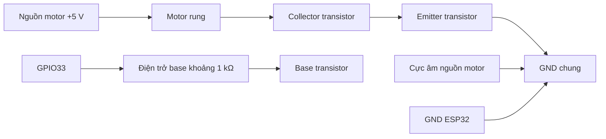

# Phần cứng Alert Node

Tài liệu mô tả GPIO, đường nguồn và vị trí đấu dây của mạch nhóm. Vị trí
breadboard là vị trí tham chiếu, không phải sơ đồ chân chung cho mọi transistor.

## 1. Board, linh kiện và GPIO

| Thành phần | GPIO / thông số | Cách dùng |
|---|---|---|
| ESP32 | PlatformIO `esp32doit-devkit-v1`; firmware demo `development` | Cấp board qua USB; đọc tên chân in trên board, không đếm chân vật lý từ tên GPIO |
| LED cảnh báo | GPIO26 | Nối tiếp điện trở 330 Ω; khác LED thử GPIO33 bên dưới |
| Còi active | GPIO25 | Qua transistor và điện trở base khoảng 1 kΩ; điện áp định mức còi cần đối chiếu linh kiện |
| Motor rung | GPIO33; **5 V theo thông số người dùng cung cấp** | Qua transistor, điện trở base và diode; nguồn thực tế/dòng khởi động chưa được đo |
| Transistor motor | Chữ trên thân: **`2N2222 / A331`** | Chưa xác nhận nhà sản xuất và pinout E/B/C bằng datasheet đúng linh kiện hoặc phép đo |
| Nút nhấn | GPIO27 | `INPUT_PULLUP`; nhấn nối GPIO27 xuống GND |
| Serial | 115200 baud | Chọn USB–Serial hiện có bằng `pio device list`; số COM có thể đổi |

Người dùng đã quan sát LED/còi hoạt động theo lệnh. Không suy điện áp tải từ tên
GPIO. Cần bổ sung ảnh board và nguồn thực tế trước khi chốt sơ đồ phần cứng.

## 2. Nguồn và thanh nguồn breadboard

- Các lỗ **A–E cùng số hàng** nối điện với nhau; **F–J cùng số hàng** là nhóm
  khác, tách khỏi A–E qua rãnh giữa.
- Hai bên thanh nguồn thường không nối sẵn. Một số breadboard ngắt thanh nguồn
  ở giữa; cùng dấu/cùng bên chưa chứng minh đã thông điện.
- Quy ước **“+” là nguồn dương**, **“−” là GND**. Dấu in không tự tạo điện áp;
  phải lần dây cấp vào từng thanh.
- GND ESP32, emitter driver motor và cực âm nguồn motor phải có đường nối chung.
- Khi chia **cùng một nguồn**, nối cầu **+ với +, − với −**. Không nối chung
  các thanh dương của những nguồn khác nhau.
- **Tháo dây cầu nối thanh có VIN sang thanh có GND**, kể cả khi hai thanh nằm
  khác phía. Đường nối đó làm nối tắt nguồn, không phải cách chia nguồn.
- Motor dùng nguồn **5 V ổn định, đủ dòng theo tải**. Phương án dưới đây dùng
  nguồn motor riêng, cực âm nối GND chung. Không nối cực dương nguồn riêng vào
  VIN/3V3 hoặc thanh dương đang được ESP32 cấp. Chưa đo dòng/khả năng cấp tải
  để chốt dùng VIN làm nguồn motor; không cấp motor 5 V từ 3V3.

Nguồn 5 V riêng là phương án cấp nguồn tham chiếu; chưa có xác nhận người dùng
đã lắp nguồn riêng trên mạch hiện tại. Thông số định mức 5 V không thay cho việc
kiểm tra nguồn đang cấp thực tế.

**Rút USB và ngắt nguồn ngoài trước khi chỉnh dây.** Nếu báo brownout hoặc đèn
nguồn tắt, tách tải và kiểm tra nguồn trước, không tiếp tục gửi lệnh tải.

## 3. Nhánh motor và đường GND đã chỉnh

Diode 1N4007 mắc song song motor: **đầu có vạch bạc về dương motor**, đầu không
vạch về âm motor/collector. Sơ đồ chức năng không thay việc xác nhận đúng chân
transistor và nguồn trên mạch thực.

| Đường nối | Vị trí trên nửa A–E |
|---|---|
| Điều khiển | **GPIO33/D33 → A10** |
| Điện trở base cũ | Ba điện trở **330 Ω nối tiếp**: **B10–B9, E9–E8, D8–D6**, tổng khoảng 990 Ω |
| Phương án thay cả chuỗi | Một điện trở **1 kΩ tại A10–A6**; không dùng đồng thời hai phương án |
| Transistor | Ba chân cắm **C5/C6/C7**; mạch yêu cầu **C5 = E, C6 = B, C7 = C**, phải xác nhận đúng pinout linh kiện |
| GND hàng transistor | **GND ESP32 → A5** trong lượt chỉnh; **D5 → thanh GND** là vị trí cũ tương đương nếu cùng đường GND thật |
| Motor | Dây đỏ → **C12**; dây đen → **B7**; lần theo màu dây sát motor, không suy cực từ màu jumper nối thêm |
| Diode | Đầu có vạch bạc → **D12**; đầu không vạch → **D7** |
| Nguồn motor | Nguồn motor +5 V → **A12**; cực âm nguồn → **GND chung** |

A5/C5/D5 cùng nhóm điện. Chuyển GND tới A5 không có nghĩa D5 vốn là vị trí sai.
Bảng ghi **chức năng cần có** tại mỗi hàng, chưa xác nhận thứ tự chân của
transistor đã mua. **Không mặc định chữ `2N2222 A331` tương đương thứ tự E–B–C**;
đối chiếu datasheet từ nhà cung cấp hoặc đo/test transistor trước khi chốt mạch.

**Không giữ dây thử E7–E5; không chuyển âm motor từ B7 sang B5.** Các đường nối
đó bỏ qua transistor, có thể làm motor rung liên tục ngoài lệnh.

## 4. LED thử và cách tháo sau kiểm tra

Hai bài này dùng LED rời với điện trở hạn dòng, **motor ngắt nguồn**: rút đầu
nối dây đỏ motor, ngắt nguồn A12, để đầu dây rời không chạm nhau. Chỉ dùng vùng
A–E hàng 20–23 nếu đang trống. Giữ nguyên LED cảnh báo GPIO26 và nhánh còi GPIO25.

### 4.1. Kiểm tra riêng GPIO33

Tách dây GPIO33 khỏi A10 rồi đấu:

| Thành phần | Vị trí |
|---|---|
| GPIO33 | **A20** |
| Điện trở LED 330 Ω | **B20–B22** |
| LED thử | Anode/chân dài chưa cắt → **C22**; cathode/chân ngắn → **C23** |
| GND ESP32 | **A23** |

Đường điện: **GPIO33 → 330 Ω → LED → GND**. Giữ firmware `development`, đợi node
ONLINE rồi gửi kiểm tra với thời lượng rung 3000 ms một lần trên web. Người
dùng đã xác nhận LED thử nháy rồi tắt: GPIO33 có tín hiệu theo lệnh; chưa chứng
minh nhánh transistor hoặc khả năng cấp dòng motor.

### 4.2. Kiểm tra nhánh transistor bằng LED

Ngắt nguồn, giữ LED/điện trở B20–B22/C22–C23 và mạch transistor/điện trở base mục 3.
Đổi dây so với bài 4.1:

| Đường nối | Thay đổi |
|---|---|
| GPIO33 | Chuyển từ A20 về **A10** |
| GND ESP32 | Chuyển từ A23 tới **A5** |
| Nguồn LED thử | Thêm **3V3 ESP32 → A20** |
| Âm LED thử tới transistor | Thêm **A23 → A7** |

**3V3 là nguồn 3,3 V, khác GPIO33/D33.** Phải chuyển GPIO33 khỏi A20 trước khi
thêm dây 3V3; không dùng VIN thay 3V3 trong bài thử này.

Đường điện: **3V3 → 330 Ω → LED → hàng 7/transistor → hàng 5/GND**. LED phải tắt
khi chưa có lệnh, sáng/nháy rồi tắt theo lệnh kiểm tra rung 3000 ms. Kết quả đúng
chỉ xác nhận đóng/ngắt được tải nhỏ, chưa chứng minh đủ dòng cho motor.

### 4.3. Tháo bộ LED thử

Ngắt USB và mọi nguồn ngoài. Với cách đấu bài 4.2, tháo đúng bốn phần:

1. Dây **3V3 ESP32 → A20**.
2. Điện trở thử **B20–B22**.
3. LED thử **C22–C23**.
4. Dây thử **A23 → A7**.

Giữ **GPIO33 → A10**, **GND ESP32 → A5**, transistor và điện trở base; không tháo
nhầm LED/điện trở của GPIO26 hoặc nhánh còi. Chỉ phục hồi nguồn A12 khi đã kiểm
tra nguồn 5 V, pinout, diode và GND. Không dùng nguồn 3V3 của bài LED để cấp motor.

Người dùng báo motor có rung sau lượt chỉnh. Vì bài thử quy định motor ngắt
nguồn, báo cáo đó chưa đủ để coi bài 4.2 đạt hoặc nghiệm thu mạch motor hoàn
chỉnh. Cần xác nhận trạng thái mạch và chu kỳ motor bật/tắt sau khi tháo bộ thử.

## 5. Hiện tượng đã gặp

| Hiện tượng | Ý nghĩa / xử lý |
|---|---|
| Nối E7–E5 hoặc chuyển B7 sang B5 thì motor rung liên tục | Đã bỏ qua transistor; tháo dây nối tắt, âm motor giữ B7 |
| Lay điện trở E8–E9 thì motor rung khi chưa gửi lệnh | Nghi tiếp xúc hở/chập hoặc chân trần chạm nhau; ngắt nguồn kiểm tra, chưa chốt riêng linh kiện hỏng |
| Nối tải làm đèn nguồn tắt, báo `Brownout` | Nguồn ESP32 bị sụt; đã phát hiện cầu nối giữa thanh có VIN và thanh có GND. Tháo cầu sai, kiểm tra tải/nguồn trước khi thử tiếp |
| Chỉ VIN/GND vào hai thanh không tải thì đèn vẫn sáng | Bước không tải đã đạt, không chứng minh nguồn chịu được cả ba tải |
| Web báo `COMPLETED` | Firmware hoàn thành chu kỳ xử lý; không có cảm biến xác nhận motor quay |
| MQTT vẫn hoạt động nhưng không thấy COM | Kiểm tra USB/cáp/cổng hiện có; đèn nguồn sáng không chứng minh USB truyền dữ liệu được, không suy firmware đã mất |

Tham khảo: [transistor làm công tắc](https://learn.sparkfun.com/tutorials/transistors/),
[brownout ESP32](https://docs.espressif.com/projects/esp-idf/en/latest/esp32/api-guides/fatal-errors.html#brownout).

## 6. Kiểm tra trước khi chốt demo

- [ ] Bổ sung ảnh board, hai bên breadboard, nguồn và pinout đúng transistor.
- [ ] Xác nhận nguồn motor 5 V, dòng khởi động, chiều diode và đầu nối chắc chắn.
- [ ] Motor đứng yên khi khởi động/chưa có lệnh; không tự rung khi tiếp điểm đã cố định.
- [ ] Motor rung đúng lệnh và tự dừng hết thời lượng sau khi tháo bộ LED thử.
- [ ] Cả LED/còi/motor hoạt động đồng thời, không brownout hoặc mất kết nối.
- [ ] Ghi request_id, ACK và quan sát tải thật; ACK không thay quan sát.

Chưa đánh dấu hoàn tất phần cứng chỉ từ build hoặc một lần motor rung. Xem
[firmware và lệnh chạy](../firmware/esp32-alert-node/README.md),
[kịch bản nghiệm thu](../tests/final-acceptance.md).
