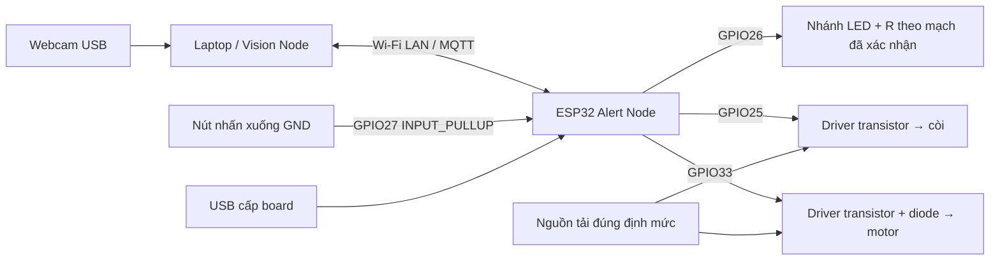

# Phần cứng Alert Node — phân biệt code, tài liệu và mạch thực

Board cấu hình: **ESP32 DOIT DevKit V1**, `board=esp32doit-devkit-v1` trong PlatformIO. Số chân của board đang cầm: **chưa xác nhận bằng ảnh/đo thực tế**. Không suy số chân vật lý từ tên board.

| Thành phần | GPIO | Nguồn cấp | Cách kết nối có nguồn xác nhận | Nguồn thông tin |
|---|---:|---|---|---|
| LED | 26 | Mạch thực chưa xác nhận | Tài liệu nêu nối tiếp 330 Ω; cần xác nhận cực LED/đầu còn lại ở mạch thực | `include/config.h`; firmware README |
| Còi active | 25 | Điện áp định mức và nguồn thực chưa xác nhận | README yêu cầu qua transistor, base khoảng 1 kΩ; chưa có mã transistor/pinout xác nhận | Firmware README; code chỉ chứng minh chân điều khiển |
| Motor rung | 33 | Nguồn riêng đúng điện áp motor; điện áp chưa xác nhận | README mô tả transistor thứ hai, ba R 330 Ω nối chuỗi khoảng 990 Ω; diode 1N4007 mắc ngược song song motor | Firmware README mục 6.3 |
| Nút nhấn | 27 | Logic ESP32 | INPUT_PULLUP; nhấn nối GPIO27 xuống GND | Code và firmware README |
| ESP32 | USB theo hướng dẫn thử | USB; cách cấp nguồn mạch thực cần TV1 xác nhận | Không suy còi/motor được cấp từ VIN/3V3 chỉ vì GPIO có trong code | Firmware README |
| GND chung | GND | 0 V tham chiếu | Tài liệu yêu cầu GND ESP32 và cực âm nguồn motor cùng GND; xác nhận lại nguồn còi | Firmware README |

Tài liệu motor: diode **đầu có vạch bạc về cực dương motor**, đầu không vạch về phía collector/motor âm. README mô tả vị trí E/B/C trên breadboard, nhưng **chưa xác định mã transistor và pinout theo datasheet**, do đó không dùng vị trí đó làm sơ đồ chân linh kiện phổ quát.

## Sơ đồ chức năng để đưa vào báo cáo

Hình là sơ đồ khối, không phải sơ đồ dây đã nghiệm thu. TV1 cần bổ sung trước khi nộp:

1. Ảnh board và số chân; ảnh hai mặt breadboard, nguồn USB/nguồn tải.
2. Mã transistor và chân B/C/E theo datasheet; mã diode thực tế.
3. Điện áp định mức còi/motor, dòng tải và nguồn cấp; các GND chung.
4. Giá trị đo/đọc từng điện trở, cực LED, sơ đồ dây đúng thực tế.
5. Video bật/tắt từng tải, nút, cả ba tải; nguồn không gây reset ESP32.

Giữ nguyên mạch của TV1 cho tới khi xác nhận những điểm trên. Build firmware thành công chưa xác nhận đấu dây.
